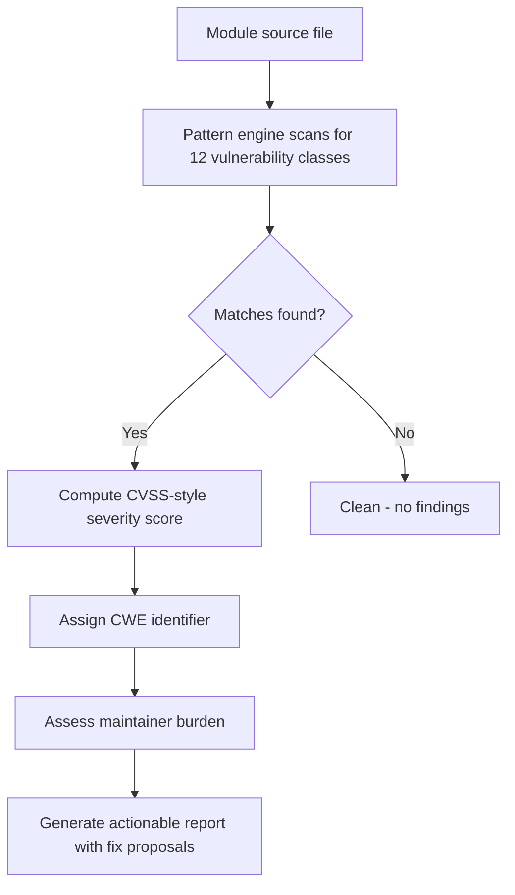

AI made finding vulnerabilities cheaper, but it did not make fixing them cheaper. The cost lands on an open-source maintainer with limited hours, who now has to sort a flood of security reports into urgent, false positive and later. Drupal AI Vulnerability Guardian works on that sorting step: it scans Drupal modules for 12 vulnerability patterns and gives each finding a score, a CWE ID and an estimate of the work to fix it.

<!-- truncate -->

<details>
<summary>TL;DR</summary>

- It scans Drupal module code for 12 vulnerability classes, and each class maps to a CWE.
- Every finding gets a CVSS-style severity score, a confidence value, a maintainer burden rating and a proposed fix.
- Patterns are data, so adding one does not touch detection logic.
- 17 tests with 55 assertions cover detection, false positive suppression, scoring and CWE mapping.

</details>

## Detection is the cheap half

Triage here means deciding, for each report, whether to fix it now, discard it as a false positive or schedule it for later. The tool started as a 3-pattern scanner and now ships as a 12-pattern detection engine with CVSS-style scoring, CWE identifiers, a maintainer burden assessment and a test suite that checks every detection path. Every one of those additions serves triage, and none of them is about finding more issues.

Two terms carry most of the report. A CWE (Common Weakness Enumeration) ID is MITRE's label for a weakness type, so `CWE-89` means SQL injection in any tool that uses the list. CVSS (Common Vulnerability Scoring System) is a numeric severity scale that many security advisories use; its ranges are in the scoring table below.

:::danger[Detection is not triage]
A scanner that dumps findings without severity, CWE context and effort estimates gives maintainers more work. Attach that metadata to every finding, so the maintainer can decide what to do instead of reading alerts.
:::

A findings list with no severity is a to-do list written by someone who will never work on it. My call: a scanner earns a place in a maintainer's week only when its output can be sorted. If it can't, it is one more inbox.

## Drupal modules need a sorted report

Drupal's security surface is wide. Modules query the database, render user-supplied markup, handle file uploads and redirect between routes, so one module can expose several vulnerability classes at once.

Manual code review catches these issues eventually. Maintainers need triage speed, and "eventually" does not give it to them.

## The 12 patterns and their CWE IDs

Each pattern maps to one CWE identifier. The patterns cover issues from the OWASP Top Ten, including SQL injection, XSS and SSRF.

| Pattern | CWE | What the scanner looks for |
|---|---|---|
| SQL Injection | CWE-89 | Direct variable concatenation in `db_query()` or `$connection->query()` |
| XSS via `Markup::create` | CWE-79 | Unsanitized variables passed to `Markup::create()` |
| XSS via `#markup` | CWE-79 | Unsanitized variables in render array `#markup` keys |
| XSS via `SafeMarkup` | CWE-79 | Deprecated `SafeMarkup::format()` with raw variables |
| Access Bypass | CWE-284 | Missing or misconfigured access callbacks on routes |
| CSRF | CWE-352 | Form handlers without token validation on state-changing operations |
| Open Redirect | CWE-601 | Unvalidated user input in `TrustedRedirectResponse` or `RedirectResponse` |
| File Upload | CWE-434 | Missing extension validation or MIME type checks on upload handlers |
| Insecure Deserialization | CWE-502 | `unserialize()` called on user-controlled input |
| SSRF | CWE-918 | User-controlled URLs passed to `httpClient->request()` without an allowlist |
| Path Traversal | CWE-22 | Unsanitized file paths with `../` sequences in file operations |
| IDOR | CWE-639 | Direct object references without ownership validation |

The flow from source file to report:



:::tip[Sample fixture]
The sample report below comes from the bundled fixture, which packs most of the patterns into one module file.
:::

## Patterns as data

Each pattern is a data structure, so detection logic does not change when a pattern is added. I would keep that rule above any clever matching trick.

| Field | Purpose |
|---|---|
| Regex pattern | What to match in source code |
| CWE ID | Formal vulnerability classification |
| Base severity score | Starting point for the CVSS-style computation |
| Description | Explanation a person can read |
| Proposed fix template | Remediation guidance |

A new vulnerability class means one new data entry and one test case for it, with no new code paths or test infrastructure. The engine iterates over the registry and applies every pattern the same way.

## CVSS-style score bands and context signals

Each finding gets a severity score on a scale aligned with CVSS v3.

| Severity | Score Range |
|---|---|
| Critical | 9.0 - 10.0 |
| High | 7.0 - 8.9 |
| Medium | 4.0 - 6.9 |
| Low | 0.1 - 3.9 |

These bands are the qualitative severity ratings from the [CVSS v3.1 specification](https://www.first.org/cvss/v3.1/specification-document). The specification defines them only as numeric ranges.

Authentication needs and exploitability are separate metrics, so a score alone does not say whether an attacker needs to log in, and it does not prove the flaw can be exploited. The scanner's score is CVSS-style: it borrows the bands and does not implement the full specification.

The limitation is built into the method. A regex match is the same match whether the code is reachable or not, so a raw score cannot tell those cases apart. The score therefore starts from the pattern's base severity and then moves with context signals:

- Is the input user-controlled?
- Can a public route reach the code?
- Does a sanitization layer already sit between the input and the sink, the call where bad input does its damage?

For example, suppose a module passes a variable to `Markup::create()`. The pattern matches either way, and the context signals are what separate a variable a visitor controls from one that is already sanitized.

## Maintainer burden is a second axis

Every finding also gets a burden rating. It answers the question the maintainer actually has: how much work will it take to fix and verify this?

| Burden | What It Means |
|---|---|
| Critical | Requires architectural changes or affects multiple subsystems |
| High | Requires careful refactoring with regression risk |
| Moderate | Requires code validation and a targeted patch |
| Low | Straightforward fix, minimal regression risk |

Severity and burden answer different questions. A critical finding with a low-burden fix is the first thing to ship, and a sorted report makes that visible.

## Sample triage report

```bash title="Terminal - run the scanner"
./bin/vulnerability-guardian triage examples/VulnerableModule.php
```

```text title="Example output (truncated)" showLineNumbers
Vulnerability #1: SQL Injection [CWE-89]
-----------------------------------------
Direct variable concatenation in database query.

Metric              Value
// highlight-next-line
Severity Score      9.5 / 10.0 (Critical)
Confidence          95 / 100
Maintainer Burden   Moderate - Requires code validation
CWE                 CWE-89

Proposed Fix
------------
[PATCH] Replace direct concatenation with placeholders:
        $connection->query("SELECT ... WHERE uid = :uid", [":uid" => $uid]);

Vulnerability #2: XSS via Markup::create [CWE-79]
---------------------------------------------------
Unsanitized variable passed directly to Markup::create().

Metric              Value
// highlight-next-line
Severity Score      7.8 / 10.0 (High)
Confidence          90 / 100
Maintainer Burden   Low - Straightforward sanitization
CWE                 CWE-79
```

Each finding comes with a confidence value and a proposed patch. A maintainer can act on the report without first reading a CWE page.

## Tests for false positives matter more

The project has 17 tests with 55 assertions. They cover every detection pattern, scoring bracket, CWE mapping and edge case, and each vulnerability class has tests for true positive detection and for false positive suppression.

The false positive tests are the ones I care about most. A scanner that flags every safe `#markup` key teaches maintainers to ignore it, and once they ignore it the scanner is a no-op.

## Triage steps

1. Clone the repository.
2. Run the scanner against your module: `./bin/vulnerability-guardian triage path/to/Module.php`
3. Review the findings, sorted by severity score.
4. Fix the Critical and High findings first.
5. Run the scanner again.
6. Add the scanner to your CI pipeline, so each change gets the same scan.

The rerun checks that the pattern no longer matches. It does not prove the flaw is gone, because a regex can stop matching for the wrong reason. I would read the patch before closing the finding.

**View Code:** [drupal-ai-vulnerability-guardian on GitHub](https://github.com/victorstack-ai/drupal-ai-vulnerability-guardian)

## References

- [Dries Buytaert: AI-Driven Vulnerability Discovery](https://socket.dev/blog/ai-accelerating-vulnerability-discovery-in-open-source)
- [MITRE CWE List](https://cwe.mitre.org/)
- [CVSS v3.1 Specification](https://www.first.org/cvss/v3.1/specification-document)
- [Drupal Security Advisories](https://www.drupal.org/security)
- [OWASP Top Ten](https://owasp.org/www-project-top-ten/)
