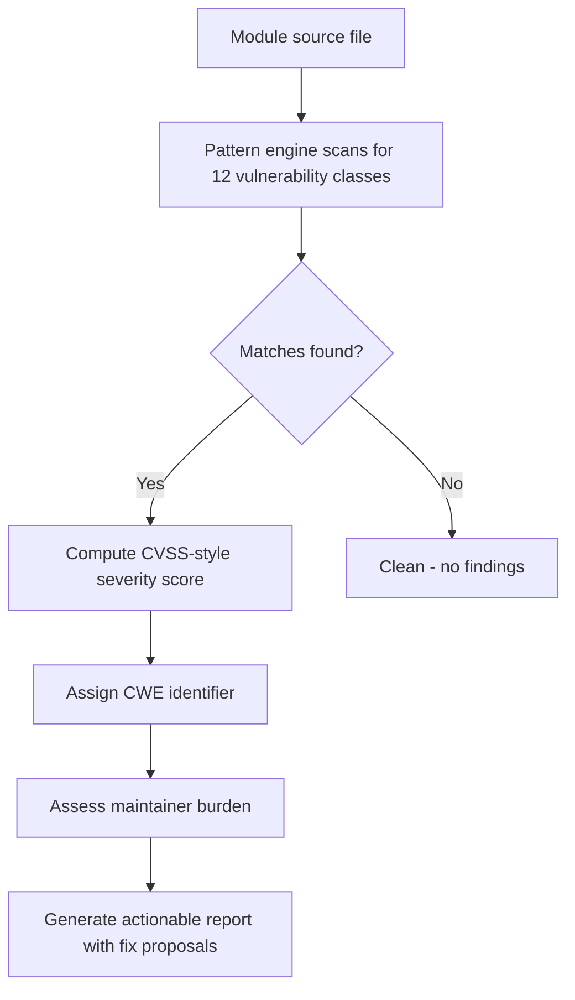

AI made finding vulnerabilities cheaper. It did not make fixing them cheaper. The cost lands on an open-source maintainer with limited hours, who now has to sort a flood of security reports into urgent, false positive and later. Drupal AI Vulnerability Guardian works on that sorting step: it scans Drupal modules for 12 vulnerability patterns and gives each finding a score, a CWE ID and an estimate of the work to fix it.

<!-- truncate -->

<details>
<summary>TL;DR</summary>

- It scans Drupal module code for 12 vulnerability classes, and each class maps to a CWE.
- Every finding gets a CVSS-style severity score, a confidence value, a maintainer burden rating and a proposed fix.
- Patterns are data, so adding one does not touch detection logic.
- 17 tests with 55 assertions cover detection, false positive suppression, scoring and CWE mapping.

</details>

## Detection is the cheap half

The tool started as a 3-pattern scanner. It now ships as a 12-pattern detection engine with CVSS-style scoring, CWE identifiers, a maintainer burden assessment and a test suite that checks every detection path. Every one of those additions serves triage. None of them is about finding more issues.

:::danger[Detection Is Not Triage]
A scanner that dumps findings without severity, CWE context and effort estimates gives maintainers more work. Attach that metadata to every finding, so the maintainer can decide what to do instead of reading alerts.
:::

A findings list with no severity is a to-do list written by someone who will never work on it. My call: a scanner earns a place in a maintainer's week only when its output can be sorted. If it can't, it is one more inbox.

## Why Drupal modules need this

Drupal's security surface is wide. Modules query the database, render user-supplied markup, handle file uploads and redirect between routes, so one module can expose several vulnerability classes at once.

Manual code review catches these issues eventually. Maintainers need triage speed, and "eventually" does not give it to them.

## The 12 patterns

Each pattern maps to a CWE identifier.

| Pattern | CWE | Description |
|---|---|---|
| SQL Injection | CWE-89 | Direct variable concatenation in `db_query()` or `$connection->query()` |
| XSS via `Markup::create` | CWE-79 | Unsanitized variables passed to `Markup::create()` |
| XSS via `#markup` | CWE-79 | Unsanitized variables in render array `#markup` keys |
| XSS via `SafeMarkup` | CWE-79 | Deprecated `SafeMarkup::format()` with raw variables |
| Access Bypass | CWE-284 | Missing or misconfigured access callbacks on routes |
| CSRF | CWE-352 | Form handlers without token validation on state-changing operations |
| Open Redirect | CWE-601 | Unvalidated user input in `TrustedRedirectResponse` or `RedirectResponse` |
| File Upload | CWE-434 | Missing extension validation or MIME type checks on upload handlers |
| Insecure Deserialization | CWE-502 | `unserialize()` called on user-controlled input |
| SSRF | CWE-918 | User-controlled URLs passed to `httpClient->request()` without an allowlist |
| Path Traversal | CWE-22 | Unsanitized file paths with `../` sequences in file operations |
| IDOR | CWE-639 | Direct object references without ownership validation |

The flow from source file to report:



:::tip[Run It Now]
`./bin/vulnerability-guardian triage examples/VulnerableModule.php` scans a realistic test fixture that packs most of the patterns into one module file and prints scored findings.
:::

## Patterns as data

Each pattern is a data structure. Detection logic does not change when a pattern is added, and I would keep that rule above any clever matching trick.

| Field | Purpose |
|---|---|
| Regex pattern | What to match in source code |
| CWE ID | Formal vulnerability classification |
| Base severity score | Starting point for the CVSS-style computation |
| Description | Explanation a person can read |
| Proposed fix template | Remediation guidance |

A new vulnerability class means one new data entry and one test case for it. It does not need new code paths or new test infrastructure. The engine iterates over the registry and applies every pattern the same way.

## CVSS-style scoring

Each finding gets a severity score on a scale aligned with CVSS v3.

| Severity | Score Range | Meaning |
|---|---|---|
| Critical | 9.0 - 10.0 | Exploitable without authentication, leads to full compromise |
| High | 7.0 - 8.9 | Significant impact, requires minimal preconditions |
| Medium | 4.0 - 6.9 | Exploitable under specific conditions or limited blast radius |
| Low | 0.1 - 3.9 | Informational or defense-in-depth concerns |

A regex match is the same match whether the code is reachable or not, and a raw score cannot tell those cases apart. So the score starts from the pattern's base severity and then moves with context signals:

- Is the input user-controlled?
- Can a public route reach the code?
- Does a sanitization layer already sit between the input and the sink?

## Maintainer burden

Every finding also gets a burden rating. It answers the question the maintainer actually has: how much work will it take to fix and verify this?

| Burden | What It Means |
|---|---|
| Critical | Requires architectural changes or affects multiple subsystems |
| High | Requires careful refactoring with regression risk |
| Moderate | Requires code validation and a targeted patch |
| Low | Straightforward fix, minimal regression risk |

Severity and burden are separate axes. A critical finding with a low-burden fix is the first thing to ship, and a sorted report makes that visible.

## Example output

```bash title="Terminal - run the scanner"
./bin/vulnerability-guardian triage examples/VulnerableModule.php
```

```text title="Example output (truncated)" showLineNumbers
Vulnerability #1: SQL Injection [CWE-89]
-----------------------------------------
Direct variable concatenation in database query.

Metric              Value
// highlight-next-line
Severity Score      9.5 / 10.0 (Critical)
Confidence          95 / 100
Maintainer Burden   Moderate - Requires code validation
CWE                 CWE-89

Proposed Fix
------------
[PATCH] Replace direct concatenation with placeholders:
        $connection->query("SELECT ... WHERE uid = :uid", [":uid" => $uid]);

Vulnerability #2: XSS via Markup::create [CWE-79]
---------------------------------------------------
Unsanitized variable passed directly to Markup::create().

Metric              Value
// highlight-next-line
Severity Score      7.8 / 10.0 (High)
Confidence          90 / 100
Maintainer Burden   Low - Straightforward sanitization
CWE                 CWE-79
```

Each finding comes with a confidence value and a proposed patch. A maintainer can act on the report without first reading a CWE page.

## Test coverage

The project has 17 tests with 55 assertions. They cover every detection pattern, scoring bracket, CWE mapping and edge case. Each vulnerability class has tests for true positive detection and for false positive suppression.

The false positive tests matter more. A scanner that flags every safe `#markup` key teaches maintainers to ignore it, and once they ignore it the scanner is doing nothing.

## Triage checklist

- [ ] Clone the repository
- [ ] Run the scanner against your module: `./bin/vulnerability-guardian triage path/to/Module.php`
- [ ] Review findings sorted by severity score
- [ ] Fix Critical and High findings first
- [ ] Run the scanner again to verify the fixes
- [x] Add the scanner to the CI pipeline for continuous monitoring

## What I learned

- Finding issues is now cheap. Sorting them is the expensive part of the work.
- Severity and fix effort answer different questions, so a report needs both.
- Keeping patterns as data keeps the engine small as the pattern list grows.
- The patterns cover issues from the OWASP Top Ten, including SQL injection, XSS, CSRF, open redirect and SSRF.

**View Code:** [drupal-ai-vulnerability-guardian on GitHub](https://github.com/victorstack-ai/drupal-ai-vulnerability-guardian)

## References

- [Dries Buytaert: AI-Driven Vulnerability Discovery](https://socket.dev/blog/ai-accelerating-vulnerability-discovery-in-open-source)
- [MITRE CWE List](https://cwe.mitre.org/)
- [CVSS v3.1 Specification](https://www.first.org/cvss/v3.1/specification-document)
- [Drupal Security Advisories](https://www.drupal.org/security)
- [OWASP Top Ten](https://owasp.org/www-project-top-ten/)
