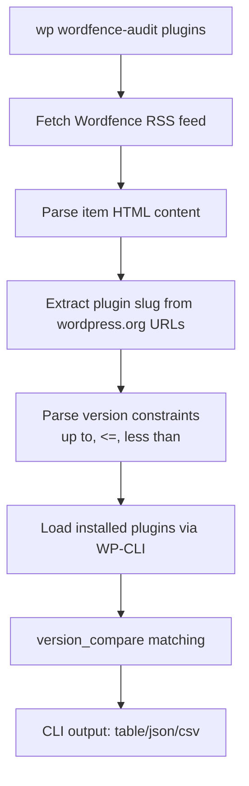

import Tabs from '@theme/Tabs';
import TabItem from '@theme/TabItem';

Wordfence tells security teams which plugins are vulnerable each week, but not whether their own sites run them. I built a WordPress plugin that adds `wp wordfence-audit plugins` and answers that question from the current Wordfence blog RSS feed. It is a triage step for teams that already read the feed, and it does not replace a full vulnerability database.

<!-- truncate -->

<details>
<summary>TL;DR</summary>

- `wp wordfence-audit plugins` reads the Wordfence blog RSS feed, extracts plugin slugs and version constraints, and flags installed plugins inside an affected range.
- Output comes as a table, JSON or CSV.
- Version strings need normalization before `version_compare()`, or real matches get missed.
- RSS is a triage signal. Pair it with a full vulnerability database for production coverage.

</details>

## Advisories arrive, spreadsheets follow

Each advisory raises the same question: do we run this plugin, and is our installed version inside the affected range? Without CLI automation, the answer is manual spreadsheet work repeated across many sites.

Comparing version strings by hand across a fleet is `version_compare()` with extra steps and more typos. My fix is to run the comparison on the site itself, where the installed versions already live, and print only the matches.

## What the command does

The command fetches RSS items, pulls plugin slugs from WordPress.org links, parses version constraints and compares them against installed plugin versions. Every step runs inside WP-CLI.



## Stack choices

Every piece is something WordPress or PHP already ships, plus a feed that asks for no credentials. I picked these because the command has to run on any site with CLI access and no extra setup.

| Component | Technology | Why |
|---|---|---|
| Platform | WordPress plugin + WP-CLI command | Runs on any WP site with CLI access |
| Signal source | Wordfence blog RSS feed | Lightweight, no API key needed |
| Slug extraction | Regex on `wordpress.org/plugins/<slug>/` | Canonical URLs make it reliable |
| Version matching | PHP `version_compare()` | Built in, handles semver correctly |
| Output | Table, JSON, CSV | Whatever downstream tools need |

The feed needs no authentication, no rate limits and no API keys, which is the right amount of setup for a tool that answers one question per advisory. The cost is coverage: the feed only knows what the blog published.

:::tip[RSS as a lightweight signal source]
Use RSS when API integration is not available yet. The Wordfence feed gives actionable signals without authentication, rate limits or API keys. For production-grade coverage, pair RSS triage with a full vulnerability database.
:::

## Version strings are where matching breaks

The slug regex holds up because WordPress.org plugin URLs are canonical. Version strings are less tidy.

`2.1.3.` and `2.1.3` are the same release to a human and a mismatch to `version_compare()`, which is how a vulnerable site ends up with a clean report. The `normalizeVersionToken` helper strips trailing dots and handles edge cases before any comparison runs.

:::caution[Normalize versions before comparing]
Version strings like `2.1.3.` vs `2.1.3` cause false mismatches with `version_compare()`. The `normalizeVersionToken` helper strips trailing dots and handles edge cases. Without it, real matches get missed.
:::

The constraint parser looks for these phrasings in the advisory text:

| Advisory phrasing | Constraint type | Flagged when |
|---|---|---|
| "versions up to X" | `max_inclusive` | Installed version is at or below X |
| "versions less than or equal to X" | `max_inclusive` | Installed version is at or below X |
| "versions" followed by the less-than-or-equal symbol and X | `max_inclusive` | Installed version is at or below X |

<Tabs>
<TabItem value="rss" label="RSS Client" default>

```php title="src/WordfenceRssClient.php"
// Extract plugin slugs from WordPress.org links in RSS HTML
// highlight-next-line
preg_match_all('#https?://wordpress\.org/plugins/([a-z0-9-]+)/?#i', $html, $matches);
```

```php title="src/WordfenceRssClient.php"
// Parse version constraints from advisory text
if (preg_match_all('/versions?\s*(?:up to|<=|less than or equal to)\s*v?([0-9][0-9a-zA-Z.\-+]*)/i', $text, $maxMatches)) {
// highlight-next-line
$constraints[] = ['type' => 'max_inclusive', 'max' => $this->normalizeVersionToken($maxVersion)];
}
```

</TabItem>
<TabItem value="matcher" label="Signal Matcher">

```php title="src/SignalMatcher.php"
// Compare installed version against advisory constraint
if ($type === 'max_inclusive' && isset($constraint['max'])) {
// highlight-next-line
if (version_compare($installedVersion, (string) $constraint['max'], '<=')) {
return true;  // Installed version is in affected range
}
}
```

</TabItem>
<TabItem value="cli" label="CLI Usage">

```bash title="wp-cli-usage.sh"
# Table output (default)
wp wordfence-audit plugins

# JSON for scripting
wp wordfence-audit plugins --format=json

# CSV for spreadsheets
wp wordfence-audit plugins --format=csv > audit.csv
```

</TabItem>
</Tabs>

## Architecture

Three classes, one job each.

<details>
<summary>Architecture breakdown</summary>

| Component | Responsibility |
| --- | --- |
| `WordfenceRssClient` | Download RSS and extract slugs, severity, version constraints |
| `SignalMatcher` | Compare constraints against installed versions with `version_compare` |
| `AuditCommand` | Expose `wp wordfence-audit plugins` and format output |

</details>

## Running it across many sites

WordPress sites running dozens of plugins face constant exposure to newly disclosed vulnerabilities. The command replaces the weekly spreadsheet pass with one run per site.

For multisite networks or managed hosting fleets, piping the `--format=json` output into a dashboard shows which sites need patching. CSV output covers teams that still want the spreadsheet, now filled in by the machine.

Related reading:
- WP Malware Sentinel Scanner
- WP QSM SQL Injection Audit

## Checklist

- [ ] Confirm WP-CLI access on each site.
- [ ] Run `wp wordfence-audit plugins` after each Wordfence advisory.
- [ ] Use `--format=json` for scripts and dashboards, `--format=csv` for spreadsheets.
- [ ] Check that version tokens are normalized before any `version_compare()` call.
- [ ] Back the RSS triage with a full vulnerability database or API scanner.

## What I learned

- RSS works as a lightweight signal source when API integration is not available yet.
- Slug extraction from canonical `wordpress.org/plugins/<slug>/` links is reliable for matching.
- Version parsing needs normalization (`2.1.3.` vs `2.1.3`), or false mismatches hide real exposure.
- For production-grade coverage, pair RSS triage with full database or API scanners.

## References

- [View Code](https://github.com/victorstack-ai/wp-wordfence-rss-signal-auditor)
- https://www.wordfence.com/blog/feed/
- https://wordpress.org/plugins/wpvulnerability/
- https://wordpress.org/plugins/fullworks-scanner/
