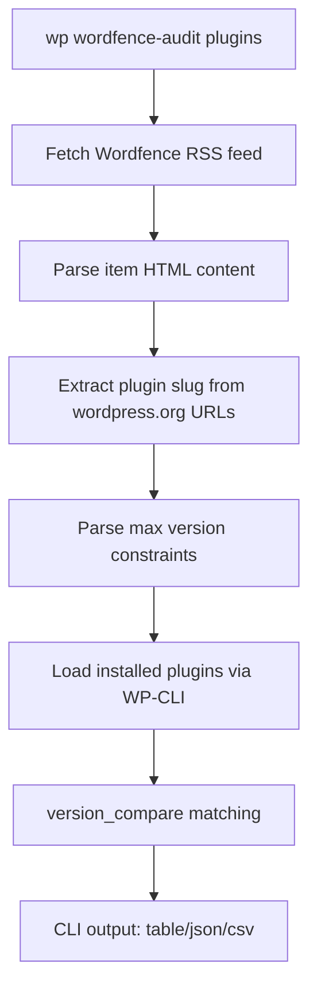

import Tabs from '@theme/Tabs';
import TabItem from '@theme/TabItem';

The Wordfence blog feed lists vulnerable plugins, but it cannot tell a team whether its own sites run them. I built a WordPress plugin that adds `wp wordfence-audit plugins` and answers that question from the current feed. It is a triage step for teams that already read the feed. A full vulnerability database still covers what the feed never publishes.

<!-- truncate -->

<details>
<summary>TL;DR</summary>

- `wp wordfence-audit plugins` reads the Wordfence blog RSS feed, extracts plugin slugs and version constraints, and flags installed plugins inside an affected range.
- Output comes as a table, JSON or CSV.
- Version strings need normalization before `version_compare()`, or real matches get missed.
- RSS is a triage signal. Pair it with a full vulnerability database for production coverage.

</details>

## Advisories arrive, spreadsheets follow

Every advisory raises two questions. Do we run this plugin, and is our installed version inside the affected range? Without CLI automation, the answer is manual spreadsheet work, repeated for every site.

Comparing version strings by hand across a fleet is `version_compare()` with extra steps and more typos. My fix runs the comparison on the site itself, where the installed versions already live, and prints only the matches.

## The command and its limits

The command fetches the RSS items and pulls plugin slugs from WordPress.org links. A slug is the short plugin name in the URL, such as `plugin-name` in `wordpress.org/plugins/plugin-name/`.

The command then parses the version constraints, compares them against the installed plugin versions, and prints the matches. Every step runs inside WP-CLI.



## Stack choices

Every piece is PHP, WordPress or WP-CLI, plus a feed that needs no credentials. The command has to run on any site with CLI access and no extra setup, so I chose these parts.

| Component | Technology | Why |
|---|---|---|
| Platform | WordPress plugin + WP-CLI command | Runs on any WP site with CLI access |
| Signal source | Wordfence blog RSS feed | Lightweight, no API key needed |
| Slug extraction | Regex on `wordpress.org/plugins/plugin-name/` | Canonical URLs make it reliable |
| Version matching | PHP `version_compare()` | Built in, compares PHP-style version strings |
| Output | Table, JSON, CSV | Matches what downstream tools need |

The feed has no authentication, no rate limits and no API keys. That is the right amount of setup for a tool that answers one question per advisory. The cost is coverage, because the feed only knows what the blog published.

:::tip[RSS as a lightweight signal source]
Use the feed for triage when no vulnerability API is wired up yet.
:::

## Version strings are where matching breaks

The slug regex holds up because WordPress.org plugin URLs are canonical: each plugin has one fixed URL form. Version strings are less tidy. The parser's version capture accepts dots, so the period that ends an advisory sentence can land inside the captured version.

A human reads `2.1.3.` and `2.1.3` as the same release. `version_compare()` reads them as a mismatch, and that is how a vulnerable site gets a clean report. The `normalizeVersionToken` helper strips trailing dots and handles edge cases before any comparison runs.

:::caution[Normalize versions before comparing]
Normalize version tokens before any `version_compare()` call, or the report misses real matches.
:::

The constraint parser looks for these phrasings in the advisory text. All three produce the same constraint type, `max_inclusive`, which means "this version and everything below it".

| Advisory phrasing | Constraint type | Flagged when |
|---|---|---|
| "versions up to X" | `max_inclusive` | Installed version is at or below X |
| "versions less than or equal to X" | `max_inclusive` | Installed version is at or below X |
| "versions" followed by the two characters less-than and equals, then X | `max_inclusive` | Installed version is at or below X |

<Tabs>
<TabItem value="rss" label="RSS Client" default>

```php title="src/WordfenceRssClient.php"
// Extract plugin slugs from WordPress.org links in RSS HTML
// highlight-next-line
preg_match_all('#https?://wordpress\.org/plugins/([a-z0-9-]+)/?#i', $html, $matches);
```

```php title="src/WordfenceRssClient.php"
// Parse version constraints from advisory text
if (preg_match_all('/versions?\s*(?:up to|<=|less than or equal to)\s*v?([0-9][0-9a-zA-Z.\-+]*)/i', $text, $maxMatches)) {
// highlight-next-line
$constraints[] = ['type' => 'max_inclusive', 'max' => $this->normalizeVersionToken($maxVersion)];
}
```

</TabItem>
<TabItem value="matcher" label="Signal Matcher">

```php title="src/SignalMatcher.php"
// Compare installed version against advisory constraint
if ($type === 'max_inclusive' && isset($constraint['max'])) {
// highlight-next-line
if (version_compare($installedVersion, (string) $constraint['max'], '<=')) {
return true;  // Installed version is in affected range
}
}
```

</TabItem>
<TabItem value="cli" label="CLI Usage">

```bash title="wp-cli-usage.sh"
# Table output (default)
wp wordfence-audit plugins

# JSON for scripting
wp wordfence-audit plugins --format=json

# CSV for spreadsheets
wp wordfence-audit plugins --format=csv > audit.csv
```

</TabItem>
</Tabs>

The regex above shows a limit of the parser. If an advisory phrases its affected range another way, the parser shown here extracts no `max_inclusive` constraint for it. It also misses the single-character less-than-or-equal symbol. That is one more reason to treat the output as triage.

## Three classes, one job each

`WordfenceRssClient` fetches and parses, `SignalMatcher` compares, and `AuditCommand` prints.

<details>
<summary>Architecture breakdown</summary>

| Component | Responsibility |
| --- | --- |
| `WordfenceRssClient` | Download RSS and extract slugs, severity, version constraints |
| `SignalMatcher` | Compare constraints against installed versions with `version_compare` |
| `AuditCommand` | Expose `wp wordfence-audit plugins` and format output |

</details>

## Running it across many sites

A WordPress site with dozens of plugins has to check every new advisory against its installed versions. The command replaces the spreadsheet pass after each advisory with one run per site.

For multisite networks or managed hosting fleets, pipe the `--format=json` output into a dashboard to see which sites need patching. CSV output serves teams that still want the spreadsheet. The difference is that the machine fills it in.

Related reading:
- WP Malware Sentinel Scanner
- WP QSM SQL Injection Audit

## Checklist

- [ ] Confirm WP-CLI access on each site before the first run.
- [ ] Run `wp wordfence-audit plugins` after each Wordfence advisory.
- [ ] Use `--format=json` for scripts and dashboards, and `--format=csv` for spreadsheets.
- [ ] For each match, compare the affected version in the advisory with the installed version that `wp plugin list` shows for that slug.

## Reading an empty result

My call: an empty result from this command means "no match in the current feed". It does not mean "no known vulnerabilities".

The feed only covers what the Wordfence blog published. For production-grade coverage, my recommendation is to pair RSS triage with a full vulnerability database or an API scanner.

## References

- [View Code](https://github.com/victorstack-ai/wp-wordfence-rss-signal-auditor)
- https://www.wordfence.com/blog/feed/
- https://wordpress.org/plugins/wpvulnerability/
- https://wordpress.org/plugins/fullworks-scanner/
