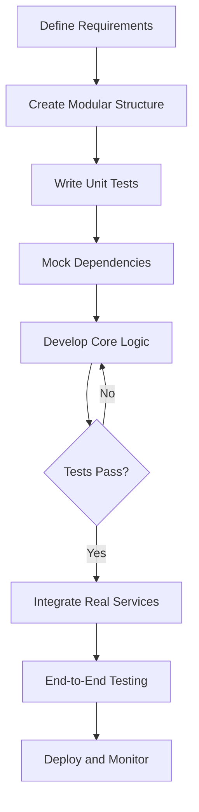
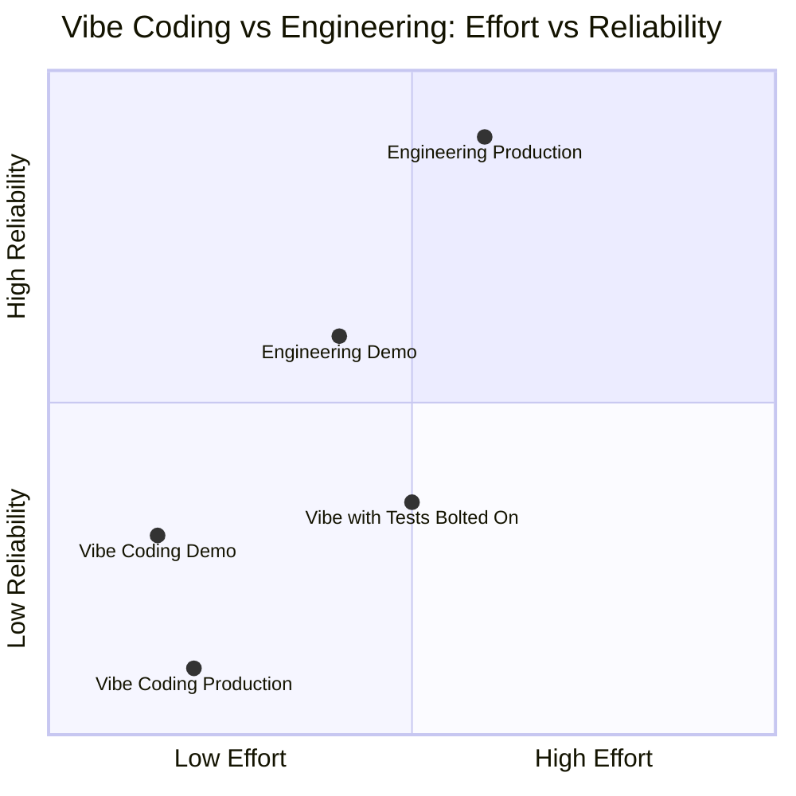

import Tabs from '@theme/Tabs';
import TabItem from '@theme/TabItem';

Vibe coding an AI agent means you tweak a prompt, rerun it and ship when the output feels right. The feeling is the only check, and a feeling does not run in continuous integration (CI), the pipeline that tests every change. I build agents the way I build any other software: modular code, mocked dependencies (test stand-ins that return a fixed answer) and tests written before the logic.

<!-- truncate -->

<details>
<summary>TL;DR</summary>

- Split agent logic, the LLM service and configuration into separate modules.
- Mock the LLM in unit tests. They should never make a real API call.
- Version prompts, keep model names and keys in config, and test the error paths.
- Connect real services only after the tests pass against mocks.

</details>

## Vibe coding in practice

Agentic AI moves fast. A few lines of code and a powerful large language model (LLM) produce an agent that does something that looks impressive, and the loop of tweak, rerun and watch is addictive. That loop is where the trouble starts.

My definition of vibe coding: development without a clear structure, relying on intuition and manual spot-checks.

:::info[Context]
I see this pattern in every team adopting AI agents. The first prototype is fast and impressive. Then it breaks in production because nobody wrote tests, nobody versioned the prompts and nobody knows what the agent does with unexpected inputs.
:::

| Vibe Coding Symptom | What Goes Wrong |
|---|---|
| Monolithic code | Agent logic, prompts and API calls live tangled in one script |
| No tests | Verification means running the agent and eyeballing the output |
| Fragile prompts | Prompts are magic strings with no versioning and no evaluation |
| Hidden risks | No boundaries and no tests for unexpected inputs or model changes |

In this setup, the test suite is one person reading output and nodding. It covers every input that person thought to try, and nothing else. The replacement is a test file that runs the same checks on every change, including the unexpected inputs.

Without that replacement, the agent is brittle, only its author can maintain it and nobody should trust it in production.

## The engineering-first workflow

The order matters. The tests and the mocks come before the core logic, real services come in only after the tests pass against mocks, and end-to-end tests come before deploy.



A mock is a test stand-in for a real dependency. It returns the answer the test configures and records how the code called it, so the test can check both.

<Tabs>
<TabItem value="project" label="Project Structure">

The project keeps each concern in its own file. The agent logic is in `agent.py`, the LLM call is in `llm_service.py` and the tests are under `tests/`:

```text title="structured-agent-example/" showLineNumbers
structured-agent-example/
├── pyproject.toml      # Project definition and dependencies
├── README.md
├── src/
│   └── structured_agent_example/
│       ├── __init__.py
│       ├── agent.py        # Core agent logic
│       └── llm_service.py  # Mocked external service
└── tests/
    └── test_agent.py     # Unit tests for the agent
```

</TabItem>
<TabItem value="test" label="A Sample Test">

This test uses Python's `unittest.mock` to check the agent's behavior without calling a real LLM. The excerpt shows one test method; the imports and the enclosing test class are omitted:

```python title="tests/test_agent.py" showLineNumbers
@patch('structured_agent_example.llm_service.get_sentiment')
def test_run_positive_sentiment(self, mock_get_sentiment):
    """Tests the agent's run method with a mock."""
    # Configure the mock to return a specific value
    mock_get_sentiment.return_value = "positive"

    agent = SentimentAgent({"model_name": "test-model-v1"})
    text = "This is a great product, I love it!"
    # highlight-next-line
    result = agent.run(text)

    # Assert that our mock was called correctly
    mock_get_sentiment.assert_called_once_with(text, model="test-model-v1")

    # Assert that the agent processed the result correctly
    self.assertEqual(result["status"], "success")
    self.assertEqual(result["sentiment"], "positive")
```

</TabItem>
</Tabs>

<details>
<summary>How the sample test works</summary>

`@patch` replaces `get_sentiment`, so this test cannot reach the API. `assert_called_once_with` checks the arguments the agent sent: the text and the model name. The two `assertEqual` lines check that the agent turns the service's answer into the right result.

</details>

The test checks the agent's own logic. It says nothing about the LLM's accuracy, and that is by design.

## Vibe coding next to engineering-first

The gap is widest on failure handling: one column has explicit error paths, and the other has "Hope it works" written where a plan should be.

| Aspect | Vibe Coding | Engineering-First |
|---|---|---|
| Structure | Single script | Modular components |
| Testing | Manual spot-checks | Automated unit and integration tests |
| Dependencies | Direct API calls everywhere | Mocked, injectable services |
| Prompts | Hardcoded magic strings | Versioned, evaluated, configurable |
| Configuration | Env vars scattered across the code | Versioned config files, keys from the environment |
| Failure handling | Hope it works | Explicit error paths |
| Maintainability | Only the author understands it | Any engineer can contribute |

"Hope it works" has one advantage: it needs no configuration file. It also needs no tests, which is how it reaches production unchecked. My call is to write the error paths down and test them, even in a script of under 50 lines.



Chart positions are schematic, not measured results.

The chart places the same split on effort and reliability axes. Tests bolted onto a vibe-coded script after the fact cost more effort and still buy little reliability. The structure has to come first for the tests to be worth writing.

:::caution[Reality Check]
Up-front structure sounds like overhead until you debug a production agent at 2 AM. That is when you find out the prompt changed three times, nobody updated the mock and nobody ever tested the error handling path. Structure built up front pays for itself on the first incident.
:::

## The four principles

Each principle removes one symptom from the first table. None of them is specific to AI, and all of them apply to the simplest agent: my example project is under 50 lines of Python.

1. **Modular structure**: Separate the agent's main logic, the services that call external APIs such as LLMs, and the configuration. Each piece should be testable on its own.

2. **Test-driven development (TDD)**: Write the tests that define what the agent should do before writing its core logic. This forces decisions about edge cases and expected outcomes before implementation.

3. **Mocking dependencies**: Agent tests should never make real API calls. Mocks return a fixed answer in place of the LLM, so tests stay fast, predictable and free.

4. **Configuration as code**: Hardcoded model names, API keys and prompts are a liability. Model names and prompts live in versioned config files, such as YAML. API keys load from the environment, for example a .env file kept out of version control.

## Checklist before an agent ships

Most items can be checked in the repository; the order of work and the monitoring need the history and the deploy setup. For the third item, run the unit tests with network access disabled. A test that passes with the network on and fails with it off was calling a real service.

- [ ] Agent logic, the LLM service and configuration live in separate modules.
- [ ] Tests define the expected behavior before the core logic exists.
- [ ] No unit test makes a real API call.
- [ ] Prompts are versioned and evaluated.
- [ ] Model names and prompts live in versioned config files, and API keys load from the environment.
- [ ] Error paths and unexpected inputs have tests.
- [ ] Real services are connected only after the tests pass, then end-to-end tests run, then the agent is deployed and monitored.

## References

- [View Code: `structured-agent-example` on GitHub](https://github.com/victorstack-ai/structured-agent-example)
