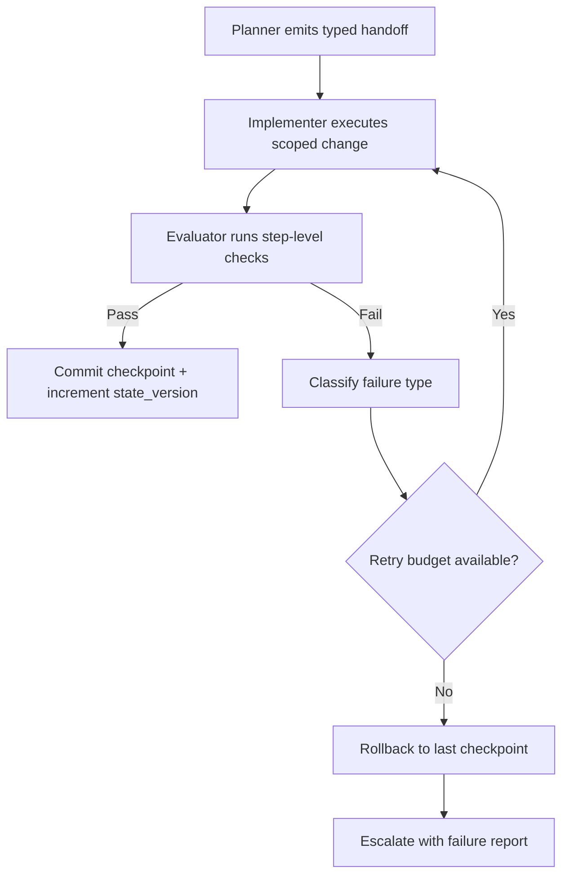
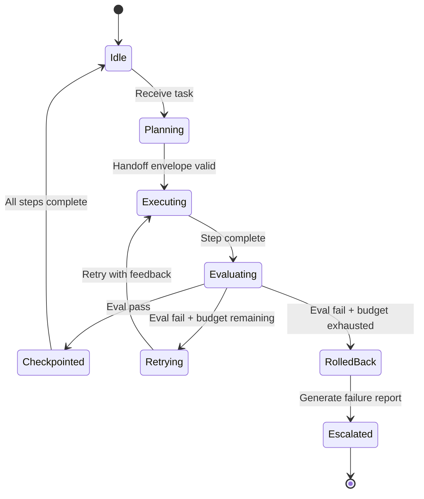

import Tabs from '@theme/Tabs';
import TabItem from '@theme/TabItem';

Most multi-agent failures are orchestration failures, and a smarter model does not repair a handoff that never said what done means. Before I tune any model, I would implement four controls: typed handoffs, explicit state contracts, step-level evals and transactional rollback. GitHub's engineering deep dive, published on February 24, shows the same core pattern.

<!-- truncate -->

## Four failure patterns in multi-agent workflows

The deep dive covers what happens when a single coding assistant becomes several specialized agents. In this post I use three roles as examples: a planner, an implementer and a verifier. A handoff is the moment one agent passes its work to the next.

The pain points the deep dive lists are practical, and none of them is about model intelligence:

1. Handoffs are ambiguous, so downstream agents infer missing context.
2. Shared state mutates without schema discipline, causing drift and duplication.
3. Success checks run at the end of the run, so bad branches accumulate cost.
4. Failed steps are hard to isolate, so recovery means "start over" instead of rollback.

The last one is the most expensive. "Start over" has the precision of turning the laptop off and on again, and it pays the full token bill every time. The replacement is a checkpoint after every passed gate, so a failure rolls back one step instead of the whole run.

:::danger[One handoff, many retries]
One weak handoff can trigger a cascade of retries across the planner, implementer and verifier roles. That failure costs both tokens and time.
:::

## One control per failure pattern

I put workflow design before model tuning. The table maps five failure patterns: the four pain points above, plus retry storms, which is the cascade of retries from the warning above. Each pattern gets one control and one rollback trigger, which is the condition that sends the run back to its last good checkpoint.

| Failure pattern from GitHub deep dive | Reliability control | Implementation detail | Rollback trigger |
|---|---|---|---|
| Missing context between agents | Typed handoff envelope | Every agent emits `goal`, `constraints`, `artifacts`, `done_criteria` | Envelope missing required keys |
| Shared memory drift | State contract with versions | Keep `state_version` and an immutable event log per step | State schema validation fails |
| Late quality detection | Step-level eval gates | Run checks after each agent output, not only at the end | Eval score below threshold |
| Retry storms | Bounded retries + policy routing | Max retries per class (`format`, `tool`, `logic`) | Retry budget exhausted |
| Full restart recovery | Transactional checkpoints | Snapshot repo + plan after each passed gate | Gate fails after side effects |

## The typed handoff envelope

The envelope is a strict JSON object that every agent emits when it passes work to the next one. An agent that infers missing context is guessing on the token budget, which is the most expensive way to read a ticket. For example, if the planner sends a goal with no `done_criteria`, the implementer has to decide on its own when the fix is finished.

The fix is a set of required keys, `goal`, `constraints`, `artifacts` and `done_criteria`, with the envelope rejected at the boundary when any of them is missing.

```json title="handoff-envelope.json" showLineNumbers
{
  "handoff_id": "uuid",
  "from_agent": "planner",
  "to_agent": "implementer",
  // highlight-start
  "goal": "Apply fix for flaky checkout test",
  "constraints": ["no schema changes", "keep API stable"],
  "artifacts": ["failing_test_trace.md", "target_file_list.json"],
  "done_criteria": ["tests pass", "diff limited to 2 files"],
  // highlight-end
  "state_version": 12
}
```

This mirrors GitHub's emphasis on explicit structure in tool inputs and outputs, and it means the downstream agent no longer has to guess the goal, constraints or finish line. The `state_version` field ties each handoff to a numbered state, so the receiving agent knows which version of shared state it is working on.

## The state and eval loop

An eval is a check that runs on an agent's output and returns pass or fail. Here the checks run after every agent output, and retries have a budget. A retry loop without a budget is `while (true)` with an invoice attached.

A max retry count per failure class (`format`, `tool`, `logic`) turns the loop into a decision. On a pass, the workflow commits a checkpoint and increments `state_version`. When the budget runs out, the workflow rolls back to the last checkpoint and escalates with a failure report.

The immutable event log per step is there so a failed run can be replayed and traced to the step that broke it.



## Evals that run per step

Each step gets checked before the next agent sees its output. The format, tool and task evals look like this:

<Tabs>
<TabItem value="format" label="Format Eval" default>

```json title="eval-format.json" showLineNumbers
{
  "eval_type": "format",
  "check": "Output matches required schema",
  // highlight-next-line
  "why": "Prevents parser/runtime failures in next agent",
  "pass_criteria": "JSON schema validates without errors"
}
```

</TabItem>
<TabItem value="tool" label="Tool Eval">

```json title="eval-tool.json" showLineNumbers
{
  "eval_type": "tool",
  "check": "Tool call used allowed inputs only",
  // highlight-next-line
  "why": "Prevents silent side effects and permission drift",
  "pass_criteria": "All tool inputs in allowlist"
}
```

</TabItem>
<TabItem value="task" label="Task Eval">

```json title="eval-task.json" showLineNumbers
{
  "eval_type": "task",
  "check": "Unit target passed for scoped files",
  // highlight-next-line
  "why": "Catches regressions before next handoff",
  "pass_criteria": "All targeted tests green"
}
```

</TabItem>
</Tabs>

A fourth type, the policy eval, adds constraint checks such as `no-depr-api` and `no-secret` on top of the others.

| Eval type | Example check | Why it matters |
|---|---|---|
| Format eval | Output matches required schema | Prevents parser/runtime failures in the next agent |
| Tool eval | Tool call used allowed inputs only | Prevents silent side effects and permission drift |
| Task eval | Unit target passed for scoped files | Catches regressions before the next handoff |
| Policy eval | Constraints respected (`no-depr-api`, `no-secret`) | Keeps compliance and security intact |

A deprecation warning lets a bad step pass with a note attached, and the next agent builds on it anyway. My call is to make it a hard stop.

:::tip[Deprecation is a failure]
Treat deprecated APIs and deprecated workflow patterns as an immediate eval failure, not a warning. When an agent proposes a deprecated hook, function or integration path, fail fast and route it back with a replacement hint in the envelope.
:::

## Agent lifecycle states

Every run ends in one of two ways: checkpointed and back to idle, or rolled back and escalated with a report. No state leads to "start again from scratch".



## Migration checklist

- [ ] Define typed handoff envelope schema
- [ ] Implement state versioning and immutable event log
- [ ] Add step-level eval gates after each agent output
- [ ] Configure bounded retry budgets per failure class
- [ ] Implement transactional checkpoints with rollback
- [ ] Add deprecation check to policy eval
- [x] Wire eval results into monitoring/alerting

To check that the controls work, I would test the failure paths, not the happy path. Send an envelope without `done_criteria` and confirm the boundary rejects it. Then exhaust a retry budget and confirm the run ends in `RolledBack` and `Escalated` with a failure report, not in a full restart.

The controls have limits. The envelope check proves the keys exist, not that `done_criteria` is correct, so the task eval still has to catch a wrong goal. A snapshot of repo and plan after every passed gate also adds a cost to each step, which I accept because a full restart pays the whole token bill again.

<details>
<summary>Related posts</summary>

- Netomi enterprise lessons playbook
- Flowdrop agents review
- [Agentic AI without vibe coding](/agentic-ai-without-vibe-coding/)

</details>

## References

- https://github.blog/ai-and-ml/github-copilot/lessons-from-githubs-multi-agent-system/
- https://github.blog/engineering/how-github-engineering-uses-mcp-github-copilot-to-ship-faster/
- https://docs.github.com/en/github-models/prototyping-with-ai-models
- https://modelcontextprotocol.io/specification/2025-06-18/schema
