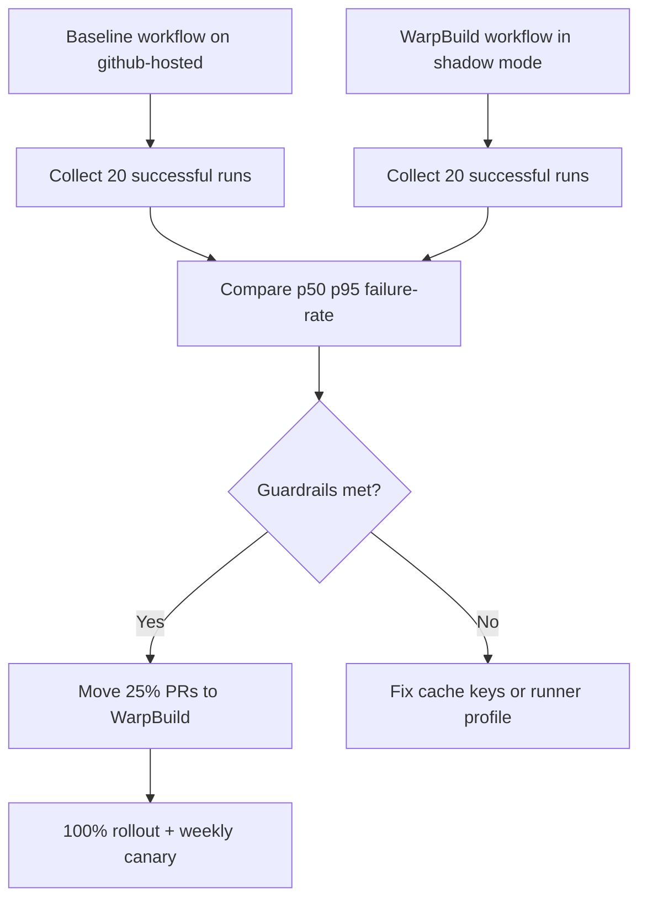

import Tabs from '@theme/Tabs';
import TabItem from '@theme/TabItem';

A faster CI runner is worth keeping only if p95 runtime and failure rate say so. Run the compute-heavy parts of a DDEV Drupal pipeline on WarpBuild runners, keep Composer cache keys deterministic, and gate the rollout on numbers so the pipeline stays explainable. I checked this playbook against DDEV `v1.25.1` (released February 23, 2026) and the WarpBuild docs as of February 25, 2026.

<!-- truncate -->

<details>
<summary>TL;DR</summary>

- Same workflow on both runners. Only `runs-on` changes.
- Composer cache keyed on `composer.lock`. No mutable keys.
- WarpBuild runs in shadow mode for one week, then moves to 25% of PRs, then 100%.
- Promote only if p95 improves by at least 20% and failure rate does not regress.
- Keep one GitHub-hosted baseline lane as a canary for two release cycles.

</details>

## Where Drupal CI loses time

A pipeline that boots DDEV, runs Composer and executes tests loses time in three places. The third one is a process failure, not a compute one.

| Bottleneck | Typical symptom | Why it hurts |
|---|---|---|
| Cold VM startup | Slow first job on each PR | Adds fixed latency to every run |
| Dependency re-download | Composer cache misses | Repeats network and unzip work |
| Unsafe rollout | Team flips all jobs at once | Outages hide whether speed gains are real |

Flip every job on the same day and you get a new runner and an outage with no way to tell them apart. The fix costs one extra workflow: keep the old lane running and compare the two.

:::warning[Not a Decision Signal]
"CI feels faster" is a mood. Decide on p50 and p95 numbers from controlled runs, collected with a reproducible benchmark method.
:::

## One workflow, two runners

I use one workflow template and one benchmark script as the source of truth. The two files below differ only in the `runs-on` line, so the benchmark measures the runner and nothing else.

<Tabs>
<TabItem value="warpbuild" label="WarpBuild Runner" default>

```yaml title="examples/devops/ddev-warpbuild-drupal-ci.yml" showLineNumbers
jobs:
  test:
# highlight-next-line
runs-on: warp-ubuntu-latest-x64-4x
steps:
- uses: actions/checkout@v4
- uses: actions/cache@v4
with:
path: ~/.cache/composer
# highlight-next-line
key: composer-${{ runner.os }}-${{ hashFiles('**/composer.lock') }}
- uses: ddev/github-action-setup-ddev@v1
- run: ddev start
- run: ddev composer install --no-interaction --prefer-dist
- run: ddev exec phpunit -c web/core
```

</TabItem>
<TabItem value="github" label="GitHub-Hosted (Baseline)">

```yaml title="examples/devops/ddev-github-hosted-drupal-ci.yml" showLineNumbers
jobs:
  test:
# highlight-next-line
runs-on: ubuntu-latest
steps:
- uses: actions/checkout@v4
- uses: actions/cache@v4
with:
path: ~/.cache/composer
key: composer-${{ runner.os }}-${{ hashFiles('**/composer.lock') }}
- uses: ddev/github-action-setup-ddev@v1
- run: ddev start
- run: ddev composer install --no-interaction --prefer-dist
- run: ddev exec phpunit -c web/core
```

</TabItem>
</Tabs>

The benchmark script takes the repository, the baseline workflow, the WarpBuild workflow and the run count.

```bash title="examples/devops/benchmark-ddev-ci.sh" showLineNumbers
./examples/devops/benchmark-ddev-ci.sh \
  acme/drupal-platform \
  drupal-ci-github-hosted.yml \
  drupal-ci-warpbuild.yml \
  20
```

## Cache layers and their failure modes

Deterministic cache keys beat a single "mega-cache" for Drupal reliability. A key derived from `composer.lock` changes only when dependencies change, so a cache hit means the same thing on every run.

| Layer | Key strategy | Eviction or limit concern | Guardrail |
|---|---|---|---|
| Composer (`actions/cache`) | `hashFiles('**/composer.lock')` | GitHub cache quotas and eviction | Keep caches lockfile-scoped; no mutable keys |
| DDEV runtime warmup | Warm via `ddev start` + smoke | Cold starts on new runners | Track cold and warm p95 separately |
| WarpBuild runner cache/snapshots | Prewarm common toolchain paths | Snapshot drift hides breakages | Weekly cold-run canary with snapshots disabled |

A snapshot that is always warm will never report that the cold path broke. That is the job of the weekly cold-run canary: it runs with snapshots disabled, and if it fails while the warm runs pass, the snapshot is hiding drift.

## Rollout in shadow mode

WarpBuild runs next to the baseline before it blocks anything. Each lane collects 20 successful runs, and the comparison decides the next step.



:::tip[Rollout Guardrails]
1. Shadow mode first: run the WarpBuild workflow in parallel for one week without blocking merges.
2. Promote only if p95 runtime improves by at least 20% and failure rate does not regress.
3. Keep one GitHub-hosted baseline workflow as a canary for two release cycles.
:::

If the guardrails fail, fix the cache keys or the runner profile before trying again. Do not lower the 20% threshold to make the promotion happen.

## Expected performance, not measured

The numbers below are expectations. They are exactly the kind of number the warning at the top of this post says not to decide on, so I treat the table as a hypothesis for the benchmark to confirm or reject.

:::warning[Replace These With Your Runs]
These ranges are estimates. Overwrite them with p50, p95 and failure rate from your own 20 runs per lane before promoting anything.
:::

| Metric | GitHub-Hosted | WarpBuild (4x) | Expected delta |
|---|---|---|---|
| p50 runtime | ~8-12 min | ~4-7 min | -40-50% |
| p95 runtime | ~15-20 min | ~8-12 min | -40-50% |
| Cold start penalty | High | Medium | Improved |
| Cache hit rate | Depends on eviction | Higher with snapshots | Improved |

## Same template, other test commands

The phases that dominate Drupal CI runtime are `ddev composer install` and `ddev start`, and those are where the speedup should show. Pipelines that run PHPUnit, Nightwatch or Cypress through DDEV follow the same flow.

- WordPress plugin or theme CI on DDEV: replace `phpunit -c web/core` with the project's own test command.
- Any Composer-managed project: the `composer.lock` cache key works unchanged.
- Any runner switch: shadow mode keeps the old lane as the comparison.

## Migration checklist

- [ ] Set up baseline GitHub-hosted workflow
- [ ] Collect 20 successful baseline runs
- [ ] Configure WarpBuild runner workflow
- [ ] Run WarpBuild in shadow mode for one week
- [ ] Collect 20 successful WarpBuild runs
- [ ] Compare p50, p95, and failure rates
- [ ] Promote to 25% PR coverage if guardrails met
- [ ] Roll out to 100% after stability confirmed
- [x] Keep baseline canary running for two release cycles

## What I learned

- WarpBuild acceleration works best when compute and cache are tuned together. Faster compute alone does not fix cache misses.
- Deterministic cache keys beat mega-cache strategies for Drupal reliability.
- A permanent baseline lane keeps CI from overfitting to one runner platform.

<details>
<summary>Related reading</summary>

- DDEV v1.25 modular share architecture
- DDEV Podman/rootless constraints
- Composer path repo workflow for Drupal

</details>

## References

- https://github.com/ddev/ddev/releases/tag/v1.25.1
- https://docs.ddev.com/
- https://www.warpbuild.com/docs/ci/quick-start
- https://www.warpbuild.com/docs/ci/features
- https://www.warpbuild.com/docs/ci/preinstalled-software
- https://docs.github.com/en/actions/using-workflows/caching-dependencies-to-speed-up-workflows
