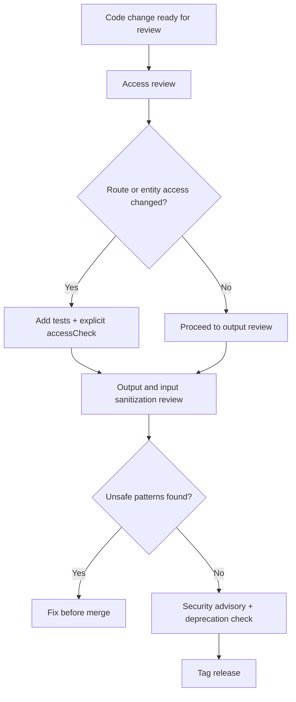

Drupal contrib security review needs explicit access decisions, CSRF protection on state-changing routes, output checks and a repeatable release gate. This checklist focuses on those checks and the limits of grep-based searches.

<!-- truncate -->

:::danger[These are not edge cases]
An unexplained `accessCheck(FALSE)` can expose content, and unsafe `|raw` can let untrusted markup run as script. My judgment: start the review with those ordinary mistakes.
:::

## Checks that survive release pressure

Maintainers are not careless. The security checklist is neither written down nor enforced, so it lives in reviewer memory: a storage layer with no backups and an eviction policy called release day.

Under release pressure, four gaps slip through:

- Entity queries with no explicit access intent.
- Privileged routes with weak permission or CSRF coverage.
- Untrusted data that reaches output without strict escaping or sanitization.
- Releases shipped without a structured security review checkpoint.

All four are avoidable on modern Drupal. My call: put each check in CI or in code review, where it runs whether or not anyone remembers it.

## The four mistakes in plain terms

**Missing access intent.** An entity query is the Drupal API call that finds entities such as nodes or users. Code often builds one with `\Drupal::entityQuery()`. Calling `->accessCheck(TRUE)` tells the query to respect the current user's access, and `FALSE` tells it to skip that check.

Suppose a block lists content through an entity query that calls `->accessCheck(FALSE)` with no documented reason: the list can then include items the visitor has no permission to see. On D10/11, a content entity query with no call at all throws an exception instead, so the risky case is the explicit `FALSE`. The change record applies to content entities, not configuration entities.

**Weak route protection.** A route maps a URL to code, and modules declare routes in `*.routing.yml`. A state-changing route saves, deletes or toggles something. CSRF (cross-site request forgery) is an attack where another site makes a logged-in user's browser send that request, so for example a delete route with no CSRF token can be triggered from a page the administrator happens to open.

**Unsafe output.** XSS (cross-site scripting) happens when untrusted text reaches the page as markup and runs as script. Render arrays and Twig auto-escaping escape output by default. Shortcuts such as `|raw`, `#markup` and `Markup::create` need a trust decision every time, which is why the searches below look for them.

**No release gate.** Without a gate, the security review happens when somebody remembers it. A gate makes the release tag wait for the checklist. The table below adds two more pitfalls with the same shape: SQL built from concatenated input and upload abuse.

## Hardening checklist before every tag

Run this before every tagged release. The table combines searches with manual review of routes, upload handlers and release controls. The next section gives the search commands and their limits.

| Pitfall | Hardening action (D10/D11) | How to verify |
|---|---|---|
| Implicit access in entity queries | Always call `->accessCheck(TRUE)`. Use `FALSE` only with a documented reason | Run the entity query search below, confirm each query has a paired `accessCheck(...)`, and confirm every `accessCheck(FALSE)` has a documented reason |
| Weak route protection | Require route permissions. Protect state-changing actions with Form API tokens or a route CSRF requirement | Review `*.routing.yml` for `_permission`, and confirm each state-changing route is a form or requires `_csrf_token` |
| XSS through rendering shortcuts | Prefer render arrays and Twig auto-escaping. Ban casual `raw` filters in templates | Run the unsafe rendering search below and review trust boundaries |
| SQL injection in custom queries | Use DB API placeholders. Never concatenate untrusted input | Run the custom SQL search below and confirm parameterization |
| Upload and extension abuse | Restrict extensions and MIME types, validate uploads, enforce access rules | Review upload validators and file field constraints |
| Missing release security gate | Add a pre-release checklist for advisories, access regressions and deprecations | Gate release tags on checklist completion in CI |

The review order, from code change to tag:



:::tip[Fastest audit command]
Start with the first search below. It lists the files that call `\Drupal::entityQuery()`. Open each file and look for `accessCheck(FALSE)`: on D10/11 a content entity query with no `accessCheck()` call throws an exception, so an explicit `FALSE` with no documented reason is the case to read closely.
:::

## Verification commands

These searches have a limited scope. Ripgrep's built-in `php` type matches `.php` files, not Drupal hook files such as `.module`, `.inc`, `.install` and `.theme`, so a clean result says nothing about those files. The entity query search also finds only `\Drupal::entityQuery(` calls, not queries built through an injected entity storage.

The results are candidates, not verdicts. The rendering search finds only the spellings it names. A person still reads each hit against its trust boundary, and an empty result does not prove that access control is correct.

```bash title="Terminal - list entity query candidates"
rg "entityQuery\(" --type php -l
```

```bash title="Terminal - find unsafe rendering patterns"
rg "\|\s*raw|#markup|Markup::create" --type php --type twig -l
```

```bash title="Terminal - find custom SQL queries"
rg --no-config -e "->query\(|db_query\(" --type php -l
```

## Triage checklist for maintainers

- [ ] Every entity query has an explicit `accessCheck()` call, and every `accessCheck(FALSE)` has a documented reason
- [ ] Every state-changing action has CSRF protection: a Form API form token, or a `_csrf_token` requirement on a route that changes state from a link
- [ ] No `|raw` in Twig templates without a documented trust boundary
- [ ] No direct SQL concatenation with untrusted input
- [ ] Upload handlers validate extensions, MIME types and destinations
- [ ] The pre-release security gate is documented and enforced in CI
- [ ] Deprecated and legacy patterns are flagged for migration

:::warning[No checklist theater]
A "security reviewed" checkbox with no verification behind it protects a release about as well as a code comment that says the code is secure. Do not mark a release reviewed unless you can point to concrete checks in code or CI output. If you cannot, add the check or remove the checkbox.
:::

<details>
<summary>Deprecation-aware security notes for D10 to D11 transitions</summary>

- Older code paths that relied on implicit entity query behavior are unsafe from a maintenance perspective. Modern Drupal requires explicit access intent.
- Legacy patterns from older Drupal generations, such as raw SQL string building, are migration debt. Do not keep them as "good enough" compatibility code.
- Keep dependency and API usage current, so the code does not drift silently into unsupported patterns during the D10 to D11 transition.
- The `SafeMarkup` class does not exist in Drupal 10 or 11, so calls to it fail when executed. Choose the replacement for each method and review its escaping behavior.

</details>

## References

- [Drupal change record: entity queries must explicitly set access checking](https://www.drupal.org/node/3201242)
- [Drupal docs: Access checking on routes](https://www.drupal.org/docs/8/api/routing-system/access-checking-on-routes)
- [Historical Drupal documentation: Writing secure code](https://www.drupal.org/docs/7/modules/securesite/writing-secure-code-for-drupal)
- [Drupal 10 release cycle and EOL policy](https://www.drupal.org/about/core/policies/core-release-cycles/schedule)
- [Drupal core project page (current stable stream)](https://www.drupal.org/project/drupal)
