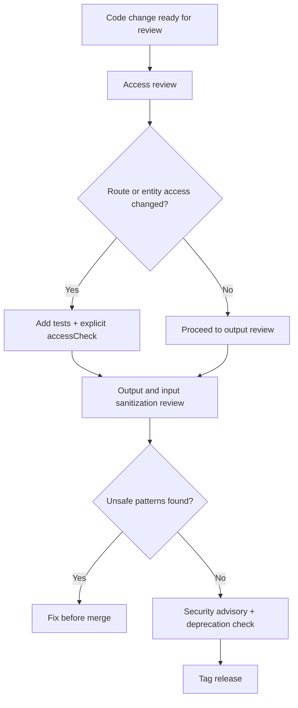

Drupal 10/11 contrib modules keep earning advisories for the same four mistakes: missing access checks, weak route protection, unsafe output and releases with no security gate. The fastest fix is boring: explicit access decisions, CSRF on every state-changing route, a ban on unsafe rendering shortcuts, and a repeatable security gate before every tag.

<!-- truncate -->

:::danger[These Are Not Edge Cases]
Contrib maintainers do not get breached by exotic 0-days. They get burned by small, repeatable mistakes made under release pressure: a missing `accessCheck()`, an unprotected route, a `|raw` in a template. Every advisory batch confirms the pattern.
:::

## Why the same bugs keep shipping

Maintainers are not careless. The checklist is neither explicit nor enforced, so it lives in reviewer memory, a storage layer with no backups and an eviction policy called release day.

Under release pressure, these gaps slip through:

- Entity queries with no explicit access intent
- Privileged routes with weak permission or CSRF coverage
- Untrusted data reaching output without strict escaping or sanitization
- Releases shipped without a structured security review checkpoint

All four are avoidable on modern Drupal. My call: put each check in CI or review, where it runs whether or not anyone remembers it.

## The hardening checklist

Run this before every tagged release. Every row ends in a check you can execute.

| Pitfall | Hardening action (D10/D11) | How to verify |
|---|---|---|
| Implicit access in entity queries | Always call `->accessCheck(TRUE)`. Use `FALSE` only with a documented reason | `rg "entityQuery\("` and confirm a paired `accessCheck(...)` |
| Weak route protection | Require route permissions and CSRF for state-changing routes | Review `*.routing.yml` for `_permission` and CSRF requirements |
| XSS through rendering shortcuts | Prefer render arrays and Twig auto-escaping. Ban casual `\|raw` | `rg "\|raw\|#markup\|Markup::create"` and review trust boundaries |
| SQL injection in custom queries | Use DB API placeholders. Never concatenate untrusted input | `rg "->query\(\|db_query\("` and confirm parameterization |
| Upload and extension abuse | Restrict extensions and MIME types, validate uploads, enforce access rules | Review upload validators and file field constraints |
| Missing release security gate | Add a pre-release checklist for advisories, access regressions and deprecations | Gate release tags on checklist completion in CI |

The review order, from code change to tag:



:::tip[Fastest Audit Command]
Run `rg "entityQuery\(" --type php` across your module directory. Every result without a paired `->accessCheck(TRUE)` or `->accessCheck(FALSE)` is a potential access bypass.
:::

## Verification commands

These three searches cover most of the table. They return candidates, not verdicts: a person still reads each hit against its trust boundary.

```bash title="Terminal - find entity queries without access checks"
rg "entityQuery\(" --type php -l
```

```bash title="Terminal - find unsafe rendering patterns"
rg "\|raw|#markup|Markup::create" --type php --type twig -l
```

```bash title="Terminal - find custom SQL queries"
rg "->query\(|db_query\(" --type php -l
```

## Triage checklist for maintainers

- [ ] Every `entityQuery()` has an explicit `accessCheck()` call
- [ ] All state-changing routes require POST and a CSRF token
- [ ] No `|raw` in Twig templates without a documented trust boundary
- [ ] No direct SQL concatenation with untrusted input
- [ ] Upload handlers validate extensions, MIME types and destinations
- [ ] The pre-release security gate is documented and enforced in CI
- [ ] Deprecated and legacy patterns are flagged for migration

:::warning[No Checklist Theater]
A "security reviewed" checkbox with no verification behind it protects a release about as well as a code comment that says the code is secure. Do not mark a release reviewed unless you can point to concrete checks in code or CI output. If you cannot, add the check or remove the checkbox.
:::

<details>
<summary>Deprecation-aware security notes for D10 to D11 transitions</summary>

- Older code paths that relied on implicit entity query behavior are unsafe from a maintenance perspective. Modern Drupal requires explicit access intent.
- Legacy patterns from older Drupal generations, such as raw SQL string building, are migration debt. Do not keep them as "good enough" compatibility code.
- Keep dependency and API usage current, so the code does not drift silently into unsupported patterns during the D10 to D11 transition.
- The `SafeMarkup` class is deprecated. Any usage is both a deprecation issue and a security risk, so fix both in the same change.

</details>

## Related resources

For adjacent upgrade planning and change tracking:

- Drupal 11 Change Record Impact Map
- Drupal 12 Readiness Dashboard
- Drupal Maintainer Shield

## What I learned

- In my judgment, explicit access intent is the highest-ROI safeguard a contrib maintainer can add.
- Route-level permission and CSRF checks catch many "small" mistakes before they become advisories.
- Security hardening holds when it is part of release operations. Ad hoc reviewer memory does not hold.
- Deprecated and legacy patterns are upgrade work, and over time they also multiply security risk.

## References

- [Drupal change record: entity queries must explicitly set access checking](https://www.drupal.org/node/3201242)
- [Drupal docs: Access checking on routes](https://www.drupal.org/docs/8/api/routing-system/access-checking-on-routes)
- [Drupal docs: Writing secure code](https://www.drupal.org/docs/7/modules/securesite/writing-secure-code-for-drupal)
- [Drupal 10 release cycle and EOL policy](https://www.drupal.org/about/core/policies/core-release-cycles/schedule)
- [Drupal core project page (current stable stream)](https://www.drupal.org/project/drupal)
