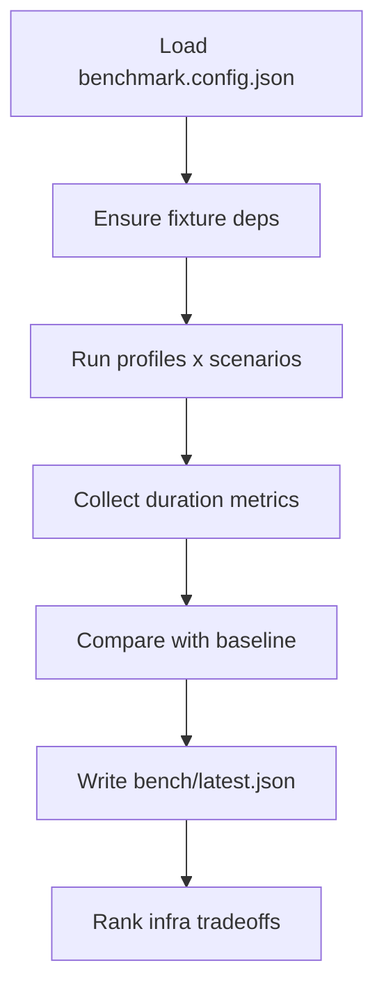
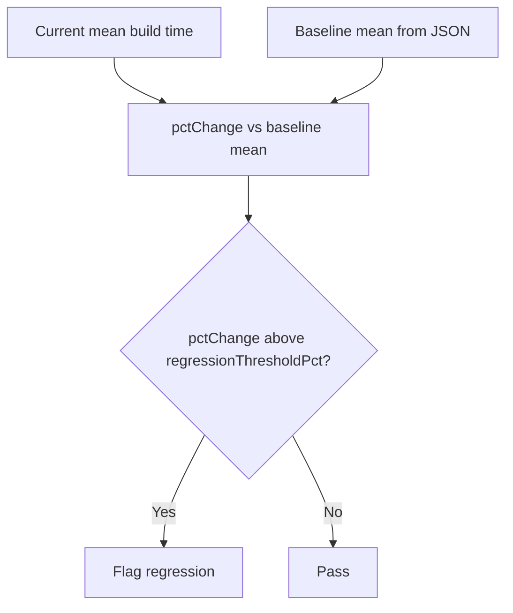

import Tabs from '@theme/Tabs';
import TabItem from '@theme/TabItem';

Most build regressions get reported as "it feels slower", long after the commit that caused them. I built a small Node CLI that benchmarks `next@16.1.6` builds under cold and warm cache, compares the result with a baseline, and writes JSON that CI can diff.

<!-- truncate -->

<details>
<summary>TL;DR</summary>

- Pin the fixture version, split cold and warm cache, and compare every run against a baseline JSON.
- A regression is a mean build time that rises past the threshold set in `benchmark.config.json`.
- Clean up deprecated Next config before you trust any timing.

</details>

## Why build timing data is usually noise

> "Without a pinned fixture, repeatable scenarios, and a baseline comparison, build time data is noisy and hard to trust."

A single local run measures one machine on one afternoon. It does not tell you whether the last merge made the build slower.

:::info[Context]
Teams usually notice build regressions after CI gets slower or delivery cadence drops. By then, the cause is buried under dozens of commits. A benchmark you can trust needs pinned fixture versions, controlled scenarios and automated regression detection.
:::

| Pain Point | What Breaks |
|---|---|
| No baseline | Regressions are subjective ("it feels slower") |
| One-off local tests | Results are not reproducible in CI |
| No scenario split | Cold-cache vs warm-cache tradeoffs stay hidden |
| Infra change without benchmark | Runtime and runner choices are hard to justify |

## How the CLI works

The tool runs every build profile against every cache scenario, repeats each pair, and writes scenario stats, regression checks and infrastructure rankings to `bench/latest.json`. No dashboard, no service, a JSON file that a CI job can compare.



<Tabs>
<TabItem value="config" label="Configuration">

```json title="benchmark.config.json" showLineNumbers
{
  "runs": 3,
  "regressionThresholdPct": 15,
  "profiles": [
{ "name": "default", "command": "npm run build" },
{ "name": "turbopack", "command": "npm run build:turbopack" }
  ],
  "scenarios": [
{ "name": "cold-cache", "clearCacheBeforeRun": true },
{ "name": "warm-cache", "clearCacheBeforeRun": false }
  ]
}
```

</TabItem>
<TabItem value="loop" label="Benchmark Loop">

```js title="src/lib/benchmark.js" showLineNumbers
for (const profile of config.profiles) {
  for (const scenario of config.scenarios) {
const durations = [];
for (let runNumber = 1; runNumber <= runs; runNumber += 1) {
// highlight-next-line
if (scenario.clearCacheBeforeRun) await clearNextCache(projectDir);
const durationMs = await timedRun(profile.command, projectDir);
durations.push(durationMs);
}
const summary = summarizeDurations(durations);
// optional baseline regression check and ranking aggregation
  }
}
```

</TabItem>
<TabItem value="regression" label="Regression Detection">

```js title="src/lib/stats.js"
// highlight-next-line
export function compareRegression(currentMean, baselineMean, thresholdPct) {
  const pctChange = Number(
(((currentMean - baselineMean) / baselineMean) * 100).toFixed(2)
  );
  return { pctChange, regression: pctChange > thresholdPct };
}
```

</TabItem>
</Tabs>

## The regression gate is a subtraction

`compareRegression` takes the current mean, subtracts the baseline mean, and turns the difference into a percent change. If that number is above `regressionThresholdPct`, the run is a regression. The whole gate is a subtraction, a division and a comparison, which is a smaller budget than one meeting about why CI feels slow.



:::tip[When to gate merges on it]
My call: baseline JSON plus threshold gating is worth the setup when CI build time is a release bottleneck. Check it works by confirming that a known slow change trips the flag.
:::

## Cold cache and warm cache disagree

A warm-cache number from a runner that purges its cache is a benchmark of a machine CI does not have. Measure both scenarios, or the ranking of "faster" options can be upside down.

| Scenario | Default Build | Turbopack Build | Key Difference |
|---|---|---|---|
| Cold cache | Slower (full rebuild) | Faster (parallel compilation) | Turbopack advantage shows here |
| Warm cache | Fast (incremental) | Fast (incremental) | Difference is smaller |
| Regression detection | Baseline JSON comparison | Baseline JSON comparison | Same mechanism, different baselines |

:::caution[Reality Check]
Cold and warm cache numbers can invert assumptions about "faster" infrastructure paths. A runtime that is fast on warm cache and slow on cold cache will surprise you in CI, where caches are purged often. Pin your benchmarks to both scenarios or you are measuring fiction.
:::

Before switching a runner or runtime, read its rank in both scenarios. One good column is not a reason to migrate.

## Next 16 config cleanup

Next 16 printed a warning that told me exactly what was wrong with the fixture. I fixed the config so the warning stopped showing up in the logs I was timing.

<details>
<summary>Next.js 16 deprecation note</summary>

During implementation, `next.config.js` warnings showed that `eslint` config in Next config is no longer supported in Next 16. I migrated the fixture to supported config only, with an explicit Turbopack root:

```js title="next.config.js"
const nextConfig = {
  turbopack: {
    root: currentDir
  }
};
```

That removes deprecated config usage and keeps benchmark output cleaner. Deprecation warnings pollute logs and can affect timing, so clear them in your own benchmarks.

</details>

## Checklist before trusting the numbers

- [ ] The fixture pins its Next.js version.
- [ ] Both `cold-cache` and `warm-cache` scenarios run.
- [ ] Each profile and scenario pair runs more than once.
- [ ] A baseline JSON exists and every run compares against it.
- [ ] `regressionThresholdPct` is set in `benchmark.config.json`.
- [ ] The fixture config produces no deprecation warnings.
- [ ] Runner or runtime changes are ranked on both scenarios before adoption.

## What I learned

- Rebuild benchmarking is only useful when fixture version and scenario controls are pinned.
- Cold and warm cache numbers can invert assumptions about "faster" infra paths.
- Baseline JSON plus threshold gating is worth it when CI build time is a release bottleneck.
- Unsupported Next config keys have no place in performance tooling. Their warnings pollute benchmark logs and skew results.

## References

- [View Code](https://github.com/victorstack-ai/nextjs-ai-rebuild-benchmark)
