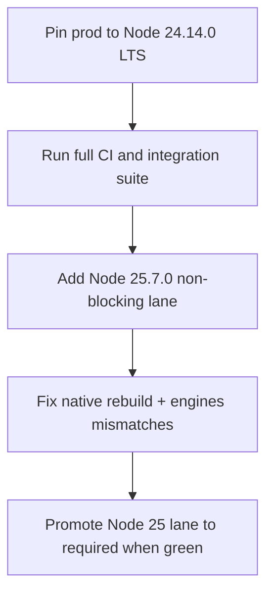
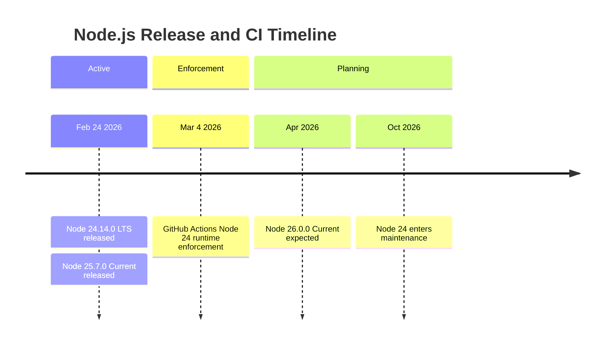

import Tabs from '@theme/Tabs';
import TabItem from '@theme/TabItem';

As of February 25, 2026, my call is to move production to Node 24.14.0 LTS first, run Node 25.7.0 in a lane that cannot fail the build, and spend the worry budget on native addons and framework `engines` ranges. Both versions shipped on February 24, 2026, but 24.x is LTS and 25.x is still the Current line.

<!-- truncate -->

## Where a Node upgrade breaks in CI

Most regressions from a runtime bump come from three gaps that a team can check before merging. None of them needs a new tool.

| Risk area | What breaks first | Why it changed now |
|---|---|---|
| CI runners and actions | Pipelines pinned to old runtime assumptions | GitHub Actions moves its runtime from Node 20 to Node 24 (enforcement begins March 4, 2026) |
| Native modules | Addon installs or rebuilds fail, or load mismatched binaries | New major and Current lines add rebuild pressure for addons that do not use Node-API |
| Framework apps | Build or start fails on `engines.node` constraints | New framework releases have raised their minimum Node versions |

:::danger[CI Deadline]
GitHub Actions runtime enforcement for Node 24 begins March 4, 2026. Actions that pin Node 20 will break.
:::

A workflow that pins Node 20 has a long record of passing, and that record has an end date. The fix costs one line per job: set an explicit `node-version` instead of inheriting whatever the runner assumes.

## Upgrade-risk matrix

The LTS line carries real risk in CI and native addons. The Current line carries more everywhere.

| Domain | 24.14.0 LTS risk | 25.7.0 Current risk | Recommended action |
|---|---|---|---|
| CI (GitHub Actions) | Medium | High | Set an explicit `node-version` per job, add a non-blocking Node 25 lane |
| Native addons (`node-gyp`, prebuilds) | Medium | High | Rebuild on upgrade, prefer Node-API packages, cache per Node major |
| Web frameworks | Low-Medium | Medium-High | Validate each app against package `engines` before changing the base image |
| Runtime behavior and API changes | Low-Medium | Medium | Run smoke and contract tests around streams, `http2` fallback, sqlite |

Native addon risk is mostly a dependency choice made long before the upgrade. A package built on Node-API skips most of the rebuild work; one that is not gets a `node-gyp` rebuild every time the major changes, so cache those builds per Node major.

## Rollout order

Production moves to the LTS line before anything else. The Current line runs beside it and only becomes required after it has been green for a while.



## Runtime changes worth a test

Two changelog lines per release are enough to justify targeted tests. Neither needs a migration project.

**Node 24.14.0 LTS**

```md title="CHANGELOG_V24.md" showLineNumbers
* **http**: add `http.setGlobalProxyFromEnv()`  (#60953)
* **sqlite**: enable defensive mode by default  (#61266)
```

- Audit startup code for proxy behavior if outbound traffic depends on environment variables.
- Keep sqlite integration tests in CI, because 24.14.0 tightened sqlite defaults.

**Node 25.7.0 Current**

```md title="CHANGELOG_V25.md" showLineNumbers
* **http2**: add `http1Options` for fallback config  (#61713)
* **stream**: rename `Duplex.toWeb()` option to `readableType`  (#61632)
```

- Review stream adapters that type or wrap `Duplex.toWeb()` options.
- 25.7.0 marks sqlite as release candidate.

A renamed option is the kind of change a type checker reports and an untyped wrapper passes along without comment. If your adapters are untyped, a contract test around `Duplex.toWeb()` is the check that catches it.

## CI baseline

Run both versions in a matrix and let only the Current lane fail without blocking the merge.

```yaml title=".github/workflows/ci.yml" showLineNumbers
strategy:
  matrix:
    node: [24.14.0, 25.7.0]
# highlight-next-line
continue-on-error: ${{ matrix.node == '25.7.0' }}
```

:::tip[Rollout Pattern]
Use `continue-on-error` only during rollout. Make 25.x required after it stays green through a stability window.
:::

Left in place, `continue-on-error` turns the Node 25 lane into a test run whose result nobody is allowed to act on. I would put the promotion date in the same pull request that adds the lane: green for one full release cycle, then required.

## Framework engines (verified February 25, 2026)

The framework ranges are not the problem this time. Every package below accepts both versions.

| Framework package | Current version | Declared Node engine | Node 24 | Node 25 |
|---|---|---|---|---|
| `next` | `16.1.6` | `>=20.9.0` | Supported | Supported |
| `nuxt` | `4.3.1` | `^20.19.0 \|\| >=22.12.0` | Supported | Supported |
| `@nestjs/core` | `11.1.14` | `>= 20` | Supported | Supported |
| `vite` | `7.3.1` | `^20.19.0 \|\| >=22.12.0` | Supported | Supported |
| `express` | `5.1.0` | `>= 18` | Supported | Supported |

:::warning[Transitive Dependencies]
Node 24.14.0 satisfies these common ranges, and so does Node 25.7.0. Compatibility still depends on transitive tooling, especially native dependencies in monorepos.
:::

A clean `engines` table certifies the frameworks and says nothing about the native package buried in the dependency tree. The `engines` check is cheap and catches avoidable failures early, so run it first, then run the full integration suite, which it does not replace.

## Release timeline



## Migration checklist

- [ ] Pin production to Node 24.14.0 LTS
- [ ] Update all CI workflows to an explicit `node-version: 24.14.0`
- [ ] Add a non-blocking Node 25.7.0 CI lane
- [ ] Rebuild all native addons against Node 24
- [ ] Validate framework `engines` compatibility
- [ ] Run smoke tests for HTTP proxy, sqlite and stream behavior
- [ ] Cache `node_modules` per Node major version in CI
- [ ] Promote the Node 25 lane once it stays green for one full release cycle

<details>
<summary>Related playbooks</summary>

- [DDEV CI acceleration and rollout guardrails](/2026-02-25-ddev-ci-acceleration-playbook-warpbuild/)
- PHP 8.4 failure-mode triage in CI
- [Secrets governance for runtime safety](/2026-02-25-vault-sprawl-secrets-governance-model/)

</details>

## What I learned

- LTS first plus a Current shadow lane is still the lowest-risk Node upgrade pattern.
- CI breakage now follows the GitHub Actions runtime policy timeline as much as your `Dockerfile`.
- Native module risk is a dependency-governance problem, and Node-API adoption reduces upgrade friction.
- Framework `engines` checks catch avoidable failures early but do not replace full integration tests.

## References

- https://nodejs.org/en/blog/release/v24.14.0
- https://nodejs.org/en/blog/release/v25.7.0
- https://raw.githubusercontent.com/nodejs/node/main/doc/changelogs/CHANGELOG_V24.md
- https://raw.githubusercontent.com/nodejs/node/main/doc/changelogs/CHANGELOG_V25.md
- https://github.blog/changelog/2026-02-05-notice-of-upcoming-deprecations-and-breaking-changes-for-github-actions/
- https://nodejs.org/en/learn/modules/abi-stability
- https://github.com/nodejs/node-gyp#installation
- https://github.com/nodejs/release#release-schedule
- https://www.npmjs.com/package/next
- https://www.npmjs.com/package/nuxt
- https://www.npmjs.com/package/@nestjs/core
- https://www.npmjs.com/package/vite
- https://www.npmjs.com/package/express
