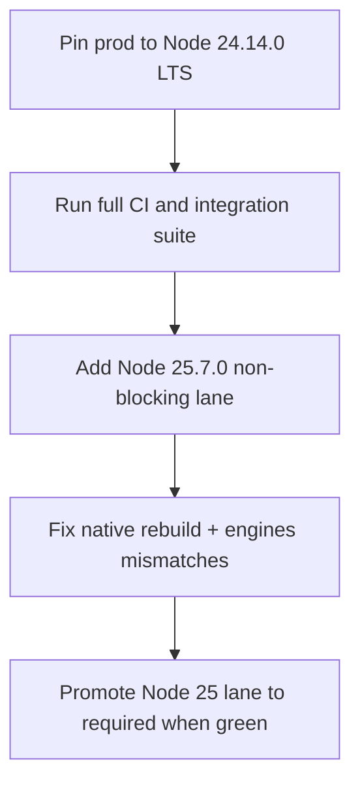
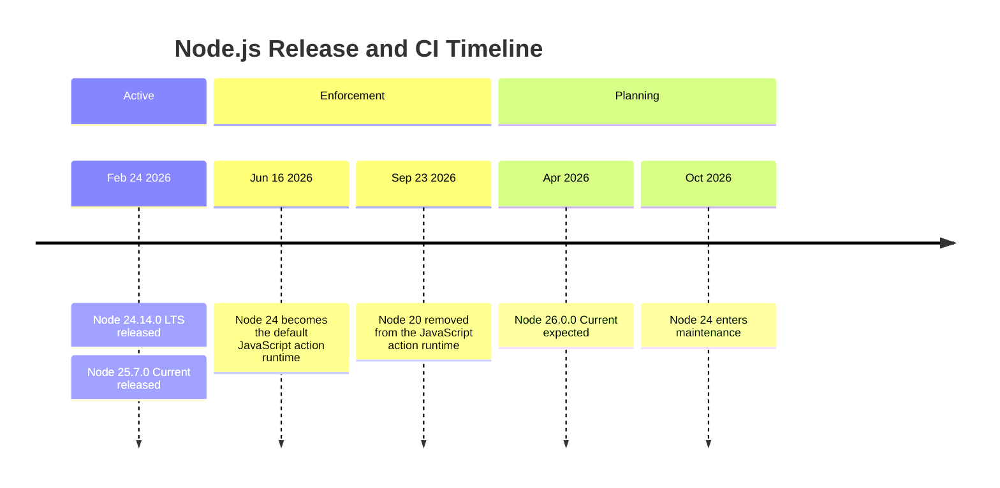

import Tabs from '@theme/Tabs';
import TabItem from '@theme/TabItem';

As of February 25, 2026, my call was to move production to Node 24.14.0 LTS first, run Node 25.7.0 in a CI lane that cannot fail the build, and check native addons and framework `engines` ranges. Both versions shipped on February 24, 2026. 24.x was the LTS (long-term support) line and 25.x was the Current line, the newest release line. These versions are historical examples, and I am not recommending that anyone install an old patch release today.

<!-- truncate -->

## Node upgrade failures in CI

Most regressions from a runtime bump come from three gaps that a team can check before merging. None of them needs a new tool.

| Risk area | What breaks first | Why it changed now |
|---|---|---|
| CI runners and actions | JavaScript actions depend on the runner's action runtime | GitHub moved the default JavaScript action runtime to Node 24 on June 16, 2026, and removed Node 20 on September 23, 2026 |
| Native modules | Addon installs or rebuilds fail, or load mismatched binaries | New major and Current lines add rebuild pressure for addons that do not use Node-API |
| Framework apps | Build or start fails on `engines.node` constraints | New framework releases have raised their minimum Node versions |

:::danger[Correction: action runtime and application runtime]
An earlier version of this post gave March 4, 2026 as the Node 24 enforcement date and treated an explicit application `node-version` as the fix. GitHub's [updated deprecation notice](https://github.blog/changelog/2025-09-19-deprecation-of-node-20-on-github-actions-runners/) states June 16 for the default change and September 23 for Node 20 removal. Update JavaScript actions to releases that declare `runs.using: node24`. `actions/setup-node` selects the application's Node version; it does not change the runtime that executes an action.
:::

Two Node versions are in play on the same runner. The application runtime runs your build and tests. The action runtime is the Node version GitHub uses to execute a JavaScript action's own code, so CI breakage follows GitHub's runtime policy timeline as much as it follows your `Dockerfile`.

A green application build does not prove that the action supports the runner's next action runtime. Check action releases separately from the application's `node-version`.

## Upgrade-risk matrix

The LTS line carries real risk in CI and native addons. The Current line carries more everywhere.

| Domain | 24.14.0 LTS risk | 25.7.0 Current risk | Recommended action |
|---|---|---|---|
| CI (GitHub Actions) | Medium | High | Update JavaScript actions for the action runtime; set the application's `node-version` separately and add a non-blocking Node 25 lane |
| Native addons (`node-gyp`, prebuilds) | Medium | High | Rebuild on upgrade, prefer Node-API packages, cache per Node major |
| Web frameworks | Low-Medium | Medium-High | Validate each app against package `engines` before changing the base image |
| Runtime behavior and API changes | Low-Medium | Medium | Run smoke and contract tests around streams, `http2` fallback, sqlite |

Native addons are compiled modules, built with `node-gyp` or shipped as prebuilt binaries. Their upgrade risk is mostly a dependency choice made long before the upgrade.

A package built on Node-API, the stable interface for native addons, skips most of the rebuild work. A package that does not use it gets a `node-gyp` rebuild every time the major changes, so cache those builds per Node major.

## Rollout order

Production moves to the LTS line before anything else. The Current line runs beside it as a shadow lane and becomes required only after it has been green for a while. My judgment is that this pattern, LTS first plus a Current shadow lane, is still the lowest-risk way to upgrade Node.



## Runtime changes worth a test

Two changelog lines per release are enough to justify targeted tests. Neither needs a migration project.

**Node 24.14.0 LTS**

```md title="CHANGELOG_V24.md" showLineNumbers
* **http**: add `http.setGlobalProxyFromEnv()`  (#60953)
* **sqlite**: enable defensive mode by default  (#61266)
```

- Audit startup code for proxy behavior if outbound traffic depends on environment variables.
- Keep sqlite integration tests in CI, because 24.14.0 tightened sqlite defaults.

**Node 25.7.0 Current**

```md title="CHANGELOG_V25.md" showLineNumbers
* **http2**: add `http1Options` for fallback config  (#61713)
* **stream**: rename `Duplex.toWeb()` option to `readableType`  (#61632)
```

- Review stream adapters that type or wrap `Duplex.toWeb()` options.
- 25.7.0 marks sqlite as release candidate.

A renamed option is the kind of change a type checker reports and an untyped wrapper forwards without comment. If your adapters are untyped, a contract test around `Duplex.toWeb()` is the check that catches it.

## CI baseline

Run both versions in a matrix and let only the Current lane fail without blocking the merge.

```yaml title=".github/workflows/ci.yml" showLineNumbers
strategy:
  matrix:
    node: [24.14.0, 25.7.0]
# highlight-next-line
continue-on-error: ${{ matrix.node == '25.7.0' }}
```

:::tip[Rollout pattern]
Use `continue-on-error` only during rollout. Make 25.x required after it stays green through a stability window.
:::

Left in place, `continue-on-error` turns the Node 25 lane into a test run whose result nobody is allowed to act on. I would put the promotion rule in the same pull request that adds the lane: green for one full release cycle, then required.

## Framework engines (verified February 25, 2026)

The framework ranges are not the problem this time. `engines.node` is the field where a package declares which Node versions it accepts, and every package below accepts both versions.

| Framework package | Current version | Declared Node engine | Node 24 | Node 25 |
|---|---|---|---|---|
| `next` | `16.1.6` | `>=20.9.0` | Supported | Supported |
| `nuxt` | `4.3.1` | `^20.19.0 \|\| >=22.12.0` | Supported | Supported |
| `@nestjs/core` | `11.1.14` | `>= 20` | Supported | Supported |
| `vite` | `7.3.1` | `^20.19.0 \|\| >=22.12.0` | Supported | Supported |
| `express` | `5.1.0` | `>= 18` | Supported | Supported |

:::warning[Transitive dependencies]
Node 24.14.0 satisfies these common ranges, and so does Node 25.7.0. Compatibility still depends on transitive tooling, especially native dependencies in monorepos.
:::

A clean `engines` table certifies the frameworks and says nothing about the native package buried in the dependency tree. The `engines` check is cheap and catches avoidable failures early, so run it first. Then run the full integration suite, which it does not replace.

## Release timeline

The enforcement dates come from GitHub. The planning dates come from the Node.js release schedule and were projections as of February 25, 2026, when this post was written.



## Migration checklist

This is the verification pass. Each item maps to one risk area above.

- [ ] Pin production to Node 24.14.0 LTS
- [ ] Set an explicit application `node-version: 24.14.0` in every CI workflow
- [ ] Update JavaScript actions to releases that declare `runs.using: node24`
- [ ] Add a non-blocking Node 25.7.0 CI lane
- [ ] Rebuild all native addons against Node 24
- [ ] Validate framework `engines` compatibility
- [ ] Run smoke tests for HTTP proxy, sqlite and stream behavior
- [ ] Cache `node_modules` per Node major version in CI
- [ ] Promote the Node 25 lane once it stays green for one full release cycle

<details>
<summary>Related playbooks</summary>

- [DDEV CI acceleration and rollout guardrails](/2026-02-25-ddev-ci-acceleration-playbook-warpbuild/)
- PHP 8.4 failure-mode triage in CI
- [Secrets governance for runtime safety](/2026-02-25-vault-sprawl-secrets-governance-model/)

</details>

## References

- [Node.js 24.14.0 release notes](https://nodejs.org/en/blog/release/v24.14.0)
- [Node.js 25.7.0 release notes](https://nodejs.org/en/blog/release/v25.7.0)
- [Node 24 changelog](https://raw.githubusercontent.com/nodejs/node/main/doc/changelogs/CHANGELOG_V24.md)
- [Node 25 changelog](https://raw.githubusercontent.com/nodejs/node/main/doc/changelogs/CHANGELOG_V25.md)
- [GitHub Actions: upcoming deprecations and breaking changes](https://github.blog/changelog/2026-02-05-notice-of-upcoming-deprecations-and-breaking-changes-for-github-actions/)
- [GitHub Actions: deprecation of Node 20 on runners](https://github.blog/changelog/2025-09-19-deprecation-of-node-20-on-github-actions-runners/)
- [Node.js ABI stability and Node-API](https://nodejs.org/en/learn/modules/abi-stability)
- [node-gyp installation](https://github.com/nodejs/node-gyp#installation)
- [Node.js release schedule](https://github.com/nodejs/release#release-schedule)
- [next on npm](https://www.npmjs.com/package/next)
- [nuxt on npm](https://www.npmjs.com/package/nuxt)
- [@nestjs/core on npm](https://www.npmjs.com/package/@nestjs/core)
- [vite on npm](https://www.npmjs.com/package/vite)
- [express on npm](https://www.npmjs.com/package/express)
