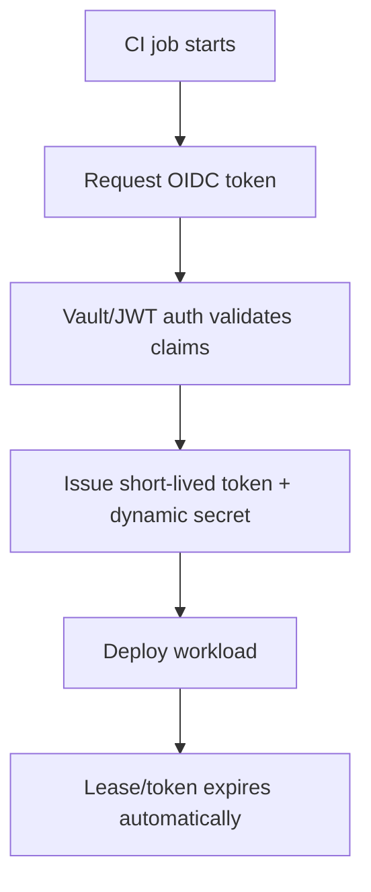
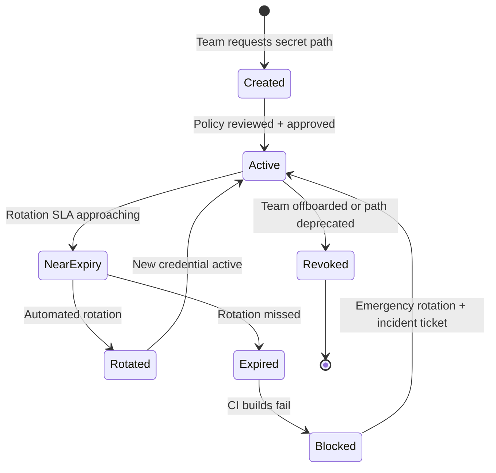

import Tabs from '@theme/Tabs';
import TabItem from '@theme/TabItem';

Vault sprawl in multi-team CI/CD usually comes from weak governance, and another tool will not fix it. The model that works has four parts: short-lived identity-based access (OIDC/workload identity), path ownership boundaries, policy-as-code with review gates, and rotation and usage controls that each team can measure.

<!-- truncate -->

## Four ways secrets sprawl

As teams scale, secrets handling drifts into the same four failure patterns. One shared namespace for many teams makes every team's secrets readable by every other team's pipeline, which is one way to make cross-team collaboration mandatory.

| Sprawl pattern | What breaks | Typical incident |
|---|---|---|
| One shared Vault namespace for many teams | No clear ownership, wide blast radius | Team A pipeline can read Team B secrets |
| Long-lived CI tokens in repo/org secrets | Rotations lag, leaked credentials stay valid | Exposed token keeps working for weeks |
| Inconsistent secret paths/names | Automation and auditing turn fragile | Rotation scripts miss critical paths |
| Manual exceptions outside policy review | Shadow access accumulates | Emergency grants never removed |

:::danger[Blast Radius]
Kubernetes guidance still warns that native secrets can be mishandled without encryption-at-rest and strict RBAC. CI has the same problem: with weak identity and policy, a secret store becomes a high-value failure hub instead of a control.
:::

My first fix would be the long-lived tokens. A leaked token that keeps working for weeks is a rotation failure first and a leak second.

## The governance blueprint

Every standard needs an enforcement point in CI. A rule that lives only in a wiki is a suggestion.

| Control plane | Standard | Enforce in CI |
|---|---|---|
| Identity | OIDC/workload identity only for CI | Block static token auth in pipelines |
| Authorization | Team-scoped Vault paths + least privilege | Validate policy diffs on PR |
| Lifecycle | TTL defaults + max TTL + mandatory rotation SLA | Fail builds for expired owners/rotation metadata |
| Observability | Audit logs mapped to repo/team/service | Daily drift report to platform + team owners |

### Reference policy contract

The policy grants one team read access to its own paths and nothing else. The workflow requests an identity token instead of carrying a stored one.

<Tabs>
<TabItem value="vault" label="Vault Policy (HCL)" default>

```hcl title="vault/policies/team-payments-ci.hcl" showLineNumbers
# highlight-start
path "kv/data/payments/prod/*" {
  capabilities = ["read"]
}
# highlight-end

path "database/creds/payments-ci" {
  capabilities = ["read"]
}
```

</TabItem>
<TabItem value="github" label="GitHub Actions Workflow">

```yaml title=".github/workflows/deploy.yml" showLineNumbers
permissions:
  # highlight-next-line
  id-token: write
  contents: read
```

The `id-token: write` permission lets GitHub Actions mint OIDC tokens. Short-lived exchanges replace stored long-lived cloud and Vault credentials.

</TabItem>
</Tabs>

### Migration from the deprecated pattern

A `VAULT_TOKEN` stored as a repo secret lives exactly as long as someone remembers to rotate it. The replacement removes the stored token and lets a bounded TTL do the remembering.

```diff
- # Deprecated: static CI secrets for Vault/cloud auth
- env:
-   VAULT_TOKEN: ${{ secrets.VAULT_TOKEN }}
+ # Replacement: OIDC federation + dynamic secrets + bounded TTL
+ permissions:
+   id-token: write
```

### OIDC authentication flow

The credential expires on its own at the end of the job. Nobody has to clean it up.



### Secret lifecycle states

A missed rotation blocks CI builds. That is the point: the failure shows up in the pipeline instead of in an incident report.



## Operating rules that prevent re-sprawl

An emergency grant with no expiry stops being an emergency and becomes the access model. These four rules keep ownership and expiry attached to every path.

1. One team owner for each secret path prefix (`kv/data/<team>/<env>/...`).
2. Every secret includes metadata: owner, rotation_sla_days, source_system.
3. PR checks reject policy changes without owner approval.
4. Any manual break-glass access auto-expires and creates a follow-up ticket.

:::warning[Break-glass access]
Do not allow emergency policy exceptions in production without automatic expiry and a ticketed cleanup. Check it by listing active grants and confirming each one has an expiry and an open ticket.
:::

:::tip[Fastest Risk Reduction]
OIDC plus short-lived credentials is the fastest risk reduction move in CI/CD. Start there before adding more tooling.
:::

## Migration checklist

- [ ] Audit all static CI tokens across repos
- [ ] Configure OIDC/workload identity for all CI pipelines
- [ ] Establish team-scoped Vault path ownership
- [ ] Write and review Vault policies as code
- [ ] Set TTL defaults and max TTL for all secret paths
- [ ] Add rotation SLA metadata to all secrets
- [ ] Configure CI to fail on expired owners/rotation metadata
- [ ] Set up daily drift reports for platform and team owners
- [x] Remove all static long-lived tokens from CI secrets

<details>
<summary>Related posts</summary>

- Unprotected AI Agents Report
- [Multi-Agent Reliability Playbook](/2026-02-24-multi-agent-reliability-playbook-github-deep-dive/)
- [Agentic AI without vibe coding](/agentic-ai-without-vibe-coding/)

</details>

## What I learned

- When many teams share one secrets platform, enforce path ownership before adding more tooling.
- OIDC plus short-lived credentials is the fastest risk reduction move in CI/CD.
- Emergency policy exceptions without expiry and ticketed cleanup do not belong in production.
- A rotation SLA written in documentation rotates nothing. Encode it as a CI gate.

## References

- https://developer.hashicorp.com/vault/docs/updates/release-notes
- https://docs.github.com/en/actions/how-tos/secure-your-work/security-harden-deployments
- https://docs.github.com/en/actions/security-for-github-actions/security-hardening-your-deployments/configuring-openid-connect-in-cloud-providers
- https://kubernetes.io/docs/concepts/security/secrets-good-practices
- https://kubernetes.io/docs/concepts/configuration/secret/
- https://developer.hashicorp.com/vault/docs/deploy/kubernetes/vso/csi
