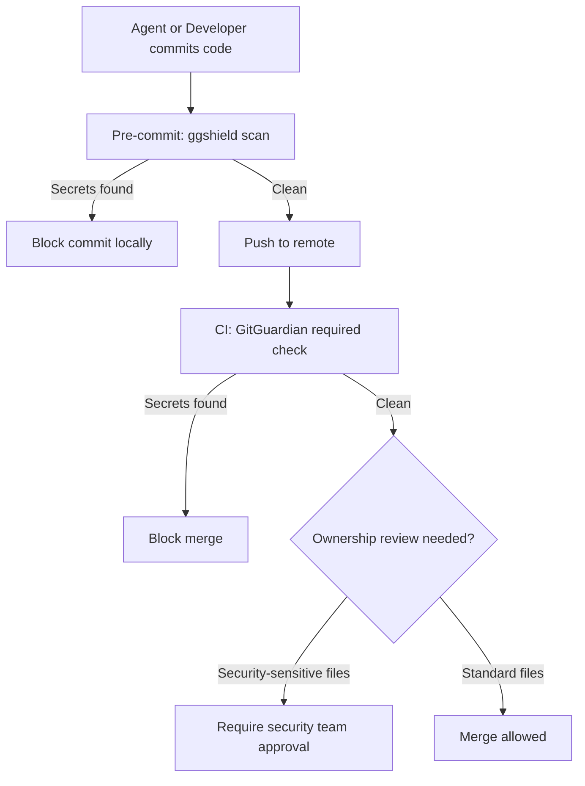

import Tabs from '@theme/Tabs';
import TabItem from '@theme/TabItem';

If AI agents can open pull requests, secret scanning has to block the merge. A scanner that only reports will write accurate notes about a key that already reached the protected branch. My baseline has three layers: a pre-commit hook for fast feedback, a required CI check for enforcement, and a break-glass path (a controlled emergency bypass) that policy governs and audit logs record.

I reviewed the GitGuardian MCP integration pattern and tested it against agent-generated pull requests. MCP is the Model Context Protocol, a standard way for an AI agent to call external tools. My call: teams shipping AI-assisted code should adopt this now.

<!-- truncate -->

## Failure modes without a gate

Most setups I see have the scanner installed and set to advisory mode. In advisory mode the scanner reports findings but never stops a merge. That combination looks like security and behaves like a log file.

Teams that adopt agent-generated code often add scanners but keep them non-blocking. That pattern fails.

:::info[Context]
Leaked credentials reach protected branches in three cases: scans run only locally, CI jobs are optional, or exceptions are handled in chat instead of policy. Agent-generated code carries more risk because it arrives at high volume and often gets less review than human-written code.
:::

| Failure Mode | Why It Happens |
|---|---|
| Scans run only locally | The agent can skip local hooks |
| CI jobs are optional | The status check is not required for merge |
| Exceptions in chat | No audit trail and no policy enforcement |
| Scanner reports but does not block | The credential reaches the protected branch anyway |

For example, suppose an agent commits a config file that contains an API key, the local hook never runs, and the CI scan is optional. The scan can flag the key correctly, and the merge still goes through.

An exception approved in a chat thread has the audit trail of a hallway conversation. Every row in the table has the same fix. Make the scan a required status check, meaning a check that branch protection requires to pass before a merge, and move exceptions out of chat into a written, logged policy.

## The two layers in `ggshield`

`ggshield` is the GitGuardian scanner, and it runs in two places. The CI gate is the control. The local hook is a convenience that makes the CI gate fail less often.

<Tabs>
<TabItem value="ci" label="CI Gate (GitHub Actions)">

```yaml title=".github/workflows/secret-scan.yml" showLineNumbers
name: secret-scan

on:
  pull_request:
  push:
    branches: [main]

jobs:
  gitguardian:
    runs-on: ubuntu-latest
    steps:
      - uses: actions/checkout@v4
      # highlight-next-line
      - name: GitGuardian scan
        uses: GitGuardian/ggshield/actions/secret@v1.37.0
        env:
          GITGUARDIAN_API_KEY: ${{ secrets.GITGUARDIAN_API_KEY }}
```

Before copying this minimal workflow, compare it with the integration documentation linked below. I would use a disposable pull request to verify which commits the scan checks before relying on it. A required check cannot block a leak it never scans.

Then set this workflow as a required status check in branch protection. When the check fails, the merge is blocked. Without that setting, the workflow is decoration.

</TabItem>
<TabItem value="local" label="Local Pre-Commit">

```bash title="Pre-commit hook setup"
# Install ggshield
pip install ggshield

# Configure pre-commit
# highlight-next-line
ggshield install --mode local --hook-type pre-commit
```

The `--mode local` option installs the hook in the current repository, and `--hook-type pre-commit` makes it run at each commit. That gives developers and agents fast feedback before code reaches CI.

It is not enough on its own, because agents can bypass local hooks. A pre-commit hook is a polite request to a process that never has to run it.

</TabItem>
</Tabs>

## Agent-safe policy contract

I treat every code contribution an agent makes through MCP tooling as untrusted until it passes every gate below. The flow is short on purpose.



| Gate | Purpose |
|---|---|
| Secret scanning gate | Stop credential leaks |
| Unit/integration tests | Stop functional regressions |
| Ownership review for security-sensitive files | Stop unauthorized access changes |

:::caution[Reality Check]
Installing the tool is the small part. If the secret-scanning job is not a required gate, you do not have a control. Minimal policy: no direct pushes to protected branches, and no bypass of required checks outside a documented, time-bound break-glass process.
:::

## Rollout and break-glass

The team pays the cost of enforcement when a false positive blocks a merge. A false positive is a finding that looks like a secret but is not one. Plan for that cost before the first blocked release, when nobody has patience for governance.

| Step | Action | Timeline |
|---|---|---|
| 1 | Add the `ggshield` scan in CI and set it as required | Week 1 |
| 2 | Add local/pre-commit scanning for faster fixes | Week 1 |
| 3 | Track false positives and write explicit ignore governance | Week 2-3 |
| 4 | Audit exception usage monthly and push it toward zero | Ongoing |

<details>
<summary>Break-glass process template</summary>

When a legitimate false positive blocks a critical merge:

1. Requester files a break-glass request with justification
2. Security team reviews within its agreed response time (SLA), for example 1 hour for a SEV-1, the highest-severity incident
3. Time-bound exception granted (e.g., 24 hours)
4. Exception logged with full audit trail
5. Root cause addressed: either fix the false positive rule or refactor the code
6. Exception revoked after time limit

Monthly audit: review all break-glass usage and reduce exceptions toward zero.

</details>

Apply the same pattern to any repo that feeds a build or deployment pipeline. That includes repos that receive AI-generated patches and automated dependency updates. Credentials that land in a repo get deployed with everything else.

## Verification checklist

- [ ] `ggshield` runs in CI on pull requests and pushes to `main`
- [ ] The scan is a required status check in branch protection
- [ ] Direct pushes to protected branches are disabled
- [ ] `ggshield install --mode local --hook-type pre-commit` is part of local setup
- [ ] Security-sensitive files require ownership review
- [ ] Break-glass exceptions are time-bound, logged and revoked on expiry
- [ ] False positives are tracked and ignore rules have an owner
- [ ] Exception usage is audited monthly

## References

- [ggshield Getting Started](https://docs.gitguardian.com/ggshield-docs/getting-started)
- [ggshield GitHub Actions Integration](https://docs.gitguardian.com/ggshield-docs/integrations/cicd-integrations/github-actions)
- [ggshield Repository](https://github.com/GitGuardian/ggshield)
- [ggshield Secret Action](https://github.com/GitGuardian/ggshield/tree/main/actions/secret)
- [GitGuardian MCP](https://github.com/GitGuardian/gg-mcp)
