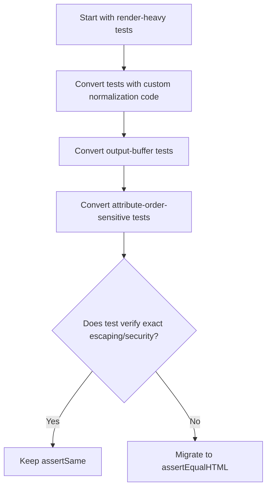

import Tabs from '@theme/Tabs';
import TabItem from '@theme/TabItem';

WordPress 6.9 added `assertEqualHTML()`, so a test that fails because of whitespace in rendered HTML no longer has an excuse. I reviewed the implementation and mapped concrete migration patterns for plugin and theme test suites, plus the places where `assertSame()` should stay.

<!-- truncate -->

## Tests that fail on formatting, not behavior

A string equality check on HTML tests the serializer's formatting habits. It does not test what the page does.

> "In plugin and theme suites, many HTML tests still use strict string equality and fail on whitespace, indentation, or equivalent tag formatting instead of real behavior regressions."

A test that fails because `class` came before `href` has caught a difference no browser cares about. My fix is to compare meaning with `assertEqualHTML()` and keep strict equality for output where every byte matters.

:::info[Context]
`assertEqualHTML()` landed in WordPress core test tools in 6.9. It compares HTML equivalence, not raw string identity. It normalizes whitespace, attribute order and insignificant formatting before comparing, so `<a class="btn" href="/docs">` and `<a href="/docs" class="btn">` count as equal.
:::

## Migration patterns

Most of these are a one-line change. The biggest win is the tab where a hand-written normalizer disappears.

<Tabs>
<TabItem value="direct" label="1. Direct String to Semantic">

**Before:**
```php title="tests/test-output.php"
$this->assertSame(
'<p class="notice">Saved</p>',
$actual_html
);
```

**After:**
```php title="tests/test-output.php"
// highlight-next-line
$this->assertEqualHTML(
'<p class="notice">Saved</p>',
$actual_html
);
```

</TabItem>
<TabItem value="normalize" label="2. Remove Custom Normalization">

**Before:**
```php title="tests/test-render.php"
$normalize = static fn( $html ) => preg_replace( '/\s+/', ' ', trim( $html ) );
$this->assertSame( $normalize( $expected ), $normalize( $actual ) );
```

**After:**
```php title="tests/test-render.php"
// highlight-next-line
$this->assertEqualHTML( $expected, $actual );
```

That regex was a homemade HTML comparator with one rule: collapse whitespace. Core now ships a comparator that also handles attribute order, so the helper can go.

</TabItem>
<TabItem value="buffer" label="3. Output Buffer Render Tests">

**Before:**
```php title="tests/test-blocks.php"
ob_start();
render_banner_block( array( 'message' => 'Hi' ) );
$actual = ob_get_clean();

$this->assertSame(
'<section class="banner"><p>Hi</p></section>',
$actual
);
```

**After:**
```php title="tests/test-blocks.php"
ob_start();
render_banner_block( array( 'message' => 'Hi' ) );
$actual = ob_get_clean();

// highlight-next-line
$this->assertEqualHTML(
'<section class="banner"><p>Hi</p></section>',
$actual
);
```

</TabItem>
<TabItem value="attr" label="4. Attribute Order Noise">

**Before (fails):**
```php title="tests/test-links.php"
$expected = '<a class="btn primary" href="/docs">Docs</a>';
$actual   = '<a href="/docs" class="btn primary">Docs</a>';
$this->assertSame( $expected, $actual ); // FAILS
```

**After (passes):**
```php title="tests/test-links.php"
// highlight-next-line
$this->assertEqualHTML( $expected, $actual ); // PASSES
```

</TabItem>
</Tabs>

## Which assertion goes where

The choice depends on what the test promises. If it promises DOM meaning, compare meaning. If it promises exact bytes, compare bytes.

| Assertion | Use when |
|---|---|
| `assertEqualHTML()` | Rendered markup where DOM meaning matters more than exact serialization |
| `assertSame()` | Exact escaping, spacing or deterministic serialization matters |
| `assertEqualHTML()` | The test currently compensates for formatting differences |
| `assertSame()` | Security assertions that verify exact output |

## A bridge for suites older than 6.9

If the suite also runs against WordPress versions before 6.9, wrap the call so the same test works on both.

```php title="tests/helpers/compat.php"
private function assertHtmlEquivalent( string $expected, string $actual ): void {
    if ( method_exists( $this, 'assertEqualHTML' ) ) {
        // highlight-next-line
        $this->assertEqualHTML( $expected, $actual );
        return;
    }
    // Fallback for pre-6.9
    $this->assertSame( trim( $expected ), trim( $actual ) );
}
```

The fallback only trims, so attribute order still fails on older versions. That is acceptable for a bridge. Remove it when the oldest supported version reaches 6.9.

:::caution[Reality Check]
Do not over-migrate. Swapping every assertion for `assertEqualHTML()` makes the suite greener and makes escaping bugs invisible, which is a bad trade. Keep `assertSame()` for escaping, security and exact output contracts, and use `assertEqualHTML()` for semantics. This two-lane policy keeps the intent of each test explicit.
:::

## Rollout order

Start where the noise is loudest and stop at anything that checks escaping.



## Migration checklist

<details>
<summary>Full rollout checklist</summary>

- [ ] Start with render-heavy tests (`render_callback`, shortcode output, template helpers).
- [ ] Convert only tests that currently compensate for formatting differences.
- [ ] Keep `assertSame()` for escaping, security assertions and exact output contracts.
- [ ] Add a short team note: "Use `assertEqualHTML()` for semantic markup checks".
- [ ] Delete hand-rolled normalization helper functions.
- [ ] Run the full suite after migration to catch tests that silently relied on exact formatting.
- [ ] Document the two-lane policy in your testing guidelines.

</details>

## What I learned

- `assertEqualHTML()` landed in WordPress core test tools in 6.9 and compares HTML equivalence, not raw string identity.
- Most of the gain comes from deleting custom normalization code and cutting flaky failures.
- A two-lane policy (`assertEqualHTML()` for semantics, `assertSame()` for exactness) keeps intent explicit and prevents over-migration.
- My call: this is one of the most underrated testing improvements in recent WordPress history.

## References

- [WordPress 6.9 Developer Changes](https://make.wordpress.org/core/2025/04/16/miscellaneous-developer-changes-in-wordpress-6-9/)
- [Core Changeset 60301](https://core.trac.wordpress.org/changeset/60301)
