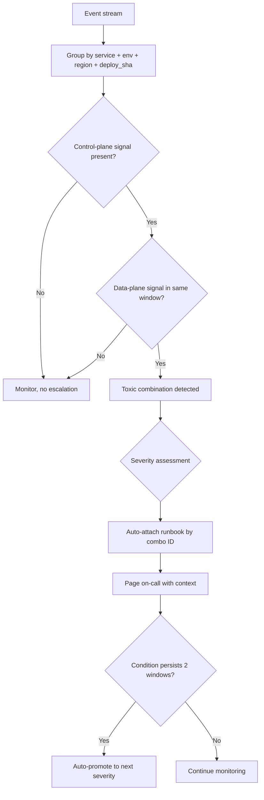

import Tabs from '@theme/Tabs';
import TabItem from '@theme/TabItem';

Two valid changes to the same service inside fifteen minutes at 2 a.m. is where the outage lives, and single-metric dashboards stay green the whole time. Cloudflare wrote a postmortem about this blind spot: stacked low-signal anomalies that every alert checks alone and nobody checks together. I turned it into an enforceable playbook, so the next on-call learns the pattern from a document and not from an incident.

<!-- truncate -->

TL;DR

- Pair one control-plane signal (deploy, config, policy) with one data-plane signal (latency, errors, timeouts) inside a fixed window.
- Start with deterministic rules. Add ML anomaly scoring later.
- Block autonomous merge or deploy when checklist items 4, 5, 8 or 9 fail.

## Toxic combinations defined

> "Incidents often come from individually normal events that become dangerous only when correlated in a short time window."
>
> Cloudflare, [The Curious Case of Toxic Combinations](https://blog.cloudflare.com/the-curious-case-of-toxic-combinations/)

A toxic combination needs two kinds of signal. A control-plane signal is a change to how the system is configured: a deploy, a config change, a policy update. A data-plane signal is a symptom on the request path that users hit: latency, errors, timeouts.

:::info[Context]
Single-metric alerting fails here. Each signal in the playbook below is normal on its own and would not trigger an alert; the danger is the pair. The fix is a playbook that names which low signals to pair, gives each pair a correlation window, and ties escalation thresholds to blast radius, meaning how much of the system and its users a failure can reach.
:::

## The gap that per-signal alerting leaves

Every control in this chain passes its own test. The outage happens in the gap between them, and no control owns the gap.

1. A change is valid in isolation.
2. Another change is also valid in isolation.
3. Existing controls evaluate each signal separately.
4. No control evaluates the combination in real time.
5. A low-probability overlap becomes a high-impact outage.

Take TC-02 from the playbook below. A WAF managed-rule update is a routine change, and a 1.5x rise in 403 responses on authenticated paths does not page anyone by itself. Two quiet signals, one loud problem.

My call: write the pairs down before adding any new tooling. Step 4 is the missing piece, and the playbook below is that list of pairs, with windows and thresholds.

## Alert-correlation playbook

Each row pairs one change with one symptom, gives the pair a window, and names the condition worth waking someone for. The second tab maps triggers to severity tiers, from SEV-3 (lowest) to SEV-1 Critical.

<Tabs>
<TabItem value="combos" label="Toxic Combinations">

| Combo ID | Low-signal A | Low-signal B | Window | Escalate When | Severity |
|---|---|---|---|---|---|
| TC-01 | 2x deploys to same service in 30 min | p95 latency up 15% for 10 min | 30 min | Error budget burn >2%/hour | SEV-3 |
| TC-02 | WAF managed-rule update | 403 rate up 1.5x on authenticated paths | 15 min | >=2 regions or >=5% signed-in traffic | SEV-2 |
| TC-03 | Feature flag enabled for >=10% traffic | DB lock wait p95 >300ms for 5 min | 20 min | Checkout/login in impact set | SEV-2 |
| TC-04 | Secrets rotation completed | Auth token validation failures >0.7% | 20 min | Sustained 10 min after rotation | SEV-2 |
| TC-05 | Autoscaler event >=20% | Upstream 5xx rises above 0.5% | 15 min | Queue lag growth >25% | SEV-2 |
| TC-06 | Cache purge or key-schema change | Origin egress up 40% | 20 min | CDN hit ratio drops >=10 points | SEV-3 |
| TC-07 | Rate-limit policy change | Support error reports >=5 in 15 min | 15 min | Same route/tenant in both sets | SEV-3 |
| TC-08 | DNS/proxy config change | Regional timeout >1.2% | 30 min | Payment/auth path impacted | SEV-1 |

</TabItem>
<TabItem value="escalation" label="Escalation Thresholds">

| Trigger | Escalation | Required Actions |
|---|---|---|
| 1 toxic combo, non-critical path | SEV-3 | Assign incident lead, freeze non-critical deploys |
| 1 combo on auth/payments OR 2 combos in same service | SEV-2 | Incident bridge, canary-only deploy mode, page service + platform owner |
| 2+ combos across 2+ services or multi-region | SEV-1 | Org deploy freeze, rollback/kill-switch within 10 min |
| Customer-visible data risk or burn >10%/hour | SEV-1 Critical | Executive comms, status page, forensic timeline owner |

</TabItem>
</Tabs>

## Correlation rules to implement first

Start with deterministic rules, meaning fixed if-then conditions a person can read, before ML anomaly scoring. My call: at 2 a.m., a rule the on-call can read is worth more than a score they have to trust.

1. Group by `service + env + region + deploy_sha` in rolling windows.
2. Require at least one control-plane signal (deploy, config, policy) and one data-plane signal (latency, errors, timeouts).
3. Suppress duplicate pages for 15 minutes after acknowledgment, and keep the event count rising in the timeline.
4. Attach runbook links by combo ID (`TC-01` to `TC-08`) in the page payload.
5. Promote to the next severity tier if the condition persists for 2 windows.

The limitation is plain: a deterministic rule catches only the pairs someone wrote down. The weekly review in the CI section exists to keep that list current.

## Pre-deploy checklist for agent workflows

Agent-driven deployments tend to evaluate each change alone. An agent that approves two safe changes separately has done two correct reviews and zero useful ones.

| # | Check | Block If "No" |
|---|---|---|
| 1 | Change coupling: did this touch auth, routing, flags, secrets, schema, or policy at the same time? | Advisory |
| 2 | Blast radius: if these fail together, is impact local, regional, or global? | Advisory |
| 3 | Concurrency: other in-flight deploys in same 30-60 min window? | Advisory |
| 4 | Control + data plane overlap: modified both control logic and request path? | **Block** |
| 5 | Rollback certainty: can we roll back every component independently in &lt;5 min? | **Block** |
| 6 | Guardrail coverage: do tests assert the interaction path as well as each component path? | Advisory |
| 7 | Canary realism: canary traffic includes high-risk edge cases? | Advisory |
| 8 | Signal correlation alert: alerts fire when two low-severity signals co-occur? | **Block** |
| 9 | Kill-switch readiness: verified emergency flag to disable new interaction path? | **Block** |
| 10 | Ownership clarity: single incident commander for this combined risk surface? | Advisory |

:::caution[Reality Check]
If any answer is "no" for items 4, 5, 8 or 9, block autonomous merge and deploy, and require human approval. An agent that reviews each change alone has no step that asks whether two changes fail together, so these four items are where the gate has to live. Two safe changes can still produce one unsafe deployment.
:::

Integration-specific security checks

- Verify every third-party integration has scoped tokens and per-environment credentials
- Require explicit allowlists for outbound hosts in agent actions and CI runners
- Deny silent fallback behavior when integration auth fails; fail fast and alert
- Confirm audit logs link each automated action to actor, workflow run, and change set
- Validate revocation path: rotating integration keys must complete without downtime

## Agent and CI implementation

The toxic combinations pattern maps onto agent and CI workflows, where several automated changes can land in the same window without checking each other. So the same logic belongs in the pipeline, where it runs before the change ships and not only after users feel it.

| Step | Action |
|---|---|
| 1 | Add `toxic_combo_id` evaluation in CI/CD metadata and the runtime alert processor |
| 2 | Compute `compound_risk_score` from combo count, critical-path weight, and persistence |
| 3 | Fail closed when `compound_risk_score >= 70` and rollback certainty is not verified |
| 4 | Require two-key approval for any deploy touching control-plane + auth/routing paths |
| 5 | Emit `toxic_combination_candidate` events and review them weekly, including near misses |

Step 5 keeps the pair list current. Near misses from production are also the labeled data that ML scoring needs later, which is why ML goes on top of the rules and not in place of them.

## Checklist to run before the next deploy

- [ ] Control-plane and data-plane pairs are written down, each with a window and an escalation condition.
- [ ] Alerts group by `service + env + region + deploy_sha`.
- [ ] Pages carry the runbook link for their combo ID.
- [ ] Checklist items 4, 5, 8 and 9 block autonomous merge and deploy.
- [ ] Every component rolls back independently in under 5 minutes.
- [ ] The kill-switch for the new interaction path is verified.

## References

- [Cloudflare: The Curious Case of Toxic Combinations (October 26, 2025)](https://blog.cloudflare.com/the-curious-case-of-toxic-combinations/)
