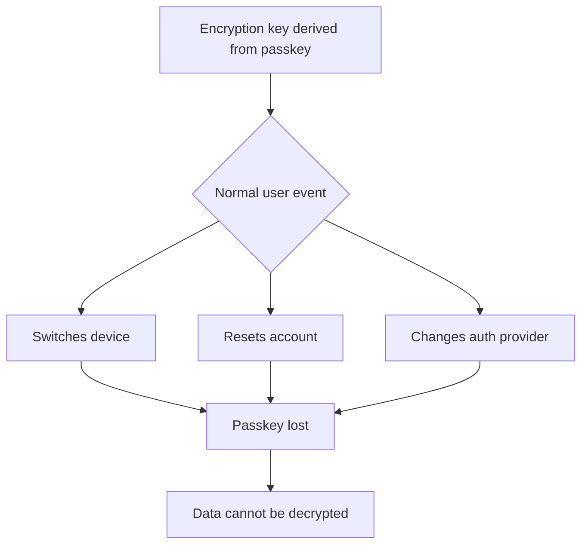
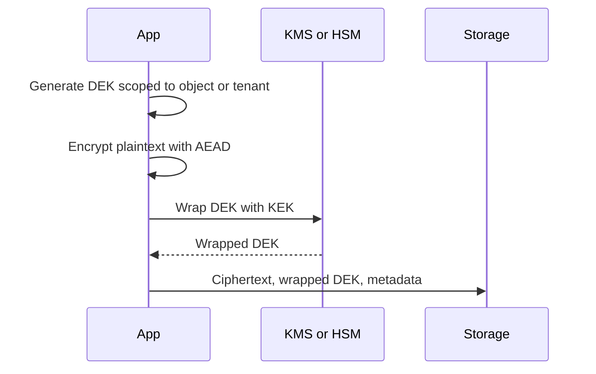
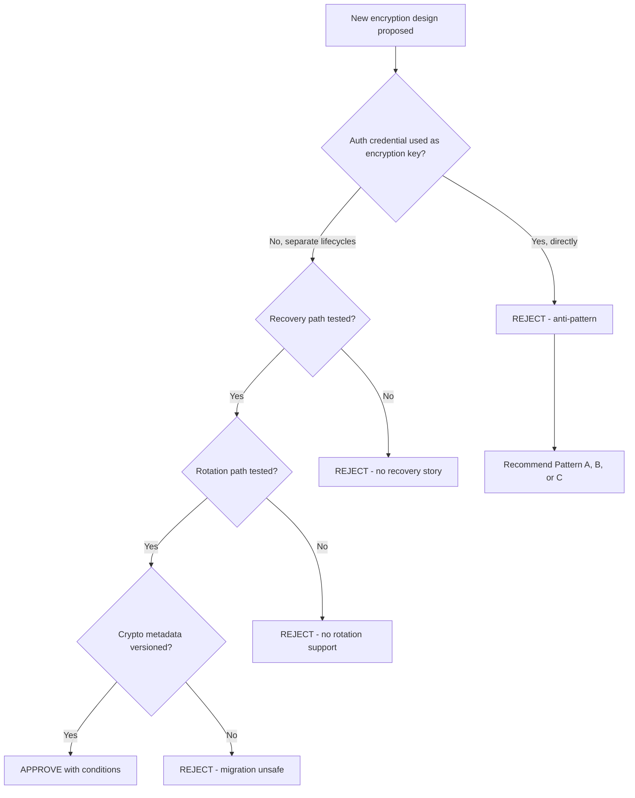

import Tabs from '@theme/Tabs';
import TabItem from '@theme/TabItem';

Passkey credentials should not double as data-encryption keys. The design looks elegant in review, and then a user switches phones and their data stays behind with the old device. The passkeys critique made this failure mode hard to ignore, so these are the guardrails I would enforce in any architecture review before that design reaches production.

<!-- truncate -->

TL;DR

- Authentication and encryption get separate key lifecycles.
- Passkeys gate access and authorize key operations. They are never the sole raw key material.
- Default to KMS-backed envelope encryption for user data.
- Reject any design that cannot show tested recovery, tested rotation and versioned crypto metadata.

## Authentication and encryption have different jobs

Authentication proves who the user is. Encryption keeps data confidential. The two controls can interact, but they must not share one key lifecycle, because then a login problem becomes a data problem.

A key lifecycle here means everything that happens to a key over time: creation, use, rotation, recovery and revocation. Login credentials and data keys change for different reasons, so each needs its own.

:::caution[Reality check]
If encryption keys are derived directly from passkey credentials, losing the passkey means losing the data. That is the default outcome of normal user behavior: switching devices, resetting an account or changing authentication providers. Reject any design that cannot survive these events without irreversible data loss.
:::

Under that design, the account reset flow also deletes the user's data, and it does so reliably. None of the three events in the diagram is an attack. They are the ordinary week of a user with a new phone.

## Approved patterns for user-data encryption

Three patterns pass review. All three keep the passkey on the access side of the line.

A few terms first. A Data Encryption Key (DEK) encrypts the data itself. A Key Encryption Key (KEK) encrypts, or "wraps", the DEK. A KMS (key management service) or HSM (hardware security module) holds the KEK. AEAD (authenticated encryption with associated data) hides the content and also detects tampering.

<Tabs>
<TabItem value="patternA" label="Pattern A: Envelope Encryption">

Use per-record or per-tenant Data Encryption Keys (DEKs), wrapped by a Key Encryption Key (KEK) in KMS/HSM.

The data path has four steps. Generate a DEK scoped to the object or tenant. Encrypt the plaintext with AEAD (AES-256-GCM or XChaCha20-Poly1305), wrap the DEK with a KEK in managed KMS/HSM, then store the ciphertext with the wrapped DEK and its metadata (algorithm, version, AAD context).

| Benefit | Why |
|---|---|
| Clean key rotation | Rewrap DEKs without re-encrypting the data |
| Scoped revocation | Revoke one tenant's keys without touching the others |
| Auditable key usage | KMS/HSM keeps the audit trail |

</TabItem>
<TabItem value="patternB" label="Pattern B: Split-Key Derivation">

When the product needs user-controlled secrecy, derive a user component from a high-entropy secret with a memory-hard KDF (key derivation function) such as `Argon2id`, then combine it with service-held key material in KMS. Memory-hard means each guess costs memory as well as time, which slows brute force.

| Requirement | Implementation |
|---|---|
| Explicit recovery path | Trusted recovery secret, escrow, or threshold recovery |
| Brute-force resistance | Argon2id parameters tied to the current hardware baseline |
| Key-version metadata | Supports transparent re-encryption |

</TabItem>
<TabItem value="patternC" label="Pattern C: Hardware-Backed Keys">

Use platform authenticators and passkeys to **gate access and authorize key operations**, not as the sole raw encryption key material.

| Acceptable use | Not acceptable |
|---|---|
| A passkey-authenticated session obtains server authorization to unwrap the DEK | Deriving an irreversible data key directly from passkey credentials |
| WebAuthn signatures authorize cryptographic operations | Passkey as the sole encryption key with no recovery path |

</TabItem>
</Tabs>

Pattern A is the one most products need. This is the request path it describes:

My call: start with Pattern A. Add Pattern B only when a business requirement asks for user-side secrecy, and accept that it brings a recovery path you have to build and test.

## Architecture review decision flow

The review asks four questions in order. Any "no" ends it with a rejection and a pointer to the approved patterns.

The word that matters in each box is "tested". A recovery path described in a design doc and never run does not count.

## Anti-patterns to block on sight

This table does more work in a review than the rest of the post. Each row is a rejection reason on its own.

| Anti-pattern | Why it fails |
|---|---|
| `Auth == Encryption key` | Losing the passkey or credential means permanent data loss |
| `No recovery story` | "Data gone forever if credential lost" in a mainstream product |
| `Client-only key custody by accident` | No backup, no escrow, no explicit warning to the user |
| `Nonce misuse` | AEAD nonce reuse, or a deterministic nonce without a proven construction. A nonce is a value that must never repeat under the same key. |
| `Homegrown crypto` | Custom primitives, unaudited constructions |
| `Single global DEK` | One compromise decrypts the entire user population |
| `Soft-delete only` | Keys stay active after a deletion request |
| `Opaque key metadata` | No key IDs, algorithm IDs or version tags |
| `Silent downgrade` | Falls back to weaker crypto without explicit control and alerting |

A single global DEK has one clear efficiency: a single compromise exposes every user at once. Per-tenant DEKs under Pattern A fix it, and revocation then touches one tenant instead of all of them.

## Control mapping for review boards

Sort controls into what must exist, what should exist and what stops a launch.

| Category | Controls |
|---|---|
| **Must-have** | Envelope encryption, documented key hierarchy, recovery and rotation runbooks, cryptographic logging and alerting |
| **Should-have** | Per-tenant key segmentation, periodic key health attestations, break-glass with dual authorization |
| **Blockers** | Irreversible user-data loss from the normal auth lifecycle, no incident response for key compromise, no test evidence for restore, rotation or deletion flows |

:::tip[No board required]
A small team does not need a review board to use this table. I would paste the Blockers row into the pull request template and require test evidence for each item before merge.
:::

Practical default baseline for most SaaS products

- WebAuthn/passkeys for phishing-resistant **authentication**
- KMS-backed envelope encryption for user **data**
- Argon2id-derived user secret only where business requirements need user-side secrecy
- Documented recovery with explicit user communication

This gives strong authentication and durable encryption, and the product's data does not depend on a single credential.

## Plugins, modules and hosted user data

Drupal and WordPress sites store user data, PII and sometimes regulated content, so the same rules apply to contrib modules and plugins that add auth or encryption.

| Module or plugin adds | Rule |
|---|---|
| Auth: SSO, passkeys, 2FA | Passkeys or OAuth tokens gate access. They are never the only key for stored data. |
| Encryption: field-level, backup | Prefer envelope encryption with a KEK in managed KMS where possible |
| Either | Reject designs where losing the auth credential means irreversible data loss. Require a documented recovery path. |

Hosting and platform teams that offer encryption at rest or key management, such as Pantheon, Acquia and WP Engine, should follow these patterns too. Otherwise site builders inherit the anti-patterns with the hosting plan.

## Review checklist

Use this list to verify a design before approval. Each checked box needs a test run or a document behind it.

- [ ] No auth credential is used directly as an encryption key
- [ ] Recovery path exists and has test evidence
- [ ] Rotation path exists and has test evidence
- [ ] Ciphertext carries key ID, algorithm ID and version tag
- [ ] DEKs are scoped per record or per tenant, never global
- [ ] AEAD nonces are never reused
- [ ] No custom primitives or unaudited constructions
- [ ] Deletion requests revoke keys, not only rows
- [ ] Any crypto fallback is explicit and alerts
- [ ] Incident response exists for key compromise

I would add the anti-pattern table to the review template as a gate, next to this checklist.
