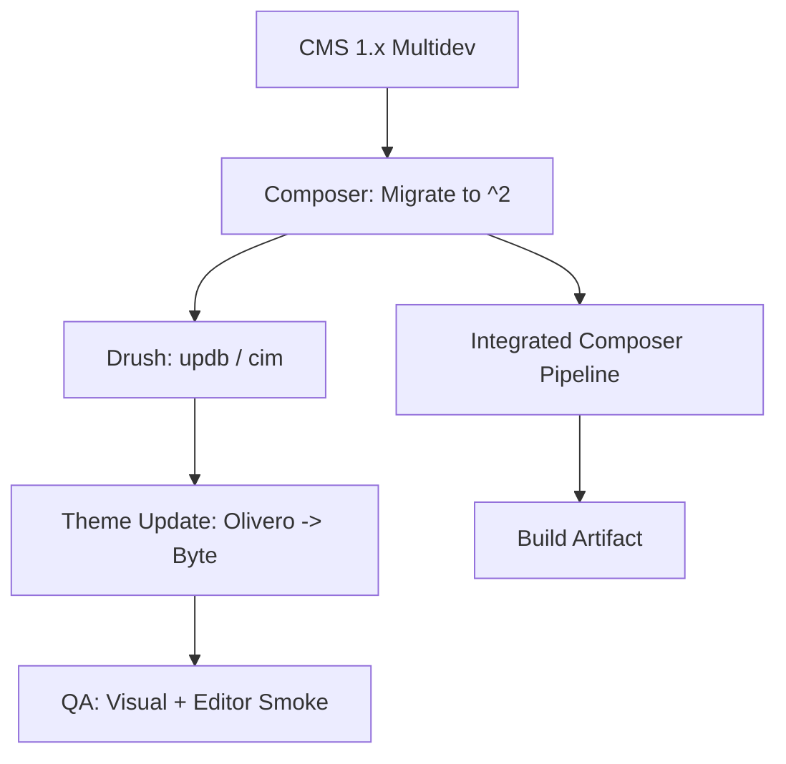
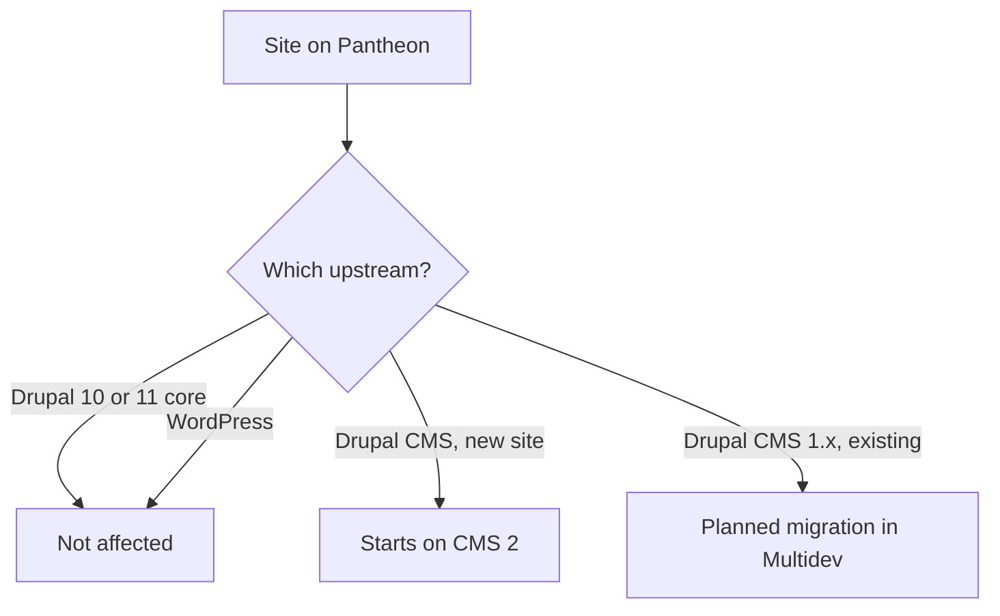

Pantheon switched the Drupal CMS upstream to Drupal CMS 2 on **March 6, 2026**, for new sites only. Existing Drupal CMS sites are not auto-updated and Drupal 10/11 upstream sites are not affected, so a team that reads this as "new upstream, apply everywhere" is about to run a migration by accident.

<!-- truncate -->

## What changed on Pantheon

The release note is short. The work it implies for existing sites is longer.

From the Pantheon and Drupal.org sources:

- Pantheon updated the Drupal CMS upstream to version 2 for newly created sites.
- Existing Drupal CMS sites need deliberate upgrade work and validation.
- CMS 2 brings architectural changes, including Canvas as the default editing UX and the Byte site template.
- Pantheon's Drupal CMS guidance lists concrete break risks for 1.x to 2.0 upgrades.

My read: moving from CMS 1.x to 2 is a controlled migration. It touches the theme, the content model and the build pipeline, which is a lot of surface for something that arrives looking like a routine upstream update.



## Classify every site by upstream first

Pantheon chose to leave existing sites alone. Applying the update across a portfolio by hand would reverse that choice, and the team doing it would own the outages.



A single update policy for every site saves one column in a spreadsheet and pays for it later in incident time. The fix costs that column back: record the upstream for each site before anyone runs Composer, and gate promotion per environment with explicit rollback checks.

WordPress sites on Pantheon are not directly impacted by this change. The same classification step works for a mixed Drupal and WordPress estate, even when only one CMS ships breaking changes.

## The breaking-change surface

Pantheon's own Drupal CMS doc names the highest-risk breaks for 1.x sites, including theme removal and recipe package splits. This is the sequence it points to:

```bash
# Update sequencing for Drupal CMS 2
composer require drupal/cms:^2 -W
composer require drupal/site_template_helper:^1
vendor/bin/drush theme:enable byte
vendor/bin/drush theme:set-default byte
vendor/bin/drush cr
```

| Change in CMS 2 | What breaks if ignored | How to check |
|---|---|---|
| `drupal_cms_olivero` removed, replaced by `byte` | Unresolved theme config triggers missing theme errors after the upgrade | No `drupal_cms_olivero` references remain, `byte` is the default |
| Several content-type recipe packages replaced by `drupal_cms_site_template_base` | Content that depends on the replaced recipes | Inventory Blog, News, Events and similar types before removing packages |
| `drupal/site_template_helper` must be explicitly allowed as a Composer plugin | Integrated Composer builds fail | The allow-plugins diff is part of the reviewed dependency change |
| `automatic_updates` marked obsolete | Obsolete module left installed | Uninstall it after the upgrade |

The obsolete module on that list is `automatic_updates`, which is a fair outcome in a release that needs seven manual steps to apply safely. Uninstall it after the upgrade and confirm it is gone in the config export.

For managed Drupal teams, the blast radius is usually here:

- Theme dependency assumptions in custom front-end work.
- Content model dependencies on replaced recipe packages.
- CI/CD breakage from Composer allow-plugins drift.
- Inconsistent environments when Dev is upgraded but promotion criteria are weak.

## Update order for managed teams

The order below follows Pantheon's Multidev-first guidance. Each step produces evidence that the next one depends on.

1. Classify sites by upstream: Drupal CMS vs Drupal 10/11 core upstreams.
2. For Drupal CMS 1.x sites, branch to Multidev first.
3. Inventory content that uses recipe-provided types (Blog, News, Events, etc.) before any package removals.
4. Change `composer.json` constraints from `^1` to `^2`, apply the package replacements and update allow-plugins.
5. Run DB updates and config validation in Multidev, and switch the theme to `byte` before declaring success.
6. Validate editor workflows (Canvas, content creation, revisions) beyond homepage rendering.
7. Merge to Dev only with explicit rollback criteria and owner sign-off.

:::warning[Do not start in Dev, Test or Live]
Run the first CMS 2 upgrade of each site in a Multidev branch. Dev is the first shared environment, so a broken theme or a failed Composer build there blocks everyone else working on the site.
:::

## A green build proves less than it looks

A successful Integrated Composer build artifact tells you Composer resolved the dependencies. Whether an editor can open Canvas and publish a page is a separate question, and the build never asks it.

CMS 2 relies heavily on recipes and configuration as code, so most of the risk sits in config and content. My call is to treat the Multidev editor check as the real gate and the build as a prerequisite.

:::tip[What the gate should prove]
Before merging toward production, confirm in Multidev that the Canvas editor works for create, edit and publish, and that the Byte theme mappings render the existing content. A build artifact alone does not cover either.
:::

## Deployment checklist

Use this as the release gate before promotion:

- [ ] Upstream classification documented per site (CMS upstream vs Drupal 10/11 upstream).
- [ ] Dependency diff approved: `composer.lock`, removed packages and plugin allowlist updates.
- [ ] Theme migration verified: `drupal_cms_olivero` references removed, `byte` active as intended.
- [ ] Content integrity checked for the replaced content-type recipes.
- [ ] Drush update, cache rebuild and watchdog checks clean in Multidev.
- [ ] Editor smoke tests passed: create, edit, publish, media, menus, forms.
- [ ] Config export and import cycle passes without unexpected drift.
- [ ] Rollback path tested: known-good tag, DB backup and an owner on call.

:::danger[One missing item means no promotion]
If any item above is unchecked, delay promotion. CMS 2 adoption is optional per site. Outage time is not.
:::

## My call

For new builds, starting on Drupal CMS 2 is a good default. For existing managed Drupal estates, I would plan each upgrade as a migration: map the breaking surface early, run the Multidev-first order, and gate promotion on content and editor checks as well as a clean deploy.

## Sources

- [Pantheon release note (March 6, 2026): Upstream update for Drupal CMS 2 now available](https://docs.pantheon.io/release-notes/2026/03/upstream-drupal-cms-2-available)
- [Pantheon docs: Drupal CMS on Pantheon (includes 1.x to 2.0 upgrade warnings and recommended steps)](https://docs.pantheon.io/drupal-cms)
- [Drupal.org: Drupal CMS releases](https://www.drupal.org/project/cms/releases)
- [Drupal.org: cms 2.0.0 release notes](https://www.drupal.org/project/cms/releases/2.0.0)
- [Pantheon docs: WordPress and Drupal Core Updates](https://docs.pantheon.io/core-updates)
