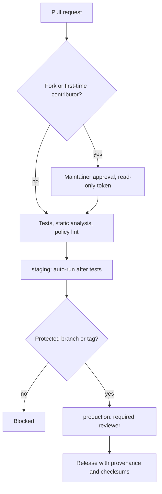

GitHub's agentic workflow architecture is a set of promises until CI enforces them, and a promise has never failed a build. For Drupal module and WordPress plugin maintainers, I treat CI as a policy enforcement plane. Its first job is to block risky behavior, and running builds is its second.

<!-- truncate -->

This review maps the architecture to six guardrails that GitHub Actions can enforce in plugin and module repositories. Guardrail 6 adds a policy workflow that fails the build on the workflow conditions it can detect: unpinned actions, missing permissions, unsafe triggers and broad secret inheritance.

## Risk in plugin and module repositories

Drupal contrib modules and WordPress plugins increasingly ship with AI-generated changes. Code quality is one risk. Workflow trust is the other: who can trigger deploys, what tokens can change, and whether a released artifact traces back to a reviewed commit.

Most compromises come through weak process edges:

- Over-scoped tokens
- Unpinned actions
- Unsafe `pull_request_target`
- Unprotected release environments

If repo policy allows these by default, agentic workflows magnify risk instead of reducing toil. The agent saves time on the work and spends it on the attack surface.

| Guardrail | What it blocks |
| --- | --- |
| Read-only `GITHUB_TOKEN` by default | Test jobs that create releases or tags, and a wide blast radius from a malicious dependency |
| OIDC instead of static cloud keys | Long-lived secrets that are hard to revoke during an incident |
| Trigger boundaries | Secret exfiltration through workflow files modified in forks |
| Pinned actions and provenance | Mutable tags, and plugin ZIPs or module archives nobody can trace |
| Protected environments | Automatic release publication from a compromised PR pipeline |
| Policy as code | Guardrails that drift because they live only in docs |

## Guardrail 1: Read-only `GITHUB_TOKEN` by default

`GITHUB_TOKEN` is the credential each workflow run receives. Set repository and workflow permissions to read-only, and grant write scopes only in the specific job that needs them.

```yaml
permissions: read-all

jobs:
  test:
    permissions:
      contents: read
  release:
    if: github.ref == 'refs/heads/main'
    permissions:
      contents: write
      packages: write
```

A test job that can create tags is a test job with career plans. Scoping write access to the release job removes those plans:

- Test jobs cannot silently create releases or tags.
- A malicious dependency running in CI gets a smaller blast radius.

For example, suppose a dependency installed during the test job is malicious. Anything it does with that job's token stays inside the token's scope, and with `contents: read` that scope no longer includes releases or tags.

## Guardrail 2: OIDC instead of long-lived cloud secrets

Static cloud keys in GitHub secrets keep working until someone revokes them, and incident response is the worst week to start that search. OpenID Connect (OIDC) federation replaces those keys: the deploy job receives short-lived credentials tied to claims about the repo, the branch and the environment. For deploy jobs, I would use it.

- Deploys to Pantheon, Acquia or container platforms get safer when release jobs publish artifacts.
- During an incident, revocation means changing the trust configuration instead of hunting down static keys.

## Guardrail 3: Trigger boundaries for untrusted code

Public forks are normal on popular plugin and module repos. A fork is a copy of the repo that anyone can create and then open a pull request from. A privileged job is one that holds secrets or a token with write access. `pull_request_target` runs in the context of the base repository, with its secrets and write token, even when the pull request comes from a fork.

A privileged job on fork pull requests treats every stranger as a maintainer who has not been introduced yet.

The rules I would enforce:

- No privileged jobs on `pull_request` from forks.
- No `pull_request_target` unless the workflow never executes PR code.
- Maintainer approval before workflows run for first-time contributors.

:::warning[Modified workflow files]
A fork can change workflow files to try to exfiltrate secrets. Keep secrets out of any job that runs code from an untrusted PR.
:::

The diagram shows the path I would enforce from pull request to release. Untrusted contributions wait for a maintainer, `staging` runs on its own, and `production` needs a protected ref and a reviewer.



## Guardrail 4: Pinned actions and artifact provenance

A mutable tag can change after review, which makes the review a statement about the past. A full commit SHA names one exact version of the action's code, and provenance is the record that ties a release artifact to the CI run and commit that built it. Pin and trace:

- Pin third-party actions by full commit SHA, not mutable tags.
- Generate build provenance for release artifacts.
- Tie release notes and package checksums to a specific CI run and commit.

Distributed plugin ZIPs and module release archives earn more trust this way. When users report a suspicious package, maintainers have verifiable lineage to check it against.

## Guardrail 5: Protected environments for release and deploy

Without protection, a compromised PR pipeline can publish a release automatically. That is the most efficient incident a team will ever have. GitHub Environments with required reviewers and branch restrictions stop it:

| Environment | Rule |
| --- | --- |
| `staging` | Runs automatically after tests |
| `production` | Explicit approval, only from protected branches or tags |

The approval step also leaves an audit trail of who approved what and when.

## Guardrail 6: Policy as code with failing checks

This is where the architecture becomes enforceable. A guardrail written only in docs describes something CI does not check, and it will drift.

Add a dedicated policy workflow that fails on:

- Unpinned third-party actions
- A missing `permissions` key
- Unsafe triggers and broad `secrets: inherit`
- Missing dependency and static analysis steps (`PHPStan`, `PHPCS`, `Psalm` as applicable)

## Monthly metrics tied to exploitable conditions

A generic "security maturity" score can climb while every action stays unpinned. For Drupal agencies and WordPress product teams, I prefer numbers that map directly to exploitable workflow conditions:

| Metric | Direction |
| --- | --- |
| Workflows with job-level write permissions | Down |
| Unpinned external actions | Down |
| Time to rotate or revoke deployment identity | Down |
| Release artifacts lacking provenance metadata | Down |
| Direct pushes to release branches | Zero |

:::tip[Direct pushes]
Direct pushes to release branches should trend to zero. Every direct push skipped pull request review and the required status checks.
:::

## Checklist to enforce this week

The architecture is directionally strong. On its own, it does not secure a Drupal module or a WordPress plugin. The checks below do, but only when something enforces them. Required status checks and the policy workflow block a merge or a build, and environment rules block a release. OIDC identity and provenance block nothing until the policy workflow or a protection rule checks for them.

Dependabot only opens update pull requests for pinned actions and lockfiles. A pin stays stale until a maintainer merges the update.

- [ ] Top-level workflows default to `permissions: read-all`, and write scopes live only in release jobs.
- [ ] Deploy jobs use short-lived OIDC identity, not static cloud keys.
- [ ] Fork PRs never reach privileged jobs or secrets.
- [ ] Third-party actions are pinned by full commit SHA.
- [ ] Release artifacts carry provenance tied to a CI run and commit.
- [ ] Distribution artifacts require signed tags or a protected release process.
- [ ] `production` requires a reviewer and a protected branch or tag.
- [ ] Publish and deploy jobs run under environment protection rules.
- [ ] Status checks are mandatory: tests, static analysis, dependency audit and workflow-policy lint.
- [ ] A policy workflow fails on unpinned actions, missing `permissions`, unsafe triggers and `secrets: inherit`.
- [ ] Dependabot (or equivalent) watches Actions and the `composer`/`npm` lockfiles.
