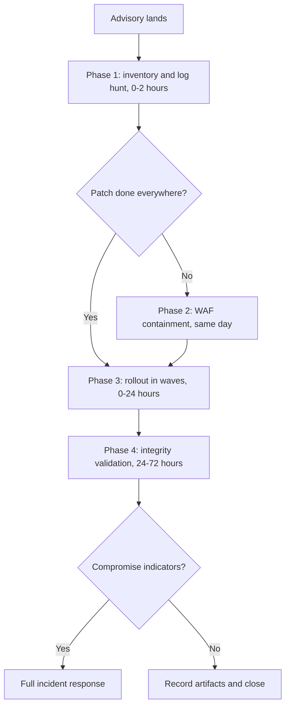

Ally shipped an unauthenticated SQL injection to 400,000+ WordPress sites, and exploit traffic arrived before many of them had updated. Plan for that order of events, because the next plugin will repeat it.

<!-- truncate -->

My call: treat an incident like this as a rehearsal template. Teams that set up detection, virtual patching, WAF controls and a structured rollout before the advisory lands can turn it into a contained maintenance event. Teams that start the plan after the advisory are writing it while the scanners are already sending requests.

Two terms carry this post. SQL injection (SQLi) means a request can insert its own SQL into a database query the plugin builds, and "unauthenticated" means the attacker does not need to log in first. A WAF (web application firewall) filters HTTP requests before they reach WordPress, and virtual patching means blocking the exploit pattern at that layer while the real fix rolls out.



## Incident snapshot

- Plugin: Ally (formerly Pojo Accessibility), slug `pojo-accessibility`.
- Footprint: 400,000+ active installations at the time of disclosure.
- Vulnerability class: unauthenticated SQL injection.
- Public tracking: CVE-2026-2413.
- Fixed release: 4.1.1.

Wordfence reported live exploitation attempts and released a firewall rule before many sites had updated the plugin. That is the pattern to plan for: exploit traffic starts before your patch campaign reaches full coverage.

## Four factors behind the risk

SQLi severity was one part of it. The risk came from four facts landing together:

| Factor | Effect |
| --- | --- |
| No authentication required | Any anonymous request can attempt the exploit |
| Large installed base | Broad scanning pays off for attackers |
| Used across production SMB and agency portfolios | Many owners, uneven maintenance |
| WordPress auto-update variance | Many sites lag even after a fix ships |

Auto-updates are on in theory. In practice a fix reaches a fleet on each site's own schedule, and the attacker does not wait for the slowest one.

My position: injection bugs in internet-facing plugins are patch-SLA events, meaning they get a committed patch deadline (a service-level agreement). They do not go in the backlog.

## Phase 1: Detection and exposure scoping (0-2 hours)

Start with the inventory, because nothing else can be prioritized without it.

### Inventory impacted sites

```bash
# WP-CLI across fleet hosts (adapt to your orchestration)
wp plugin list --format=json | jq -r '.[] | select(.name=="pojo-accessibility") | [.name,.version,.status] | @tsv'
```

Sort every site into one of three buckets right away:

| Bucket | Meaning |
| --- | --- |
| Vulnerable and active | Exposed now, first in line |
| Vulnerable but inactive | Code is on disk, still needs the update |
| Fixed version deployed | 4.1.1 or later confirmed |

### Hunt for SQLi-like request patterns

In edge or origin logs, look first at:

- unusual query-string payloads (`UNION`, `SELECT`, `SLEEP(`, encoded quotes),
- spikes to plugin-exposed endpoints,
- repeated probes from rotating IPs with similar payload structure.

Example grep:

```bash
grep -Ei "union|select|sleep\\(|%27|%22|information_schema" /var/log/nginx/access.log | tail -n 200
```

Treat each match as a lead to investigate. Words like `select` also appear in normal query strings, so confirm a match against the plugin endpoints and the payload structure before you call it an attack.

### Look for post-exploitation signals

You will not have full forensic certainty at this stage. Check these anyway:

- unexpected admin users,
- capability changes,
- modified plugin or theme files in recent time windows,
- new scheduled tasks or unexpected outbound callbacks.

## Phase 2: Virtual patching and WAF containment (same day)

WordPress fleets win or lose incidents here. Without WAF-first containment, the plan amounts to hoping every client clicks Update before the scanners arrive. When the rollout cannot finish right away, apply compensating controls:

1. Enable or verify managed WAF signatures for known exploit patterns tied to the incident.
2. Add temporary custom rules for suspicious parameter patterns and high-risk paths.
3. Apply rate limits or challenges on anomalous bursts targeting the plugin attack surface.
4. Throttle by geo or IP where business context permits.

The goal is to push exploit success probability close to zero while patching proceeds. Teams with this layer absorb disclosure spikes. Teams without it depend on update speed alone.

## Phase 3: Update rollout in waves (0-24 hours)

A random rollout order helps only the attacker. Roll in waves, worst exposure first:

| Wave | Scope |
| --- | --- |
| 1 | Internet-facing production with the highest traffic and weakest auth posture |
| 2 | Remaining production and the client long tail |
| 3 | Staging and dev mirrors |

Gate each wave with health checks after deploying 4.1.1:

- run synthetic availability checks,
- verify critical frontend and admin flows,
- watch DB and PHP error rates,
- confirm plugin version state through WP-CLI or telemetry.

To verify the wave is done, rerun the Phase 1 inventory command. Every site that has the plugin should report version 4.1.1 or later and land in the fixed bucket.

:::tip[Freeze unrelated changes]
During the emergency rollout, hold unrelated plugin and theme deployments. They complicate rollback and root-cause analysis. The middle of an incident is the wrong time to work out which of two deploys broke the site.
:::

## Phase 4: Integrity validation (24-72 hours)

Updating to 4.1.1 closes the hole. It does not delete an admin account that was created through it. After containment and patching:

1. Validate user and role integrity, and revoke suspicious sessions.
2. Rotate privileged credentials where compromise cannot be ruled out.
3. Review modified files against known-good baselines.
4. Capture incident artifacts: timeline, indicators, blocked requests, patch completion.

:::warning[Indicators change the process]
If you find compromise indicators, run full incident response. Vulnerability management alone is no longer enough.
:::

## Controls to standardize now

A runbook written during the incident is a diary. Write these as policy before the next advisory:

- SLA tiers: unauthenticated RCE or SQLi in active plugins gets the emergency patch SLA.
- Fleet visibility: a central plugin inventory by version and status.
- Virtual patching: pre-approved WAF runbooks for SQLi classes.
- Rollout governance: a canary and wave deployment template for plugin emergencies.
- Detection: saved log queries for injection strings and endpoint anomalies.

The plugin name will change next time. The failure mode will not.

## Checklist for the next plugin advisory

- [ ] Run the fleet inventory and sort sites into the three buckets.
- [ ] Run saved log queries for injection strings and endpoint spikes.
- [ ] Check for new admins, capability changes, modified files, new scheduled tasks.
- [ ] Confirm managed WAF signatures are active, add temporary rules and rate limits.
- [ ] Deploy the fix in waves, with health checks gating each wave.
- [ ] Freeze unrelated plugin and theme deployments until the rollout ends.
- [ ] Validate users and roles, rotate privileged credentials where needed, diff files against baselines.
- [ ] Record the timeline, indicators, blocked requests and patch completion.

## Sources

- [Wordfence incident write-up and remediation version context](https://www.wordfence.com/blog/2026/03/400000-wordpress-sites-affected-by-actively-exploited-unauthenticated-sql-injection-vulnerability-in-ally-plugin/)
- [WordPress.org plugin page (install base and release context)](https://wordpress.org/plugins/pojo-accessibility/)
- [Wordfence vulnerability intelligence record for CVE-2026-2413 (CVE and version references)](https://www.wordfence.com/threat-intel/vulnerabilities/wordpress-plugins/pojo-accessibility/ally-410-unauthenticated-sql-injection-via-alyd_determine-cve-2026-2413)
