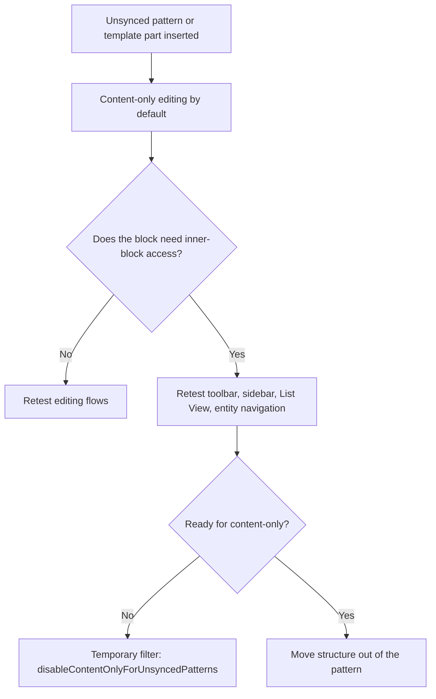
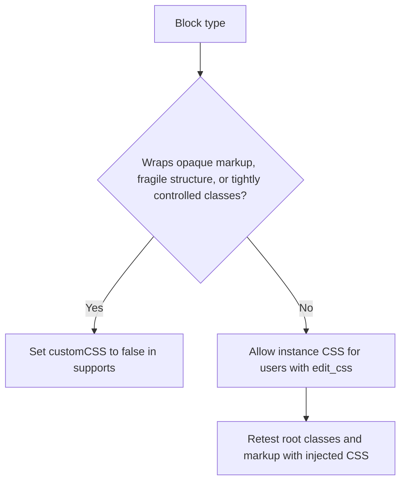

WordPress 7.0 ships five block-editor changes that look small in a changelog and can still break custom patterns, mislead teams about hidden content, and let editors inject CSS into blocks that were never built for it. The dev notes landed on March 15, 2026, and they cover content-only pattern editing, viewport-based block visibility, per-block custom CSS, expanded dimensions support and native text indent. The good news is that several of them let plugin and theme teams delete custom UI and CSS they have been carrying for years.

<!-- truncate -->

## The five changes at a glance

None of these is a platform shift like the Interactivity API or the collaboration work. They change what editors can do without custom code, and what block authors need to opt into or out of.

| Change | What core added | Main developer risk |
|---|---|---|
| Pattern editing | Unsynced patterns and template parts default more often to content-only editing | Custom blocks and editor extensions that assume full inner-block editing can break or confuse users |
| Block visibility | Viewport-based show and hide rules for desktop, tablet and mobile | Teams treat presentation rules as access control, or skip testing the hidden state |
| Per-block custom CSS | Instance-level CSS in the block inspector, gated by `edit_css` | Wrapper blocks expose unsafe or misleading styling surfaces unless they opt out |
| Dimensions support | Width, height and dimension size presets | Drift in `theme.json` tokens and inconsistent block support configuration |
| Text indent | Native `textIndent` typography support | Legacy CSS overrides conflict with the new block support |

## Pattern editing: content-only is the new default

The pattern-editing dev note says unsynced patterns and template parts inserted into the editor now default to content-only editing more broadly. If your block expects editors to reach inner blocks, reorder children or use block-level controls inside a pattern, retest those flows. Core names toolbar controls, sidebar panels, List View visibility and entity navigation as areas that behave differently without full block access.



Core provides an escape hatch for projects that are not ready:

```php
add_filter( 'block_editor_settings_all', function( $settings ) {
    $settings['disableContentOnlyForUnsyncedPatterns'] = true;
    return $settings;
} );
```

:::tip[Treat the filter as temporary]
The filter makes the old flows work again, which proves that the filter works and tells you nothing about the pattern. My call: if a pattern only works when editors can reach every inner block, it carries too much structure. Move that structure out, then remove the filter.
:::

## Block visibility: presentation, not authorization

WordPress 7.0 lets blocks be shown or hidden per device class, and the dev note documents `mobile`, `tablet` and `desktop` visibility state in block metadata. Editorial teams need fewer one-off responsive utility classes and duplicate pattern variants. Plugin authors can ship curated patterns that carry visibility metadata out of the box.

| Question | What the dev note describes |
|---|---|
| Where the rule lives | Block metadata with `mobile`, `tablet` and `desktop` state |
| How it works | CSS-driven viewport behavior |
| What it protects | It is not described as a permission or data-protection boundary |

:::warning[Hidden is not protected]
A block hidden on mobile stays away from mobile readers, as long as none of them opens the page source. This is my reading of the dev note, which describes metadata and CSS behavior and says nothing about permissions. Sensitive content still needs server-side or capability-based protection.
:::

The migration risk is mostly about meaning:

- Audit any custom block inspector UI that already offers responsive hide and show.
- Check whether your patterns or reusable blocks duplicate visibility logic that core now provides.
- Verify List View and editor affordances if your plugin adds custom block actions.

## Per-block custom CSS: decide block by block

Editors can now add CSS to individual block instances in the block inspector. The CSS is stored in `style.css`, needs no selector, is gated by the `edit_css` capability, applies live in the editor, and can override both defaults and Global Styles block-type CSS. That removes a lot of theme and agency workaround code, and it gives every block author a new question: should this block expose instance-level CSS at all?



If the answer is no, core provides the opt-out:

```json
{
  "supports": {
    "customCSS": false
  }
}
```

I would disable it on blocks that wrap opaque markup, render fragile structures or depend on tightly controlled class output. Leave it on for those, and the support queue changes topic from "how do I style this block?" to "why did my injected CSS break this block?"

## Dimensions: one size palette in theme.json

The dimensions dev note matters more to theme authors than its changelog line suggests. Blocks can opt into width and height controls, and `theme.json` gets `settings.dimensions.dimensionSizes` presets, so a theme defines a controlled size palette once and blocks consume it consistently.

```json
{
  "supports": {
    "dimensions": {
      "width": true,
      "height": true
    }
  }
}
```

The hard part is governance, not syntax. If sizing tokens already live in block styles, editor CSS and bespoke controls, that is three sources of truth for a width, and 7.0 adds a fourth unless the first three move. My call: consolidate them into `theme.json` presets now instead of extending them further.

## Text indent: delete the workarounds

WordPress 7.0 adds native `textIndent` block support, and the Paragraph block is the first core adopter. Core calls it a long-requested typography capability and positions it as native support that avoids custom CSS. The value for maintainers is what they get to delete:

- custom editor styles that exist only for first-line indentation
- frontend-only CSS that does not round-trip through the editor
- block variations created only to simulate indentation options

If your block needs the control, opt in through typography support and retire the one-off style UI.

## Migration checklist

The more editorial behavior lives in core block supports and `theme.json` settings, the less upgrade debt a project carries. Run this before shipping WordPress 7.0 support in a plugin, theme or agency distribution:

- [ ] Test all custom patterns with content-only editing enabled, especially patterns containing Buttons, List, Social Icons, Navigation or custom container blocks.
- [ ] Review editor extensions that depend on toolbar buttons, sidebar panels, List View or entity navigation inside patterns.
- [ ] Remove or deprecate plugin-provided responsive block visibility UI that core now covers.
- [ ] Confirm no team uses viewport visibility for content protection. Replace that assumption with capability or rendering controls where needed.
- [ ] Decide block by block whether instance custom CSS is allowed. Add `"customCSS": false` where it is not.
- [ ] Retest wrapper and dynamic blocks whose root classes or markup can be destabilized by injected per-instance CSS.
- [ ] Define shared dimension size presets in `theme.json` so width and height do not become another place for arbitrary values to spread.
- [ ] Audit legacy CSS for paragraph indentation and replace it with `textIndent` support where appropriate.
- [ ] Run editor smoke tests on existing production content and on new content creation flows. These changes affect authoring behavior as much as rendering.

## Sources

- [Pattern Editing in WordPress 7.0 (Make WordPress Core, March 15, 2026)](https://make.wordpress.org/core/2026/03/15/pattern-editing-in-wordpress-7-0/)
- [Block Visibility in WordPress 7.0 (Make WordPress Core, March 15, 2026)](https://make.wordpress.org/core/2026/03/15/block-visibility-in-wordpress-7-0/)
- [Custom CSS for Individual Block Instances in WordPress 7.0 (Make WordPress Core, March 15, 2026)](https://make.wordpress.org/core/2026/03/15/custom-css-for-individual-block-instances-in-wordpress-7-0/)
- [Dimensions Support Enhancements in WordPress 7.0 (Make WordPress Core, March 15, 2026)](https://make.wordpress.org/core/2026/03/15/dimensions-support-enhancements-in-wordpress-7-0/)
- [New Block Support: Text Indent (textIndent) (Make WordPress Core, March 15, 2026)](https://make.wordpress.org/core/2026/03/15/new-block-support-text-indent-textindent/)
