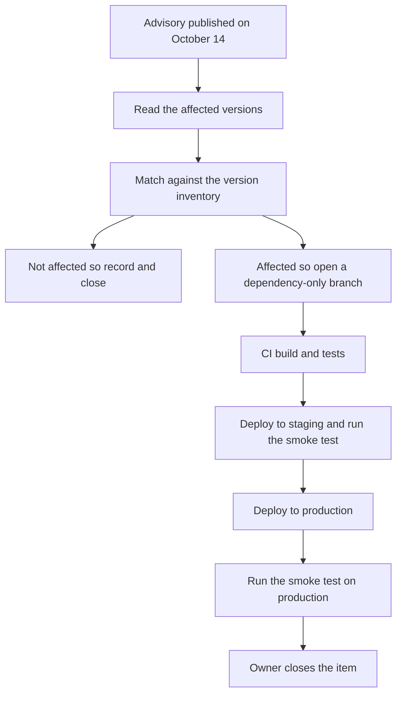

Next.js plans an out-of-band security update on Wednesday, October 14, 2026, for three vulnerabilities in upstream dependencies: two Critical and one High. Out-of-band means outside the regular release schedule. The affected versions arrive only with the update, so my call is to prepare now: list every Next.js app, name an owner, dry-run a dependency-only deploy and write the smoke test before the advisory is published.

<!-- truncate -->

## The announced release

Next.js posted the notice on Thursday, October 8, 2026. It gives teams a release date and severity counts, with affected versions and upgrade instructions due alongside the update.

"Upstream dependencies" are the packages Next.js itself depends on. The announcement still ships the fix as a Next.js update, so each app's installed Next.js version is the thing to check.

| Item | What the announcement says | What I would do before Wednesday |
| --- | --- | --- |
| Date | October 14, 2026 | Book the release window and one owner per app |
| Severity | Two Critical and one High | Plan the upgrade for the same day |
| Scope | Upstream dependencies | Include every Next.js app in the inventory |
| Affected versions | Published with the update | Record the installed version of each app now |
| Upgrade path | Published with the update | Dry-run a dependency-only deploy through the pipeline |

Two rows say "published with the update". Until Wednesday, nobody can rule out a single app, so the inventory has to cover all of them.

## Planning around the release date

Announcing the date before the details is a big-vendor practice I would keep at any team size. It costs the reader nothing and gives a small team time to book what it needs:

- The release window on October 14.
- A named owner for each app, with a backup.
- Any approval that normally needs a meeting, granted in advance for a dependency-only change.

## Two of the fixes were postponed from September

Next.js says upstream coordination delayed two fixes planned for September. A team that upgraded in September closed the right ticket. That ticket now describes a version that is still waiting on two of these fixes.

My proposal is to use the September upgrade as the starting point for an inventory. One pass through the repositories records each app's installed Next.js version from its lockfile (the file that pins the exact installed package versions), along with the owner and the deploy target. The cost is that pass, and the check is a table with a version in every row before Wednesday.

## A release process that supports same-day updates

The instruction is "Upgrade to a patched version as soon as the update is available." Taken at its word, it assumes a team can ship a framework bump to production on the day it appears. A pipeline that deploys only at the end of a sprint will read "as soon as" as "at the end of the sprint", and the vulnerabilities will wait politely in the meantime.

The fix I would adopt this week is a dependency-only change path: one branch with the version bump and the lockfile, the normal CI run, staging, then production. Its limitation is that it skips feature review, so it must carry nothing else. The check is a dry run that sends the current, unchanged version through the same path and reaches staging.

:::warning[Ship the patch alone]
Freeze feature merges for each affected app until the patched version is on production and the smoke test passes. If something breaks, a release with one change has one suspect.
:::

## A green build only proves the build

CI tells me the app compiles and the existing tests pass with the new dependencies. It can report success while the sign-in page fails, and in that case the pipeline has protected the build and nobody else.

The fix is a smoke test per app, written this week. A smoke test is a short check of the flows a user hits first. A person or a script runs it on production after the deploy:

- Load the home page and one dynamic page.
- Sign in, if the app has accounts.
- Submit the main form or complete the main transaction.
- Check the server logs for new errors after the deploy.

If an app already has `Playwright` tests for these flows, I would point them at production instead of writing new ones. The limitation is coverage: the list catches what a user notices first, and it will miss some regressions.

## The release-day runbook

I build React and Next.js interfaces and CI/CD pipelines, so this is the order I would run on October 14.

Each app has one owner from the first box to the last. The item stays open until the production smoke test passes, because a merged pull request says nothing about the sign-in page.

:::tip[Write down the negative result]
When an app is not affected, record the installed version and the advisory it was checked against. The next person who asks will not have to repeat the check.
:::

## Evidence that would change my plan

- If the advisories show that none of my installed versions are affected, the cost was an inventory and a dry run. Both stay useful for the next release.
- If the upgrade instructions require more than a version bump, the dependency-only path is too narrow. I would plan that app as a normal release with its own review.

## Checklist before October 14

- [ ] Every Next.js app is listed with its installed version, owner and deploy target.
- [ ] A dry run sent the current version through the dependency-only path to staging.
- [ ] Approvals for a dependency-only production deploy are granted in advance.
- [ ] Each app has a written smoke test that runs on production.
- [ ] Feature merges are frozen for the release window.
- [ ] One person reads the advisories on October 14 and matches them against the inventory.

## References

- [Upcoming Next.js Security Update for Upstream Vulnerabilities](https://nextjs.org/blog/upcoming-nextjs-security-update-october-2026), Next.js blog, October 8, 2026.
