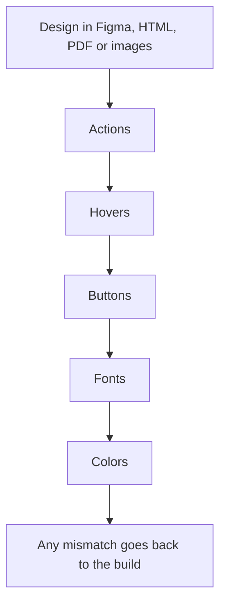

An automated AI review passed front-end work that had missing interactions, no hover states, colors that did not match the design and a laggy page. I think the LLM reviewer is wrong in its concept. It should work like a QA engineer and check the implemented page against the design, so I set up a front-end testing procedure that validates the work from the mockup, step by step.

<!-- truncate -->

## What I kept seeing

I use Claude and Codex across different jobs. When I give them a design to build from, in any form (Figma, HTML, a PDF or images), the development and the QA are not done well, and not the way a human would do them.

In the work I reviewed:

- Front-end interactions were not implemented.
- There were no hover states.
- Colors on elements did not match the design.
- The page was laggy.

The automated review still passed it. The only part of that delivery that behaved exactly as designed was the green check. Every item on the list shows up when a person uses the page with the design open next to it. That is the check the review did not do.

## Why a code review passes this

Reading the code alone does not show whether the rendered page behaves and looks like the mockup. The failures I found sit on the screen, so the check has to look at the screen.

| Failure I found | Where it shows | Step that checks it |
|---|---|---|
| Interactions not implemented | Using the page | Actions, buttons |
| No hover states | Pointer over each element | Hovers |
| Colors did not match the design | Page next to the mockup | Colors |
| Page was laggy | Using the page | Proposed lag check, see below |

A review that reads code to approve a design is a test with no assertions about the screen: it runs, it passes, and the missing hover state is still missing. The reviewer needs a different job. It should work like a QA engineer and run a QA check on the implemented work against the design.

## The procedure I set up

The procedure validates the work from the mockup, step by step: actions, hovers, buttons, fonts, colors.

The last box is my proposal for what happens on a mismatch. The intent of each step, as I would describe it:

- Actions: the interactions the design shows are implemented on the page.
- Hovers: the hover states in the design exist on the page.
- Buttons: the buttons on the page match the design.
- Fonts: the fonts on the page match the mockup.
- Colors: element colors match the design.

## A proposal for lag

The page was laggy, and the review still passed it. A reviewer that only reads code never waits on the page, so lag is the failure it is least likely to notice.

:::warning[Add a lag check]
My call: add a lag check after colors, because the page was laggy and the review still passed it. Use the page the way a person would and fail the check if it is laggy. It costs time on every page reviewed, and it is working when a laggy page can no longer get a pass.
:::

## What would change my mind

I keep using these tools across jobs. The change I want is in what the reviewer has to prove before a page passes.

If an automated reviewer opens the rendered page, compares it to the mockup and catches the failures in the table above, I would let it own those steps. Until it does, my call is a named person who owns the five steps and signs off on them.

## Checklist for Monday

- [ ] Open the last page an AI review approved, with its design next to it.
- [ ] Trigger every action the design shows.
- [ ] Hover over each element that has a hover state in the design.
- [ ] Click every button.
- [ ] Compare fonts and element colors to the mockup.
- [ ] Use the page and note whether it is laggy.
- [ ] Send any mismatch back to the build before the review counts as a pass.

## What I learned

- A passed automated review did not tell me whether the page matched the design.
- The design is the test plan in whatever form it arrives: Figma, HTML, a PDF or images.
