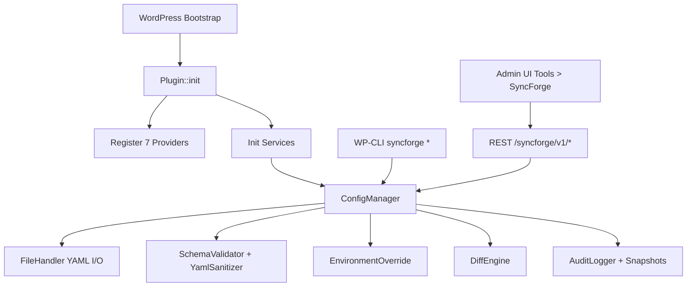
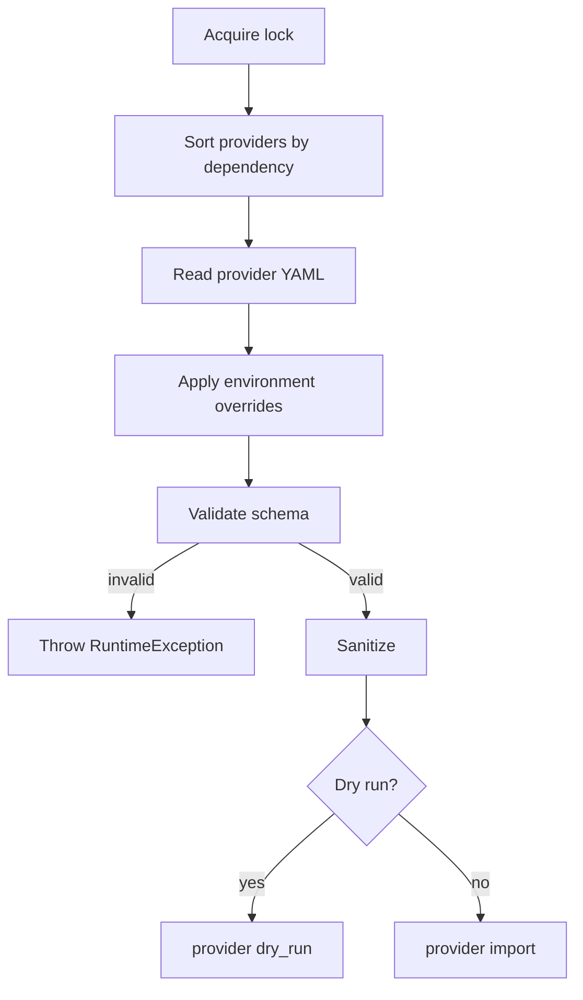

import Tabs from '@theme/Tabs';
import TabItem from '@theme/TabItem';

WordPress site configuration usually lives in `wp-admin` and in the memory of whoever changed it last. I built **SyncForge Config Manager** to export that configuration to YAML, diff it, import it with guardrails and roll it back when a release goes wrong. The YAML is the boring part; the value is one deterministic workflow across the admin UI, REST and WP-CLI, instead of three interfaces that behave almost the same.

<!-- truncate -->

<details>
<summary>TL;DR</summary>

- Seven providers map config domains (options, roles, menus, widgets, theme mods, rewrite rules, block patterns) between the database and YAML files.
- `ConfigManager` runs export, import, diff and rollback for admin, REST and WP-CLI through the same path.
- Every import goes through lock, dependency sort, env overrides, schema validation and sanitization before dry-run or import.
- Two known gaps: capability checks differ between REST and admin, and the docs still name an old config path.

</details>

## Configuration drift and the database dump

Configuration drift means two environments that should match no longer do, and nothing in the release process recorded the change. A database dump is not config management. It is mostly a panic button.

The drift that hurts teams is the kind normal release pipelines do not track:

- options changed in `wp-admin`
- theme mods changed in one environment only
- widget trees drifting without anyone noticing
- rewrite config that differs after one plugin update

For example, suppose a theme mod changes on staging only. Production keeps the old value, the deploy goes green, and the difference shows up later as a page that looks wrong in one place.

> "Export, import, and sync WordPress site configuration as YAML files across environments."
>
> - SyncForge Config Manager README, [GitHub](https://github.com/victorstack-ai/config-sync/blob/main/README.md)

## Building a plugin instead of installing one

The first question was whether a maintained WordPress plugin already did this. I did not find one that combined the pieces that matter in delivery work.

| Requirement | What it replaces |
|---|---|
| Provider-based exports | One giant opaque blob |
| Diff, dry-run and rollback in one workflow | Separate tools, or hope |
| Roles, menus, widgets, theme mods, rewrite rules, block patterns | Options-only sync |
| One orchestration path for admin, REST and WP-CLI | Three interfaces with their own edge cases |

That gap is the only reason the plugin exists. If a maintained plugin had covered those boundaries, writing another one would have been waste.

## One path for three interfaces

The plugin boots a container, registers providers, then hands every operation to `ConfigManager`. A provider owns one config domain, such as menus or roles, and defines how that domain maps between database state and YAML files.



The admin UI goes through REST, and REST and WP-CLI both land on `ConfigManager`. A bug fixed there is fixed in all three places, which is the whole argument for the design.

<Tabs>

<TabItem value="cli" label="WP-CLI Path" default>

```bash title="real commands from src/CLI/*.php"
wp syncforge export
wp syncforge diff --format=json
wp syncforge import --dry-run
wp syncforge import --yes
wp syncforge status
wp syncforge discover --track-all
```

</TabItem>

<TabItem value="rest" label="REST/Admin Path">

```bash title="real routes from src/Rest/*.php"
/wp-json/syncforge/v1/export
/wp-json/syncforge/v1/import
/wp-json/syncforge/v1/diff
/wp-json/syncforge/v1/snapshots
/wp-json/syncforge/v1/rollback/{id}
/wp-json/syncforge/v1/discover
```

</TabItem>

</Tabs>

## The import pipeline in ConfigManager

`ConfigManager` runs imports in a fixed order, and nothing reaches a provider without passing validation and sanitization first. A dry-run is the same pipeline with a different last step: the provider reports the result through `dry_run()`, and `import()` is never called.



The per-provider step is below. The two highlighted lines are the ones that matter: environment overrides are applied before validation, so an override cannot slip past the schema, and sanitization runs before the provider sees the data.

```php title="syncforge-config-manager/src/ConfigManager.php" showLineNumbers
private function do_import_provider( Provider\ProviderInterface $provider, bool $dry_run ): array {
	$config = $this->read_provider_config( $provider );

	// highlight-next-line
	$config = $this->container->get_environment_override()->apply_overrides( $provider->get_id(), $config );

	$validation = $this->container->get_schema_validator()->validate( $provider->get_id(), $config );

	if ( is_wp_error( $validation ) ) {
		throw new \RuntimeException(
			sprintf(
				esc_html__( 'Validation failed for provider %1$s: %2$s', 'syncforge-config-manager' ),
				esc_html( $provider->get_id() ),
				esc_html( $validation->get_error_message() )
			)
		);
	}

	// highlight-next-line
	$config = $this->container->get_yaml_sanitizer()->sanitize( $config, $provider->get_id() );

	if ( $dry_run ) {
		return $provider->dry_run( $config );
	}

	return $provider->import( $config );
}
```

If the config fails validation after overrides are applied, `ConfigManager` throws a `RuntimeException` that names the provider and the validation error, and that provider's data never reaches `import()`. This method handles one provider and contains no rollback of its own; how the caller handles a failure is outside this excerpt. Before relying on a multi-provider import, confirm whether a failed provider leaves earlier providers written, and confirm a snapshot exists so the rollback route has a target.

## Option discovery without a hardcoded plugin list

A hardcoded list of plugin options is out of date the day after the next plugin install. Discovery classifies option keys by pattern instead, then groups them by plugin slug, or under `misc` when ownership is ambiguous.

```php title="syncforge-config-manager/src/Admin/OptionDiscovery.php" showLineNumbers
private const RUNTIME_KEYWORDS = array(
	'_version',
	'_db_version',
	'_migration',
	'_nonce',
	'_session',
	'_token_',
	'_count',
	'_dismissed',
	'_telemetry',
	'_last_run',
	'_children',
	'_site_health',
);

private const RUNTIME_SUFFIXES = array(
	'_state',
	'_rat',
	'_pubkey',
	'_auth',
	'_install',
);
```

These patterns keep runtime state such as nonces, sessions, counters and version markers out of the YAML. WordPress hides a lot of mutable state in options, so this filter decides whether the export is config or noise.

Suppose a key containing `_last_run` changes each time its job runs. If that key were committed, every export after a job run would show a new diff line. In my judgment, a diff that is always noisy is a diff people stop reading.

## Providers and their dependencies

Each provider declares what it depends on, which lets `ConfigManager` run a topological sort: an ordering where every provider runs after the providers it depends on. Menus, widgets, theme mods and rewrite rules all wait for `options`.

| Provider ID | Dependency | File strategy |
|---|---|---|
| `options` | none | fixed files (`options/general.yml`, etc.) + dynamic extra groups |
| `roles` | none | dynamic directory (`roles/{role}.yml`) |
| `menus` | `options` | directory (`menus/`) |
| `widgets` | `options` | directory (`widgets/`) |
| `theme-mods` | `options` | single file (`theme-mods.yml`) |
| `rewrite` | `options` | single file (`rewrite.yml`) |
| `block-patterns` | none | directory (`block-patterns/`) |

## The rename to SyncForge

The project moved from generic `config-sync` branding to `syncforge-config-manager`. The plugin header and docs reflect it.

```diff
-=== Config Sync ===
+=== SyncForge Config Manager ===
-Contributors: victorstack-ai
+Contributors: victorjimenezdev
-Text Domain: config-sync
+Text Domain: syncforge-config-manager
-Plugin Name: Config Sync
+Plugin Name: SyncForge Config Manager
```

<details>
<summary>Supplementary: security controls implemented in code</summary>

- `FileHandler::resolve_safe_path()` rejects traversal before file access.
- ZIP import rejects entries containing `..` and only extracts `.yml`.
- `YamlSanitizer` rejects serialized object payload patterns.
- `AuditLogger` redacts secret-looking keys before storing snapshots/diffs.
- Config directory gets `.htaccess`, `index.php`, and `web.config` deny files.

</details>

## Known gaps

Two things are not finished, and both are drift of the kind the plugin exists to catch. The code defaults to `wp-content/syncforge-config-manager`, while the docs still mention `wp-content/config-sync/`. A config drift tool with drift between its code and its docs is a fair live demonstration of the problem.

:::caution[Capability model is split]
REST checks `manage_config_sync`, while parts of admin and ZIP handling check `manage_options`. If you run this with delegated ops roles, unify the capability checks before someone finds an action that works in one interface and is blocked in another.
:::

## Dry-run as a release gate

The tooling is there. What is missing is the habit of running it before production, and no plugin ships that.

:::tip[Use dry-run as a release gate]
Make `wp syncforge diff` and `wp syncforge import --dry-run` mandatory in staging before any production import. If the diff is not reviewed, the import does not run.
:::

## Release checklist

- [ ] Run `wp syncforge export` and commit the YAML.
- [ ] Run `wp syncforge diff --format=json` in staging and read it.
- [ ] Run `wp syncforge import --dry-run` and confirm no validation errors.
- [ ] Confirm a snapshot exists under `/wp-json/syncforge/v1/snapshots` so rollback has a target.
- [ ] Check which config directory the site uses: the code default, not the old docs path.
- [ ] Check that the user running the import has both `manage_config_sync` and `manage_options`.
- [ ] Run `wp syncforge import --yes` in production.

## Lessons from the build

- Provider contracts beat one giant "sync everything" routine. Dependencies are explicit and sortable.
- The lock model (`config_sync_lock` in `wp_options`) is plain and good enough for admin and CLI concurrency.
- WordPress stores mutable state in runtime options, so classification, sanitization and rollback have to be strict for this to work outside demos.

## References

- [View Code](https://github.com/victorstack-ai/config-sync)
- [Project README](https://github.com/victorstack-ai/config-sync/blob/main/README.md)
- [Main Plugin Bootstrap](https://github.com/victorstack-ai/config-sync/blob/main/syncforge-config-manager/syncforge-config-manager.php)
