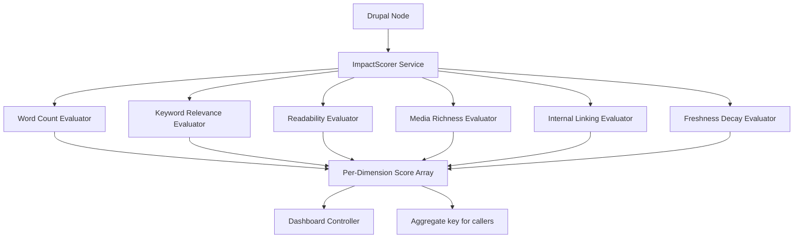

import Tabs from '@theme/Tabs';
import TabItem from '@theme/TabItem';

Version one of Drupal AI Content Impact Analyzer returned one opaque number, which told editors how a page scored and nothing about why. It was a minimal proof of concept with a single scoring function, no tests and no documentation worth mentioning, so it proved the idea worked but not that editors could use it. Version two rewrites the core into a scoring engine with six dimensions, and each one tells the editor what to fix.

<!-- truncate -->

## From one number to six dimensions

The original `ImpactScorer` returned a single number. A score of 42 is a verdict without a reason, and the editor has to guess which part of the page earned it. The new version scores every node (Drupal's name for a content item, such as an article or a page) on six measurable dimensions.

- **Word count:** raw content length. Thin pages underperform, and editors need to see that as a number.
- **Keyword relevance:** term-frequency scoring, which measures how often the terms from a configurable keyword list appear in the content.
- **Readability:** sentence-length analysis that flags walls of text without pulling in external NLP (natural language processing) libraries.
- **Media richness:** counts `img`, `iframe`, `video` and `audio` elements, so pages that go beyond plain text score higher.
- **Internal linking:** measures how well a node connects to the rest of the site's content graph.
- **Freshness decay:** a 180-day linear decay function. Content older than six months with no updates loses points in proportion to its age.



The service returns a score for each dimension instead of collapsing them into one number. "Your content scored 42" becomes "your content scored low on internal linking and freshness, and this is what to improve."

| | v1 | v2 |
|---|---|---|
| Return type | `int` | Keyed `array` |
| What the editor sees | One aggregate score | Six dimension scores plus the aggregate |
| Tests | None | 11 PHPUnit tests |
| Existing callers | Expect an integer | Must read the `aggregate` key |

## Tech stack: Drupal, PHP and PHPUnit

Nothing in the stack needs a network call to score a page. Drupal services, PHP and PHPUnit cover all of it.

| Component | Technology | Why |
|---|---|---|
| CMS | Drupal 10/11 | Target platform, hooks + services architecture |
| Scoring | PHP `ImpactScorer` service | Deterministic per node and time, no LLM calls in the critical path |
| Testing | PHPUnit (11 tests) | Every scoring dimension tested in isolation |
| UI | Drupal admin dashboard controller | Editors see results without leaving the CMS |
| License | MIT | Open for adoption |

## Architecture: same module, new return shape

This is still a Drupal module. Hooks, an action plugin and a dashboard controller connect it to the admin UI, and the `ImpactScorer` service runs the six evaluations and returns a keyed array. The return type changes from an integer to an array, so callers must read the `aggregate` key or select a dimension.

:::tip[Score Each Dimension Independently]
A single composite number costs little to compute and gives an editor nothing to act on. With each dimension visible, the editor can pick the next task: add images, update stale pages or improve internal linking.
:::

<Tabs>
<TabItem value="before" label="Before (v1)" default>

```php title="src/ImpactScorer.php"
// Single opaque score - useless for editors
public function score(NodeInterface $node): int {
return $this->computeAggregate($node);
}
```

</TabItem>
<TabItem value="after" label="After (v2)">

```php title="src/ImpactScorer.php" showLineNumbers
// Per-dimension breakdown - actionable
public function score(NodeInterface $node): array {
return [
'word_count' => $this->evaluateWordCount($node),
'keyword_relevance' => $this->evaluateKeywords($node),
'readability' => $this->evaluateReadability($node),
'media_richness' => $this->evaluateMedia($node),
// highlight-next-line
'internal_linking' => $this->evaluateInternalLinks($node),
'freshness' => $this->evaluateFreshness($node),
'aggregate' => $this->computeAggregate($node),
];
}
```

</TabItem>
</Tabs>

The `aggregate` key retains a combined score. It does not preserve the old return type, so code expecting an integer needs an update before the upgrade ships.

## Test coverage for every dimension

Version one had no tests, so it never failed one. The upgrade ships with 11 PHPUnit tests that cover every scoring dimension in isolation. Word count, keyword matching, readability thresholds, media detection, link counting and freshness decay each have their own test cases.

<details>
<summary>Test coverage breakdown</summary>

| Test area | Assertions |
|---|---|
| Word count thresholds | Min/max content length scoring |
| Keyword matching | Term-frequency against configurable list |
| Readability | Sentence-length analysis boundaries |
| Media detection | img, iframe, video, audio element counting |
| Internal linking | Link count scoring |
| Freshness decay | 180-day linear decay calculation |
| Aggregate score | Combined score available in the array |

</details>

## No LLM in the critical path

For a module with AI in its name, the most dependable design choice is that scoring never calls an LLM (large language model) in the critical path, the code that runs every time a page is scored. Each dimension is computed from the node's data with no network call and no side effects, so the same node scored at the same moment always gets the same score. Freshness also depends on the page's age, which is why an untouched page loses points over time.

That design also keeps the module fast enough for real-time editorial dashboards, including on shared hosting. My call: any future model-based feature should sit outside this path, so the scores editors rely on stay deterministic.

## Freshness decay needs an editorial decision

The 180-day window treats every old page as a stale page. That fits news and guides, and it misjudges content that is meant to stay the same. For example, suppose a site has a seasonal page that is intentionally static: six months after its last edit it starts losing points, although nothing on it is wrong.

:::caution[Freshness decay is a 180-day linear function]
Content older than six months with no updates loses points in proportion to its age. If your editorial calendar has seasonal content that is intentionally static, adjust the decay window or exempt those content types.
:::

I would make that decision before rolling the dashboard out to editors. If editors start updating pages only to reset the timer, the score has stopped measuring freshness and started measuring obedience to the score.

## Checklist before you rely on the scores

- [ ] Run the PHPUnit suite and confirm all 11 tests pass.
- [ ] Open the admin dashboard and confirm a node shows six dimension scores, not one.
- [ ] Update callers to read the `aggregate` key and verify their output.
- [ ] Set the keyword list used for keyword relevance.
- [ ] List seasonal or intentionally static content types, then adjust the decay window or exempt them.

## References

- [View Code](https://github.com/victorstack-ai/drupal-ai-content-impact-analyzer)
