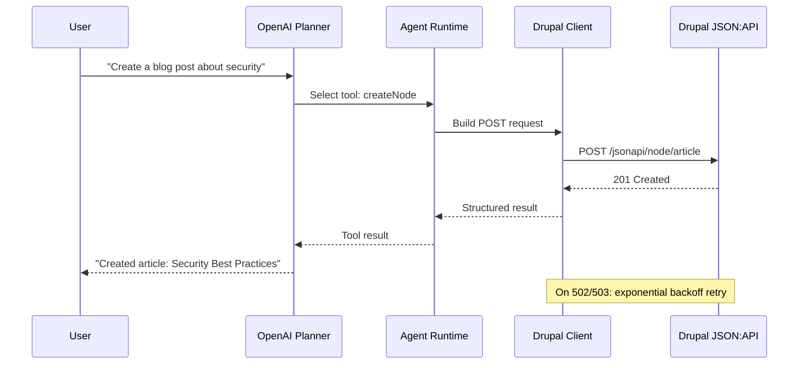
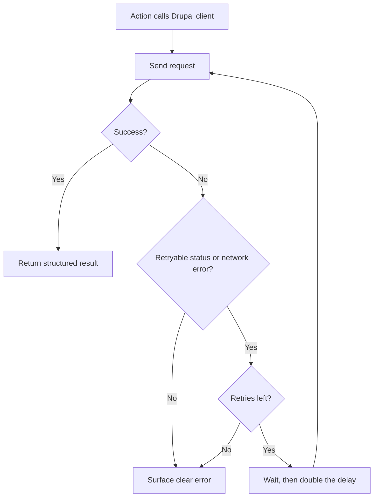

import Tabs from '@theme/Tabs';
import TabItem from '@theme/TabItem';

The first version of this Drupal agent could create, read and list nodes. That proved the concept, but it could not fix a typo in the content it had created. A content operations agent also needs update, delete, users, taxonomy and media, and it has to survive a flaky network, so retry logic now lives once in the HTTP client.

<!-- truncate -->

## Five new actions on top of the original three

Three actions were enough for a demo. Real content work also changes and removes things, so I added five actions that go through the same JSON:API client. JSON:API is Drupal's standard RESTful interface for content operations.

| Action | What it does |
|---|---|
| `updateNode` | Sends a PATCH request to change existing content |
| `deleteNode` | Sends a DELETE request to remove content |
| `listUsers` | Queries the Drupal JSON:API users endpoint |
| `listTaxonomyTerms` | Queries taxonomy term collections, so the agent can browse vocabularies |
| `uploadMedia` | Handles file uploads through Drupal's media system |

Every action follows one pattern: validate the inputs, build the request, call the Drupal client and return a structured result. The OpenAI planner sees each action as a tool, which is a function the model is allowed to call, and picks one from the user's intent. The diagram follows one prompt from the user to Drupal and back.



The note in the diagram names 502 and 503, the deploy errors. The client retries on a longer list of statuses and network errors, shown in the retry section below.

One correction for anyone reading the code: the original 3 plus the 5 new ones come to one short of the 9 that the tab label and the test table below claim. I would reconcile that count before adding another action, because the code, the tab label and the test table should describe the same set of actions.

## The stack uses standard parts

Nothing here is new infrastructure. The API is Drupal's standard JSON:API, and the agent is a Node.js client with a planner in front of it.

| Component | Technology | Why |
|---|---|---|
| Planner | OpenAI GPT | Picks the tool from natural language intent |
| Runtime | Node.js | Async HTTP and the JSON:API client |
| API | Drupal JSON:API | Standard RESTful interface for all content operations |
| Retry | Exponential backoff | Built for deployment windows and cache rebuilds; tested against mocks |
| Testing | Jest (24 tests, 4 files) | Mocked Drupal responses; wiring and orchestration, no real Drupal site |
| License | MIT | Open for adoption |

## Retry lives in the HTTP client

Drupal sites behind reverse proxies and CDNs return 502 and 503 during deployments and cache rebuilds. These are transient errors: the request fails now and can work a little later. An agent that quits on the first one works well on any site that never deploys.

The Drupal client now retries with exponential backoff, which means it waits before each new attempt and doubles the wait every time. These are the triggers:

| Trigger | Values |
|---|---|
| HTTP status | 408, 429, 500, 502, 503, 504 |
| Network error | DNS resolution failure (`ENOTFOUND`) and connection reset (`ECONNRESET`) |

In `requestWithRetry`, the default is 3 retries, and the delay doubles on each one. When the retries run out, the error goes back to the caller and the agent surfaces a clear error instead of hanging or throwing an unhandled exception.



:::caution[Drupal behind reverse proxies returns 502/503 during deployments]
Drupal sites behind reverse proxies and CDNs return 502 and 503 during deployments and cache rebuilds. An agent that gives up on the first transient failure is unusable in production. Put retry logic in the HTTP client layer, not in each action.

The client retries every method the same way, including the POST in `createNode`. If a 504 from the proxy or a connection reset (`ECONNRESET`) arrives after Drupal saved the node, a retry can create a second node. In my judgment, writes need a duplicate check before you trust retries on them.
:::

:::tip[Retry at the transport layer, not the action layer]
Every action goes through the same Drupal client, so transient error handling is defined once. I would keep retry handling in the client and check each write action for duplicate risk before using it.
:::

<Tabs>
<TabItem value="actions" label="All 9 Actions" default>

```javascript title="src/actions/index.js" showLineNumbers
const actions = {
  // Original 3
  createNode: require('./createNode'),
  readNode: require('./readNode'),
  listNodes: require('./listNodes'),
  // New 5
  // highlight-start
  updateNode: require('./updateNode'),
  deleteNode: require('./deleteNode'),
  listUsers: require('./listUsers'),
  listTaxonomyTerms: require('./listTaxonomyTerms'),
  uploadMedia: require('./uploadMedia'),
  // highlight-end
};
```

</TabItem>
<TabItem value="retry" label="Retry Logic">

```javascript title="src/drupalClient.js" showLineNumbers
async function requestWithRetry(config, retries = 3) {
  for (let attempt = 0; attempt <= retries; attempt++) {
try {
const response = await axios(config);
return response;
} catch (error) {
const status = error.response?.status;
// highlight-next-line
const retryable = [408, 429, 500, 502, 503, 504].includes(status)
|| error.code === 'ECONNRESET'
|| error.code === 'ENOTFOUND';

if (!retryable || attempt === retries) throw error;

const delay = Math.pow(2, attempt) * 1000;
await new Promise(r => setTimeout(r, delay));
}
  }
}
```

</TabItem>
</Tabs>

## The 24 mocked tests check wiring, not deploys

There are 24 tests across 4 files: `drupalClient.test.js`, `actions.test.js`, `agent.test.js` and `openAiPlanner.test.js`. They check HTTP method selection per action, retry behavior on transient errors, planner tool registration and end-to-end orchestration. Every new action has dedicated assertions.

All of them run against mocked Drupal responses, so they prove the agent agrees with its mocks. That is the right check for wiring and method selection, and it says nothing about a real proxy during a real deploy. My next step would be one run against a real Drupal site during a cache rebuild, because that is the failure the retry logic exists for.

<details>
<summary>Test file breakdown</summary>

| Test file | Coverage area |
|---|---|
| `drupalClient.test.js` | Retry logic, transient error handling, HTTP method selection |
| `actions.test.js` | All 9 actions: input validation, request building |
| `agent.test.js` | End-to-end orchestration with mocked Drupal |
| `openAiPlanner.test.js` | Tool registration, intent-to-action mapping |

</details>

## Repo files for a second person

The repo now ships the files a second person needs to run it:

- `.env.example` documents every required environment variable.
- An MIT `LICENSE`.
- A README with an ASCII architecture diagram of the flow from user prompt through the OpenAI planner to Drupal API actions.
- 7 usage examples in the README, covering each action type and common multi-step workflows.

## Checklist before adding the next action

- [ ] The new action calls the shared Drupal client and makes no HTTP calls of its own.
- [ ] The retryable statuses and network codes still match the list in `drupalClient.js`.
- [ ] Exhausted retries surface a clear error, not a hang.
- [ ] The action count in the code, the tab labels and the tests agrees.
- [ ] The action has dedicated assertions in `actions.test.js`.
- [ ] `.env.example` lists every variable the agent reads.

## References

- [View Code](https://github.com/victorstack-ai/drupal-cms-2-ai-agent-poc)
