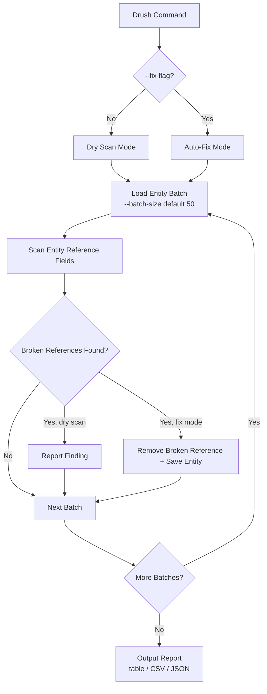
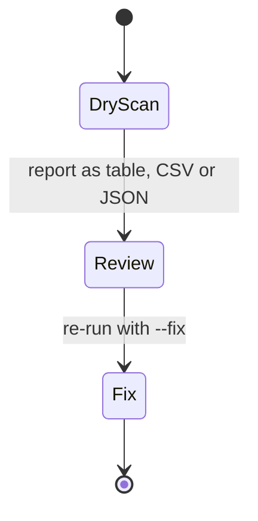

import Tabs from '@theme/Tabs';
import TabItem from '@theme/TabItem';

A scanner that only reports broken entity references hands you a well-formatted list of manual work. The first version of `drupal-entity-reference-integrity` did exactly that. This upgrade adds an opt-in auto-fix mode, batch processing for large sites and the tests needed to trust both in production.

<!-- truncate -->

<details>
<summary>TL;DR</summary>

- `drush entity-reference-integrity:scan` reports broken references as table, CSV or JSON.
- `--fix` removes them and saves the entities. It is opt-in, so the default run writes nothing.
- `--batch-size` (default 50) loads and processes entities in fixed-size cycles on large sites.
- 9 PHPUnit tests run on mocked entity storage, with no database.

</details>

## Changes in the upgrade

An entity reference field stores a pointer to another entity, such as a media item, a taxonomy term or a node. When the target is deleted and the field is not cleaned, the pointer stays and points at nothing. That is a broken reference.

The original module scanned these fields and printed a report. It was useful for audits and useless for remediation, because every broken reference still had to be fixed by hand.

| | First version | Upgraded module |
|---|---|---|
| Broken references | Reported | Reported, or removed with `--fix` |
| Fixing them | Manual editing, or exporting config and grepping YAML | The command cleans the field and saves the entity |
| Large sites | Not addressed | Processed in batches, 50 entities by default |
| Output | Table, CSV, JSON | Table, CSV, JSON |

The upgrade adds two capabilities:

- **Auto-fix mode.** Pass `--fix` to the Drush command and the module removes broken references from entity fields and saves the entities.
- **Batch processing.** `--batch-size` (default 50) sets how many entities are loaded and processed per cycle. The scanner processes one batch, flushes and moves to the next, so a site with tens of thousands of nodes does not load every entity at once and no longer risks memory exhaustion or a timeout.



Both modes share the same batch loop. The only difference is whether a finding gets reported or removed.

## Commands: scan first, then fix

A command that deletes data by default would be fast in the worst way. Here the default is a non-destructive scan, and writes happen only when you ask for them.

:::tip[Dry Scan First, Then Fix]
`--fix` is opt-in on purpose. Run a dry scan, review the report, then re-run with `--fix`. On large sites this is how you confirm the scope of the changes before any entity gets saved.
:::

<Tabs>
<TabItem value="scan" label="Dry Scan" default>

```bash title="drush-scan.sh"
# Scan and report - no changes applied
drush entity-reference-integrity:scan --format=table
drush entity-reference-integrity:scan --format=json > report.json
drush entity-reference-integrity:scan --format=csv > report.csv
```

</TabItem>
<TabItem value="fix" label="Auto-Fix">

```bash title="drush-fix.sh"
# Scan and auto-fix broken references
# highlight-next-line
drush entity-reference-integrity:scan --fix --batch-size=100
```

</TabItem>
</Tabs>

The JSON and CSV reports are the review artifact. Keep the one from the dry scan, so you can compare it with what the fix run touched.

## Batch size on large sites

The default of 50 is conservative. My call is to start there and tune only when a run gives you a reason.

:::caution[Batch Size Matters on Large Sites]
On sites with tens of thousands of nodes, raise `--batch-size` for speed or lower it if memory is tight. Watch PHP's `memory_limit` and the Drush timeout settings while you tune it.
:::

## Stack

| Component | Technology | Why |
|---|---|---|
| CMS | Drupal 10 and 11 | No deprecated API calls, no version-locked service definitions |
| CLI | Drush command | `--fix`, `--batch-size`, `--format` flags |
| Testing | PHPUnit (9 tests) | Mocked entity storage, no database required |
| Output | Table, CSV, JSON | Whatever downstream tools need |
| License | MIT | Open for adoption |

## Tests that run without a database

9 PHPUnit tests cover the scanner, the auto-fix logic, the batch boundaries and the output formatting. Entity storage, field definitions and entity references are all mocked, and every code path that touches entity data is covered.

That is the limitation. Mocked tests prove the logic and say nothing about your data, which has never read the mocks. The tests show the command removes the right things; the dry scan report shows what the right things are on your site.

<details>
<summary>Test coverage areas</summary>

| Area | What is tested |
|---|---|
| Scanner | Detecting broken references across field types |
| Auto-fix | Removing broken refs and saving entities |
| Batch processing | Boundary handling, flush between batches |
| Output formatting | Table, CSV, JSON serialization |
| Mocking | Entity storage, field definitions, references |

</details>

## Common sources of broken references

Broken entity references are one of the most common data integrity problems on Drupal sites with complex content models. Agencies usually clean them up by hand with database queries, and the audit trail is whatever someone remembered to paste into a ticket.

- Paragraphs referencing deleted media.
- Taxonomy terms pointing to removed vocabularies.
- Node references to content that was bulk-deleted.

The module replaces the hand-written queries with one command and a saved report. The cost is a second run: scan, review, then fix.

## Detection without remediation

A report with no fix path tends to sit in someone's inbox while the data stays broken. Auto-fix turns the workflow into scan, review, apply, and batch processing lets that workflow run on sites where entity counts are in the tens of thousands.



Because `--fix` is opt-in, the module can be added to an existing site without risk of unintended writes.

## Checklist

- [ ] Run `drush entity-reference-integrity:scan --format=json > report.json` and keep the file.
- [ ] Review the report and confirm the scope of the changes.
- [ ] Check PHP's `memory_limit` and the Drush timeout before a large run.
- [ ] Start with the default `--batch-size` of 50 and adjust only when memory or speed requires it.
- [ ] Re-run with `--fix`.
- [ ] Run the dry scan again and confirm the report is clean.

## References

- [View Code](https://github.com/victorstack-ai/drupal-entity-reference-integrity)
