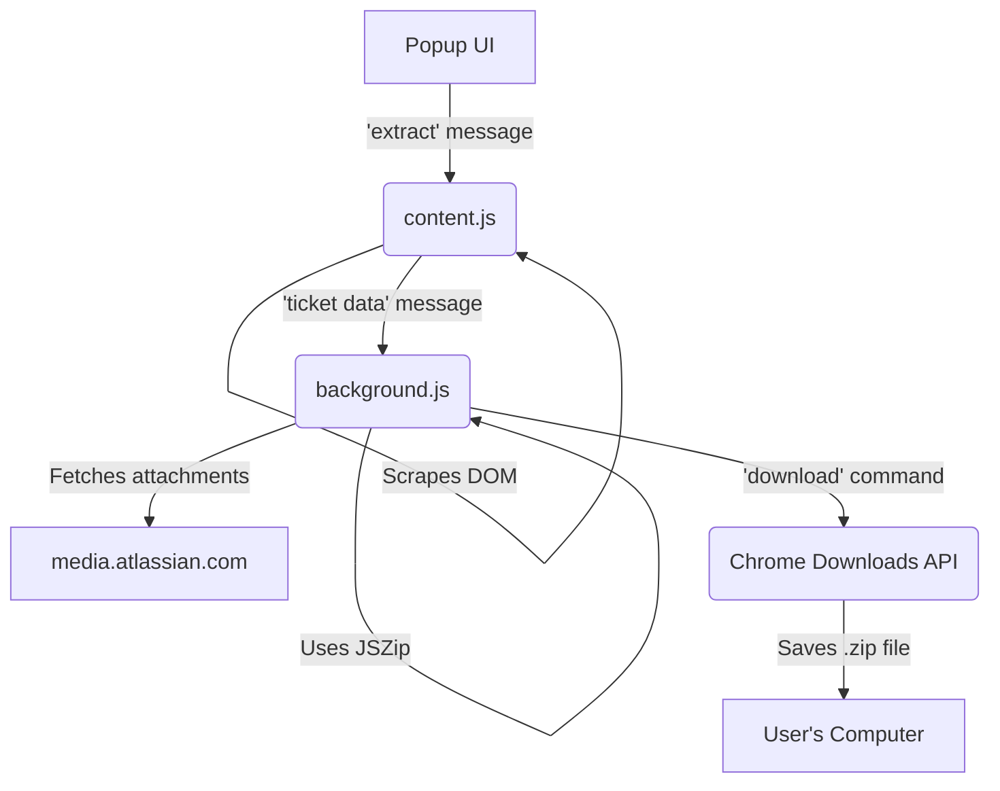

import Tabs from '@theme/Tabs';
import TabItem from '@theme/TabItem';

I needed full Jira tickets in a form other scripts could read: the description, the comments and every attachment. The official API offers a token, a 5000-line JSON response and a separate authenticated call per attachment, and the SaaS alternative charges $20/month for what amounts to a `curl` command behind a dashboard. I built a Chrome extension that reads the ticket from the page I already have open.

<!-- truncate -->

`jiraextractor` is a privacy-first Chrome extension with one job. It packs a Jira ticket's entire contents into a local ZIP file, with no servers and no data collection.

## Three bad ways to read your own ticket

Jira shows me the ticket in the browser and makes every other route to the same data harder. These were the options:

1. **Manual work:** copy the description, save every image and attachment one by one, then put it back together. It is slow and error-prone.
2. **The official API:** generate an API token and request `/rest/api/3/issue/{issueKey}`. The response is about 5000 lines of JSON, the description arrives in proprietary Jira Document Format, and each attachment is metadata that needs its own authenticated API call to download.
3. **A SaaS export tool:** pay a monthly fee for a service that runs option 2 for you, and send your private ticket data through their servers on the way back to you.

The third option bills $20/month to `fetch` a page I already have open. I am logged into Jira in my browser and the data is on the page, so my call was to read it from there.

## The whole job stays in the browser

The extension reuses the session I already have. A content script (a script Chrome runs inside the Jira tab, so it can read the page's DOM) scrapes the ticket, a background service worker fetches the attachments and builds the archive, and Chrome's download manager saves the result.



Nothing leaves the machine except the attachment requests to Atlassian, which the browser would make anyway.

## Tech stack

| Component | Technology | Why |
|---|---|---|
| Platform | Chrome Extension (Manifest V3) | Direct access to the logged-in browser context |
| DOM scraping | Content script (`content.js`) | Runs inside the Jira tab |
| Attachment fetch | Background service worker | Handles cross-origin requests |
| CORS fix | `declarativeNetRequest` | Strips the `Authorization` header for Atlassian media |
| Packaging | JSZip | Builds the ZIP in memory, no server needed |
| Icons | Python + Pillow | A few lines beat any web-based icon generator |

## The extraction, step by step

### 1. Triggering the extraction

The popup is one button. A click sends an `extract` message to the content script in the active Jira tab.

```javascript title="content.js" showLineNumbers
chrome.runtime.onMessage.addListener((request, sender, sendResponse) => {
  if (request.action === 'extract') {
    // highlight-next-line
    extractTicket().then(result => {
      sendResponse(result);
    }).catch(error => {
      sendResponse({ error: error.message });
    });
    return true; // Keep message channel open for async response
  }
});
```

The `return true` keeps the message channel open, so the async result from `extractTicket()` can still reach the popup.

`extractTicket()` in `extractor.js` does the scraping. Jira's class names vary between versions and instances, so it tries a list of known selectors for the title, description, comments and attachments instead of trusting one. For example, if two instances render the description under different class names, a scraper with one selector comes back empty on one of them; the fallback list is what makes it hold up across instances.

### 2. CORS and `declarativeNetRequest`

The scraped attachment URLs point to domains like `api.media.atlassian.com`, and the background script has to `fetch` them. A cross-origin `fetch` with a header like `Authorization` triggers a CORS preflight: an `OPTIONS` request the browser sends first to ask the other server whether the real request is allowed. Atlassian's media servers reject that preflight.

My code never sets an `Authorization` header, which did not stop Chrome from sending one. Chrome sometimes attaches the session's auth headers on its own, so the header that broke the request was not in any line I wrote. The fix is to tell the browser to remove the header before the request leaves.

:::caution[Chrome can add auth headers you never set]
If your extension fetches Atlassian media and the preflight fails, check the outgoing headers before you debug your own code. Chrome may attach session auth headers to cross-origin requests, and Atlassian's S3-signed media URLs reject the resulting preflight. Add a `declarativeNetRequest` rule that strips `Authorization`, then confirm the `GET` succeeds.
:::

`chrome.declarativeNetRequest` lets you define rules that the browser itself applies to requests.

```javascript title="background.js" showLineNumbers
chrome.runtime.onInstalled.addListener(() => {
  chrome.declarativeNetRequest.updateDynamicRules({
    removeRuleIds: [1], // Clear old rule
    addRules: [
      {
        id: 1,
        priority: 1,
        action: {
          type: 'modifyHeaders',
          requestHeaders: [
            // highlight-next-line
            { header: 'Authorization', operation: 'remove' }
          ]
        },
        condition: {
          urlFilter: 'media.atlassian.com',
          resourceTypes: ['xmlhttprequest', 'other']
        }
      }
    ]
  });
});
```

The rule says: for any request of type `xmlhttprequest` or `other` whose URL contains `media.atlassian.com`, remove the `Authorization` header. With the header gone, the preflight goes away, the plain `GET` goes through, and the download works.

The condition has no initiator or tab filter, so the rule is not limited to the service worker. It can also match `xmlhttprequest` or `other` requests from a tab, wherever the extension has host permissions for the URL.

### 3. Packaging with JSZip

With the attachments fetched as blobs, the background script builds the archive in memory:

1. Create `ticket.json` with the scraped text.
2. Add each attachment blob to an `attachments/` folder inside the virtual ZIP.
3. Have `JSZip` generate the final `.zip` as a blob.
4. Call `chrome.downloads.download()` to save it to disk.

:::tip[The web page is the real API]
For a read-only task in a session you already have, a DOM scraper can be faster to build than an integration with a large REST API.
:::

The output JSON is clean and predictable:

<Tabs>
<TabItem value="json" label="Output JSON" default>

```json title="ticket.json" showLineNumbers
{
  "title": "Ticket Title",
  "ticketKey": "PROJ-123",
  "url": "https://...",
  "extractedAt": "2024-01-01T00:00:00.000Z",
  "description": "Clean text description without HTML",
  "comments": [
{
"id": 1,
"author": "John Doe",
"timestamp": "3 days ago",
"body": "Comment text"
}
  ],
  "attachments": [
{
"id": 1,
"name": "file.pdf",
"url": "https://..."
}
  ]
}
```

</TabItem>
<TabItem value="icons" label="Icon Generator">

```python title="create_icons.py" showLineNumbers
#!/usr/bin/env python3
from PIL import Image, ImageDraw

def create_icon(size, output_path):
    # Create a new image with transparent background
    img = Image.new('RGBA', (size, size), (0, 0, 0, 0))
    draw = ImageDraw.Draw(img)

    # Draw background circle (Jira blue: #0052CC)
    margin = size // 10
    # highlight-next-line
    draw.ellipse([margin, margin, size - margin, size - margin],
                 fill=(0, 82, 204, 255), outline=None)
    # ... more drawing logic
    img.save(output_path, 'PNG')
```

</TabItem>
</Tabs>

## Before you build one, and how to check a run

This approach only fits a read-only task in a session you are already logged into.

To verify a run, open the downloaded ZIP and check that `ticket.json` holds the title, description and comments, and that `attachments/` holds the files the ticket lists. If the attachments are missing, inspect the outgoing headers on the `media.atlassian.com` requests, as the caution box above describes.

## Lessons from the build

- **Scraping can beat the API.** For read-only work in a logged-in session, a careful DOM scraper was faster to build than handling the REST API's format and per-attachment calls. The cost is the selector list, because Jira's class names vary between versions.
- **`declarativeNetRequest` is the header tool to learn in Manifest V3.** In my judgment it is faster and safer than the old `webRequest` API for any extension that talks to third-party resources.
- **Keep it client-side.** `JSZip` plus the `Downloads` API runs the whole process on the user's machine, which is faster, cheaper and safer than sending ticket data through a backend.
- **Write the small tools yourself.** The extension ships three PNG icons, and a web-based icon generator or a large npm dependency is more machinery than three PNG icons need. A short Pillow script I own and understand did the job.

<details>
<summary>Full extension file structure</summary>

```text showLineNumbers
jiraextractor/
  manifest.json
  popup.html
  popup.js
  content.js
  background.js
  extractor.js
  lib/
    jszip.min.js
  icons/
    icon16.png
    icon48.png
    icon128.png
  create_icons.py
```

</details>

## License

The repository includes an MIT LICENSE.

## References

-   **[View Code on GitHub](https://github.com/victorjimenezdev/jiraextractor)**
-   **[Install from Chrome Web Store](https://chromewebstore.google.com/detail/mjdgnpmadepahnoeiahafimajgoajgdp)**
