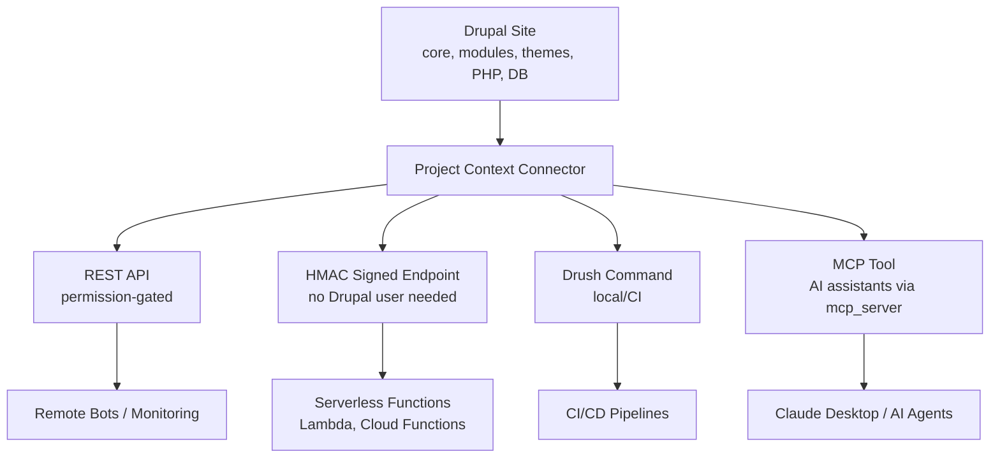
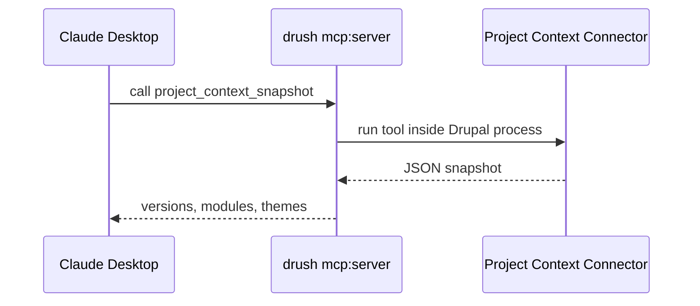

import Tabs from '@theme/Tabs';
import TabItem from '@theme/TabItem';

Asking a Drupal site which PHP version it runs should not require an SSH key and a terminal. I built **Project Context Connector**, a Drupal module that exposes a read-only JSON snapshot of site configuration to AI agents, automation scripts and monitoring tools. It offers four interfaces: REST, an HMAC-signed endpoint, Drush and native Model Context Protocol support.

<!-- truncate -->

<details>
<summary>TL;DR</summary>

- One module, one read-only snapshot, four ways to read it: REST, HMAC-signed endpoint, Drush, MCP.
- With `drupal/mcp_server` installed, Claude Desktop calls the snapshot tool inside Drupal's process.
- No PII, no secrets, database version off by default, rate limited through the Flood API at 60 req/min by default.

</details>

## The problem: Drupal sites that only answer over SSH

A tool has no standard way to ask a Drupal site "What version of Drupal is running?" or "Which modules need security updates?". The usual answers are SSH access, manual Drush commands or parsing HTML pages. That works for one site, and for an agency with dozens of client sites it becomes a part-time job that nobody was hired to do.

| Consumer | What it cannot do today |
|---|---|
| Support bots | Answer environment questions |
| CI/CD pipelines | Adapt to site configuration |
| AI assistants | Get real-time context about the stack |
| Security monitoring | Run without custom scripting for each site |

My fix is to expose the answer once, read-only, and let each tool read it through the access path it already supports.

## One snapshot, four interfaces

The module builds one JSON snapshot of site metadata and serves it four ways. Each interface matches a consumer from the table above.



## Tech stack

| Component | Technology | Why |
|---|---|---|
| CMS | Drupal 10/11 | Target platform, service container |
| Protocol | MCP via `drupal/mcp_server` | Native AI assistant integration |
| Auth (REST) | Drupal permissions | Standard access control |
| Auth (serverless) | HMAC-SHA256 with replay protection | No Drupal user session needed |
| CLI | Drush command | CI/CD pipeline integration |
| Caching | Drupal render cache + cache tags | No extra DB queries on cached hits |
| Testing | Unit, kernel, functional + GitLab CI | Full coverage, production-ready |

### The four access patterns

<Tabs>
<TabItem value="rest" label="REST API" default>

```bash title="rest-api-usage.sh"
# Permission-gated REST endpoint
curl -u user:pass https://site.com/project-context-connector/snapshot
```

</TabItem>
<TabItem value="hmac" label="HMAC Signed">

```bash title="hmac-signed-usage.sh"
# No Drupal user needed - HMAC authentication
curl -H "X-PCC-Timestamp: $(date +%s)" \
-H "X-PCC-Signature: $(echo -n "$(date +%s)" | \
openssl dgst -sha256 -hmac 'secret' -binary | base64)" \
https://site.com/project-context-connector/snapshot/signed
```

</TabItem>
<TabItem value="drush" label="Drush">

```bash title="drush-usage.sh"
# Local or CI usage
drush pcc:snapshot --format=json
```

</TabItem>
<TabItem value="mcp" label="MCP Tool">

```json title="mcp-tool-definition.json"
{
  "name": "project_context_snapshot",
  "description": "Get Drupal site context",
  "input": {}
}
```

</TabItem>
</Tabs>

### What the snapshot contains

The snapshot holds what external tools need and nothing else: versions, module security status and theme configuration.

```json title="snapshot-response.json" showLineNumbers
{
  "generated_at": "2026-02-16T18:00:00Z",
  "drupal": {
    "core_version": "10.3.0",
    "php": {"version": "8.3.0"},
    "database": {"driver": "mysql", "version": "8.0.36"},
    "active_modules": [
      {
        "name": "views",
        "version": "10.3.0",
        "origin": "core",
        // highlight-next-line
        "security_status": "current"
      }
    ],
    "themes": {
      "default": "olivero",
      "admin": "claro"
    }
  }
}
```

Security update status comes from Drupal's Update module cache, so building the snapshot makes no outbound requests.

## MCP: the assistant asks Drupal directly

The newest feature is Model Context Protocol support through Drupal's Tool API. Install the `mcp_server` module alongside Project Context Connector, and AI assistants like Claude Desktop can query the site directly.

:::tip[MCP Means No HTTP Requests Needed]
When Claude Desktop connects through Drush MCP, the tool call runs inside Drupal's process. There is no HTTP overhead, no authentication step and no CORS. It is the shortest path from "what PHP version is production running?" to an answer.
:::



The network's contribution to this feature is staying out of it. Here is the install:

```bash title="installation.sh"
composer require drupal/mcp_server drupal/project_context_connector
drush en -y mcp_server project_context_connector
drush cr
```

This is the Claude Desktop config:

```json title="claude-desktop-config.json" showLineNumbers
{
  "mcpServers": {
    "drupal-prod": {
      "command": "drush",
      "args": ["mcp:server"],
      // highlight-next-line
      "cwd": "/var/www/drupal"
    }
  }
}
```

Claude can now answer "What PHP version is the production site running?" by calling the `project_context_snapshot` tool directly, without an HTTP request.

## Slack bot on the signed endpoint

I built a companion Slack bot that uses these endpoints to answer team questions.

```text title="slack-bot-interaction.txt"
/drupal-env production

Response:
Production Environment:
- Drupal: 10.3.0
- PHP: 8.3.0
- Database: MySQL 8.0.36
- Modules needing updates: 0
- Security status: All current
```

The bot authenticates with HMAC signatures, runs on AWS Lambda and costs pennies per month. It needs no SSH access, and no credentials are stored in the bot code.

## Security: minimal by design

A snapshot with nothing secret in it is a dull target, and that is the design goal. The module is secure by default, and anything added to the snapshot should keep it that way.

:::caution[The Snapshot Is Deliberately Minimal]
The snapshot includes versions, security status and configuration flags. It excludes sensitive data such as database credentials, API keys and user information. Even the optional database version is off by default, per OWASP recommendation. Do not extend the snapshot with PII or secrets.
:::

- Read-only operations, with no write endpoints
- Zero PII exposure: no user data, emails or credentials
- Rate limiting through Drupal's Flood API (default: 60 req/min)
- CORS allow-lists for browser clients
- HTTP caching with cache tags
- HMAC-SHA256 authentication with replay protection
- Optional database version hiding (OWASP recommendation)

## Technical decisions

Each interface exists because a consumer needs it, and the optional MCP dependency had a cost in static analysis. PHPStan has no concept of "optional". A class that is not installed is a missing class.

<details>
<summary>Why multiple interfaces?</summary>

Different use cases need different access patterns. MCP is ideal for local AI assistants, REST APIs work for remote bots, Drush fits CI/CD pipelines, and HMAC signatures enable serverless functions without managing Drupal sessions.

</details>

<details>
<summary>Why not expose everything?</summary>

The snapshot is deliberately minimal. It includes versions, security status, and configuration flags, but excludes sensitive data (database credentials, API keys, user information). Even the optional database version is off by default.

</details>

<details>
<summary>PHPStan challenge with optional MCP dependency</summary>

The MCP integration uses an optional dependency (`drupal/tool`). PHPStan fails if the module isn't installed, but it cannot be required since HTTP/Drush features work fine without it. Solution: `phpstan.neon` with `excludePaths` to skip the MCP plugin during analysis when the tool module is absent.

</details>

## Performance

Every read comes from a cache that Drupal already maintains, so the endpoint does not add database queries.

| Aspect | Detail |
|---|---|
| Cached responses | Full Drupal render cache with proper contexts |
| Database queries | None. Uses cached module and theme lists from extension discovery |
| Security updates | Reads from the Update module cache, already warmed by cron |
| Response size | About 50KB typical for 100+ modules |

## Installation (2 minutes)

```bash title="quick-install.sh"
composer require drupal/project_context_connector
drush en -y project_context_connector
drush cr
```

For MCP support, add `mcp_server`:

```bash title="mcp-install.sh"
composer require drupal/mcp_server
drush en -y mcp_server
```

Grant the "access project context snapshot" permission to service users, or configure HMAC authentication.

## For agencies with many Drupal sites

The usual alternative is a custom script for each client, and the maintenance work grows with every client added. With this module, every site exposes the same interface for core version, PHP version, module security status and theme configuration, without SSH access. The HMAC-signed endpoint matters most for serverless monitoring stacks that cannot keep a Drupal user session.

## What is next

The module is production-ready on Drupal.org, with unit, kernel and functional tests and GitLab CI pipelines. These are the directions I plan to explore, and none of them is built yet:

- Custom field plugins for site-specific metadata
- GraphQL endpoint alongside REST
- Webhook notifications on security updates
- Multi-site aggregation dashboard

## Checklist

- [ ] Install `drupal/project_context_connector` with Composer, enable it and run `drush cr`.
- [ ] Grant "access project context snapshot" to a service user, or configure HMAC authentication.
- [ ] Run `drush pcc:snapshot --format=json` and confirm the output contains no PII or secrets.
- [ ] Confirm cron warms the Update module cache, because security status is read from it.
- [ ] Leave the database version off unless a tool needs it.
- [ ] For MCP, install `drupal/mcp_server` and point the Claude Desktop `cwd` at the Drupal root.

## What I learned

- Different consumers need different access paths: MCP for local assistants, REST for remote bots, Drush for CI and HMAC for serverless.
- An optional dependency needs explicit PHPStan config: `excludePaths` in `phpstan.neon`.
- Reading from existing caches (render cache, Update module cache, extension discovery) keeps the endpoint free of database queries and outbound calls.

## References

- [Project Context Connector (Drupal Module)](https://www.drupal.org/project/project_context_connector)
- [GitHub Mirror](https://github.com/victorjimenezdev/project_context_connector)
