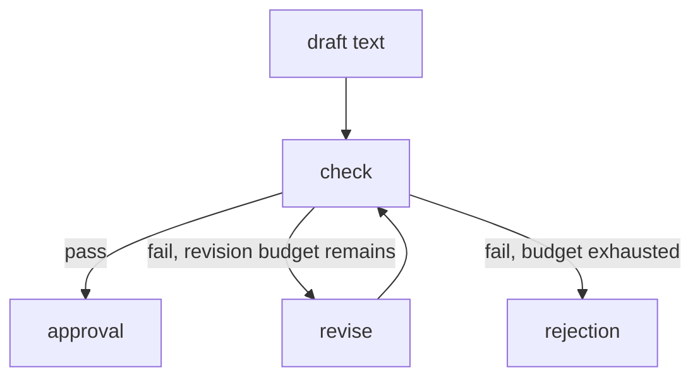
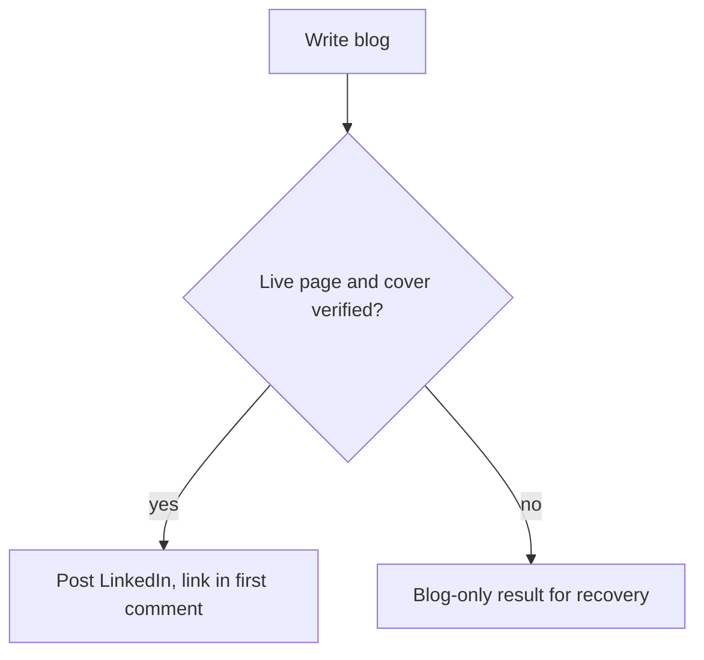

When I know the order a workflow must follow, I write that order down explicitly and let the model work inside one step at a time. The drawn route decides what runs next. It cannot prove that a draft is good, and a stored hash can tell me approved bytes changed but not whether the change helped.

<!-- truncate -->

## Graph engineering in this series

Graph engineering is my working name for workflow control-flow engineering. It is not a standardized discipline, and it has nothing to do with knowledge graphs.

I define state, nodes, edges, conditions, dependencies and routing explicitly. In plain words:

| Term | Plain meaning |
| --- | --- |
| State | The data a run carries from step to step. |
| Node | One step that reads and updates the state. |
| Edge | The link that says which step runs next. |
| Conditional edge | An edge chosen by a condition, such as a checker's verdict. |
| Dependency | A step that may run only after another step succeeded. |
| Routing | The choice of which edge to follow. |

This is part 3 of a series, alongside [harness engineering](https://victorstack-ai.github.io/agent-blog/harness-engineering) and [loop engineering](https://victorstack-ai.github.io/agent-blog/loop-engineering). The [LangGraph Graph API](https://docs.langchain.com/oss/javascript/langgraph/graph-api) describes nodes acting on state, connected by fixed and conditional edges. My content engine implements its state flow in TypeScript and does not require LangGraph.

## The route in my content engine

Ideas from feeds go through `scan`, `ideas` and `brief`, while my own briefs skip the first two. The generation model has no tools and returns draft or revision text.

The check loop is the part worth drawing, because its exits decide where a draft can end up.

The revision budget is per run. A draft that keeps failing exits to rejection instead of revising forever.

The routing follows the checker's verdict and the remaining budget; literary judgment is absent from its job description. If the checker passes a weak draft, the route carries it to approval. I would test the checker before giving the route credit for quality.

## Approval belongs to bytes

The engine stores hashes of the checked and approved blog and LinkedIn bytes. A hash is a short fingerprint of the exact content, and `stageOf` compares the stored hashes with the hashes of the current bytes.

On a mismatch, the old acceptance no longer covers the current bytes. They count as drafted, and the publish path refuses them. Suppose I edit one word in an approved post: the fingerprint changes and the post is back to drafted.

No watcher updates a stage on file save; `stageOf` derives the stage from the hash comparison. A hash is an excellent witness and a poor editor: it notices that the bytes changed and has no view on whether the change helped.

## Publication is where graph state runs out

Publication writes the blog, verifies its live page and cover, then posts to LinkedIn with the blog link in the first comment. If live verification fails, the run leaves a blog-only result for recovery.

The LinkedIn post is an external side effect, meaning a change outside the engine that the engine does not own. Suppose a run stops after sending the share and before recording a confirmation: graph state alone cannot show whether the share reached LinkedIn.

:::warning[Reconcile before you repeat]
An unconfirmed LinkedIn attempt must be reconciled before it is repeated.
:::

An edge says what runs next. It does not say whether the process may run it, or whether an earlier external action happened. My engine handles that uncertainty with attempt records, locking and reconciliation, again without requiring LangGraph.

[LangGraph Persistence](https://docs.langchain.com/oss/javascript/langgraph/persistence) describes checkpoints at super-steps and thread-specific state. My publication path is sequential, so there are no parallel publication branches to join.

## Routing in the assistant setup

My separate assistant setup uses a role matrix and a delivery graph. Claude leads by default, another CLI reviews the underlying source, and browser QA checks nontrivial rendered changes.

Two CLI names in the role matrix are two labels; neither proves a second provider or an accurate review. I would read the reviewer's findings against the source.

## Hold the dependent step

My advice: when a prerequisite fails, hold the dependent step, report it, and recover from recorded state. The blog-only result works this way, because the LinkedIn share waits for a page that passed verification.

This adds rigidity, and every branch I draw is a branch someone maintains. Exploratory work with no known order may need less prescribed flow. Drawing that order early could record a guess as if it were a requirement.

## A safe check on a local target

:::tip[Keep it local]
Run these checks against a local test target, with no actual public posts.
:::

| Test setup | Expected result |
| --- | --- |
| Approved draft with one byte changed | The publisher refuses the changed bytes. |
| Live-page verification fails | The run returns blog-only for recovery. |
| Existing share attempt is unconfirmed | The repeat share is held until the attempt is reconciled. |

## References

- [LangGraph Graph API](https://docs.langchain.com/oss/javascript/langgraph/graph-api): nodes acting on state, fixed and conditional edges.
- [LangGraph Persistence](https://docs.langchain.com/oss/javascript/langgraph/persistence): checkpoints at super-steps and thread-specific state.
- Series: [harness engineering](https://victorstack-ai.github.io/agent-blog/harness-engineering), [loop engineering](https://victorstack-ai.github.io/agent-blog/loop-engineering), [the combined workflow](https://victorstack-ai.github.io/agent-blog/how-i-combine-harness-loop-graph-engineering).
