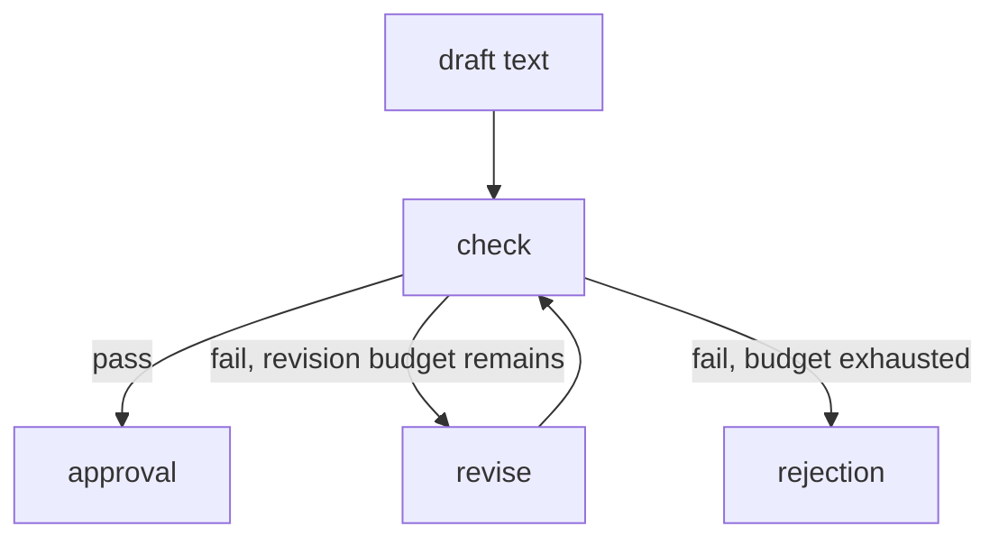

When I know the required order, I write the workflow explicitly. The model then works inside a step.

<!-- truncate -->

## What I mean by graph engineering

Graph engineering is my working name for workflow control-flow engineering. It is not a standardized discipline, and it has nothing to do with knowledge graphs.

I define state, nodes, edges, conditions, dependencies and routing explicitly. This is part 3, alongside [harness engineering](https://victorstack-ai.github.io/agent-blog/harness-engineering) and [loop engineering](https://victorstack-ai.github.io/agent-blog/loop-engineering).

The [LangGraph Graph API](https://docs.langchain.com/oss/javascript/langgraph/graph-api) describes nodes acting on state, connected by fixed and conditional edges. My content engine implements its state flow in TypeScript without requiring LangGraph.

## The route in my content engine

Feed ideas go through `scan`, `ideas` and `brief`, while my own briefs skip the first two. The generation model has no tools and returns draft or revision text.

The check loop is the part worth drawing, because its exits decide where a draft can end up.

The budget is per run, so a draft that keeps failing exits to rejection instead of revising forever.

A weak draft can reach approval with impeccable routing. The edge follows the checker's verdict and the remaining budget; literary judgment is absent from its job description. I would test the checker before giving the route credit for quality.

## Approval belongs to bytes

Checked and approved blog and LinkedIn bytes have stored hashes. `stageOf` compares them with the hashes of the current bytes.

On a mismatch, the old acceptance no longer covers the current bytes. They count as drafted, and the publish path refuses them. No watcher updates a stage on file save.

A hash is an excellent witness and a poor editor. It notices that the bytes changed and has no view on whether the change helped.

## Publication is where graph state runs out

Publication writes the blog, verifies its live page and cover, then posts LinkedIn with the link in the first comment. Failed live verification leaves a blog-only result for recovery.

An unconfirmed LinkedIn attempt must be reconciled before it is repeated. Graph state alone does not establish whether an external side effect occurred.

An edge says what runs next. It does not say whether the process may run it or whether an earlier external action happened. Attempt records, locking and reconciliation address publication uncertainty.

[LangGraph Persistence](https://docs.langchain.com/oss/javascript/langgraph/persistence) describes checkpoints at super-steps and thread-specific state. My engine uses attempt records, locking and reconciliation, without requiring LangGraph. The publication path is sequential, so there are no parallel publication branches to join.

## Routing in the assistant setup

My separate assistant setup uses a role matrix and a delivery graph. Claude leads by default, another CLI reviews the underlying source, and browser QA checks nontrivial rendered changes.

Different CLI names alone do not establish different providers or an accurate review. I would read the reviewer's findings against the source.

## Hold the dependent step

My advice: when a prerequisite fails, hold the dependent step, report it, and recover from recorded state. The blog-only result works this way, because the share waits for a page that passed verification.

This adds rigidity, and every branch I draw is a branch someone maintains. Exploratory work with no known order may need less prescribed flow. Drawing that order early could record a guess.

## A safe check on a local target

Run these against a local test target, with no actual public posts.

| Test setup | Expected result |
| --- | --- |
| Approved draft with one byte changed | Publisher refuses the changed bytes. |
| Live-page verification fails | Run returns blog-only for recovery. |
| Existing share attempt is unconfirmed | Repeat share is held until the attempt is reconciled. |

## References

- [LangGraph Graph API](https://docs.langchain.com/oss/javascript/langgraph/graph-api): nodes acting on state, fixed and conditional edges.
- [LangGraph Persistence](https://docs.langchain.com/oss/javascript/langgraph/persistence): checkpoints at super-steps and thread-specific state.
- Series: [harness engineering](https://victorstack-ai.github.io/agent-blog/harness-engineering), [loop engineering](https://victorstack-ai.github.io/agent-blog/loop-engineering), [the combined workflow](https://victorstack-ai.github.io/agent-blog/how-i-combine-harness-loop-graph-engineering).
