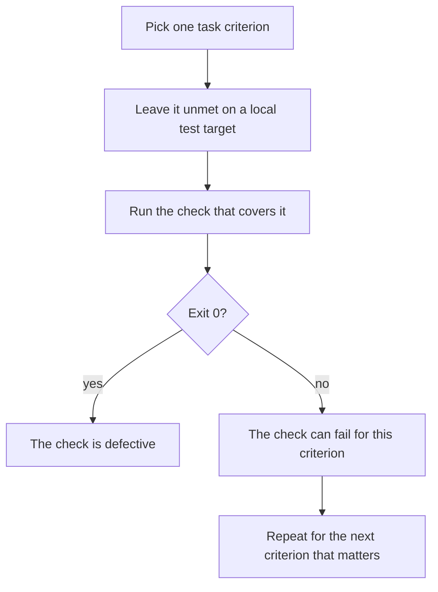

A check can return success while a task criterion remains unmet. In harness engineering, I recommend checking the context and the completion evidence before you change models.

<!-- truncate -->

## Inspect what the runtime supplied

In this post, harness engineering means building and checking the runtime, the software that runs an agent's task.

For a failing task, I would list what the runtime supplied and confirm each item was present before comparing models:

- The context the task needed
- The tools the task needed
- The access controls that applied
- A testable criterion for completion

Two published reports describe this layer. OpenAI's [Harness engineering](https://openai.com/index/harness-engineering/) describes repository knowledge and architectural constraints that are enforced mechanically. Anthropic's [Effective harnesses for long-running agents](https://www.anthropic.com/engineering/effective-harnesses-for-long-running-agents) describes progress records and browser verification.

Those are their reports, not my results. My publication checks target different conditions from architectural dependency rules, so I do not borrow their outcomes.

## Written rules describe intent

My assistant rules reject a silent `exit 0` or empty reviewer output as acceptance evidence. An `exit 0` is the process status that means success, and it says nothing about what was tested. The rule has completed the part of enforcement that involves being written down; I still need evidence that the runtime enforces it.

| Mechanism | What it does | What it does not do |
|---|---|---|
| Assistant rules | State the intended policy on acceptance evidence | Prove that anything enforces it |
| Typed terminal phrase | Marks a manual interaction as deliberate | Prevent automation or act as a security boundary |
| `git worktree` | Separates working copies and keeps main on its integration branch | Restrict filesystem access |

:::warning[A typed phrase is not an access limit]
Typing the phrase is also within a script's skill set. I would put access limits in tools, credentials or isolation.
:::

## A text-only model call can only claim completion

My content engine's subscription model call returns text and has no tools. When that call claims a task is complete, the claim is more writing. So drafts must pass these gates before autonomous approval:

- word lint, a check of the wording
- grounding, a check of claims against the sources
- safe MDX, a check that rejects unsafe blog markup
- editorial review

## Make the check fail first

Configuration and a verified result are different things. A check must test the specific task criterion, and a passing check is evidence only for that check.

Use a local test target to find out whether the check can reject an unmet criterion.

For example, suppose the criterion is that a form saves its input. Leave saving broken on the local target and run the check; if it still exits 0, the check failed to detect the broken save.

For a rendered change, I recommend browser interactions as the check. A clean build is evidence about the build, and the build is not what the user clicks.

This test shows whether the check can fail. Context needs its own inspection with the list above.

## Evidence for a model change

The evidence that would change my mind is narrow. If a model change fixes a result while the context and the checks stay fixed, the model was the variable. That is the comparison I would want before switching.

I have not measured how often context is the cause, and a better model could change the result.

## References

- OpenAI, [Harness engineering](https://openai.com/index/harness-engineering/)
- Anthropic, [Effective harnesses for long-running agents](https://www.anthropic.com/engineering/effective-harnesses-for-long-running-agents)

Series links: [loop engineering](https://victorstack-ai.github.io/agent-blog/loop-engineering), [graph engineering](https://victorstack-ai.github.io/agent-blog/graph-engineering) and [the combined workflow](https://victorstack-ai.github.io/agent-blog/how-i-combine-harness-loop-graph-engineering).
