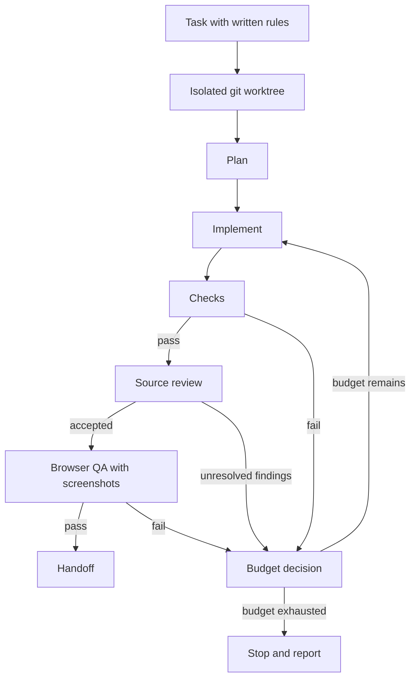
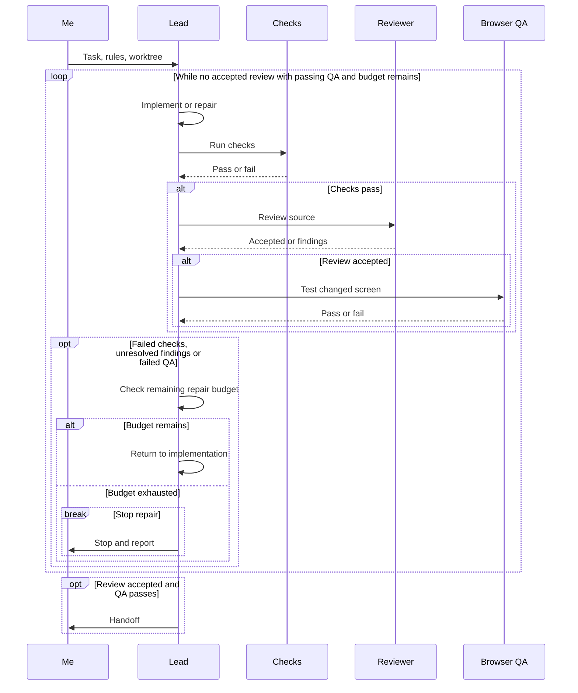
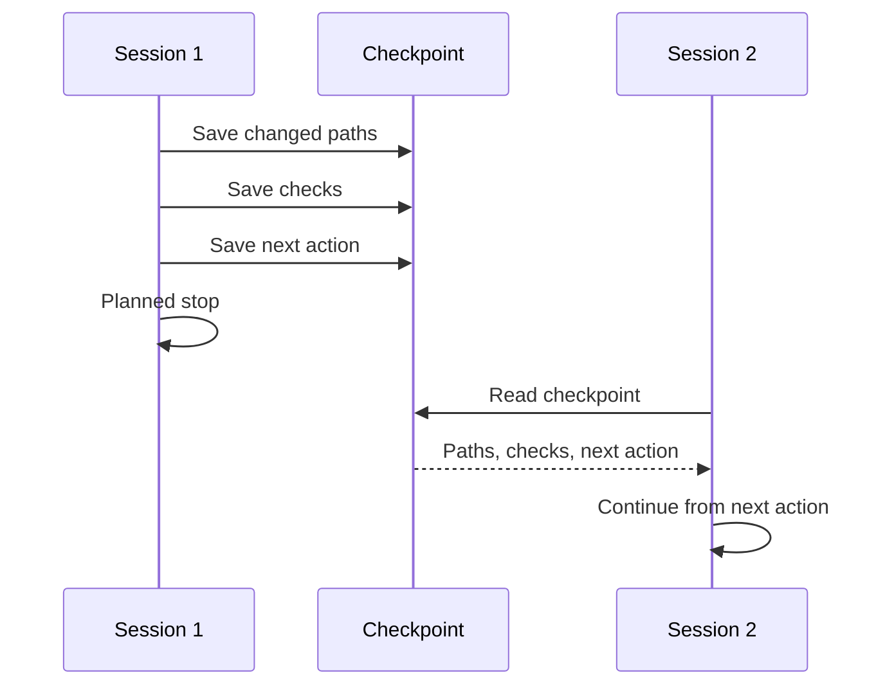
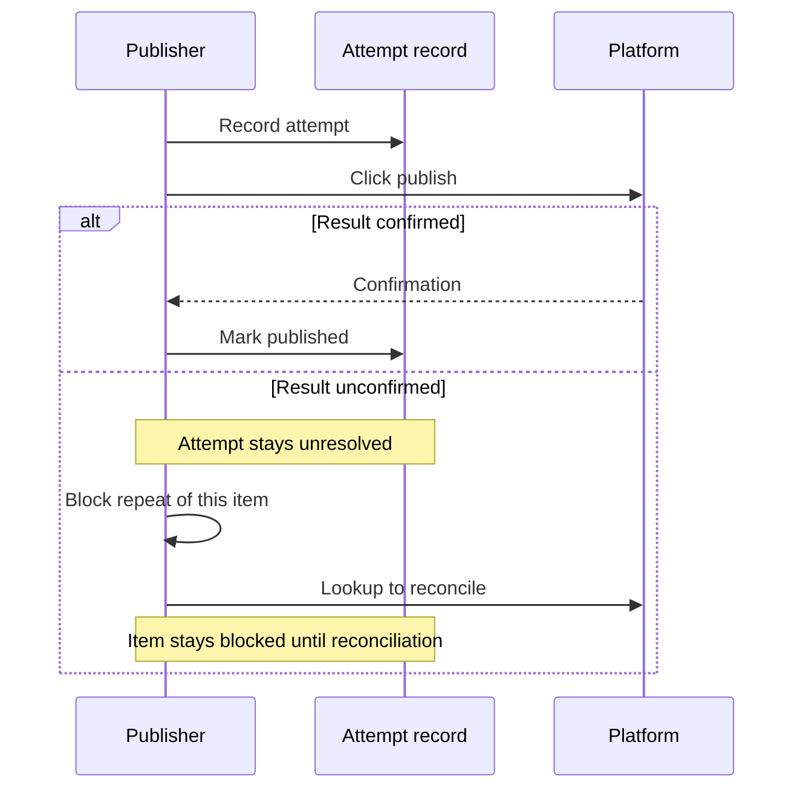

A rule file states policy, and it cannot refuse unfinished work. In part 4, I connect the runtime that supplies tools, credentials and isolation, a delivery graph that orders the work, and a loop that bounds repair.

<!-- truncate -->

## A rule file has the enforcement power of a README

My rule file says mutable repository work must begin in an isolated linked git worktree. A `git worktree` is a second working directory attached to the same repository. The rule is correct, and the file cannot make anything obey it.

Worktrees separate working files. They do not separate filesystem permissions, so a worktree is not a sandbox. Atomic questions and trivial tasks keep their limited scope.

## The runtime supplies access and evidence

A rule that asks for browser QA cannot open a browser. I use harness engineering to supply the tools and the evidence. The browser bridge handles signed-in browsing, and separate browser-class tools perform the testing.

:::note[Typed approval is a marker]
Typed approval marks manual interaction. It is not an unbreakable security boundary. A separate checked autonomous route exists.
:::

## The graph puts browser QA after accepted review

A green check is evidence only for that check. It has no opinion about a page that nobody opened.

I use a graph to make the order explicit. The delivery graph declares role nodes, dependencies, parallel groups, locks, invalidation scope and repair routing. It places browser QA after accepted review.

Below is a simplified configured example for a nontrivial rendered change. Other tasks use the verification that applies to them. On small screens, scroll wide diagrams sideways.

A nontrivial rendered change requires browser QA with screenshots before handoff. I would rather keep screenshots of reviewed code than screenshots of code that review is about to change.

## The loop decides when repair stops

The runtime supplies the browser tools and their evidence. The loop routes their failures to a declared repair budget.

Failed checks, unresolved review findings and failed QA reach the budget decision. Work returns to implementation while budget remains. When the budget is exhausted, the run stops and reports.

## Two CLI names are two labels

A role matrix selects the lead and the reviewer. Claude leads by default, and another CLI reads the underlying source.

CLI names alone do not prove different providers or correct review. A different name on the reviewer is a fact about the name. Nontrivial code work therefore gets applicable source review and functional verification.

## Each budget has its own number

In each autonomous content preparation run, a candidate can be revised up to twice. If it still fails, that run rejects it and considers another. My content engine checks word rules, grounding, safe MDX and editorial quality.

I do not reuse that number for code repair. Manual writing commands are separate, and code repair uses its own declared budgets.

## A planned stop writes the checkpoint first

A planned stop saves the changed paths, the checks and the next action before stopping. The next session reads that checkpoint and continues from the saved next action.

The order matters. A checkpoint written after the session ends is a note to nobody.

## Publication records the attempt before the click

A silent click is an economical confirmation, since it leaves no evidence to store. My publisher records an attempt before clicking, and an unconfirmed result stays unresolved. The engine blocks any repeat of that item until reconciliation.

The lookup can remain inconclusive, and then the item stays blocked. Waiting can delay publication; guessing can duplicate it. I accept the delay, and there is no exactly-once guarantee.

## The notation that saved nothing

My compact instruction notation measured flat-to-negative token savings, so I replaced it. My call: no token-saving change counts as an improvement until it shows a measured saving.

I now use filler removal checked against the tokenizer, plus a fidelity guard. The tokenizer splits text into the units a model counts, so it measures the savings.

The fidelity guard checks defined protected content. Neither the tokenizer nor that guard proves that all meaning was preserved.

## Limits

This setup needs maintenance. Rules, graph nodes, budgets and the role matrix describe it only while I keep them current. I have no measured productivity outcome to report.

## Check it on a disposable repo

:::warning[Use throwaway targets]
Use a disposable local repository and a local target. Take no irreversible action.
:::

To check the QA order and the repair routing:

1. Make a small rendered change in the throwaway repository.
2. Make browser QA fail on purpose.
3. Confirm the work goes to the budget decision instead of handoff.
4. Exhaust the budget and confirm the run stops and reports.

To check recovery:

1. Save a checkpoint with changed paths, checks and the next action.
2. End the test session.
3. Give a new session only the saved checkpoint.
4. Compare its first action with the saved next action.

In both cases, take the expected behavior from the declared route or the record, not from memory.

## References

Series links: [Harness engineering](https://victorstack-ai.github.io/agent-blog/harness-engineering), [Loop engineering](https://victorstack-ai.github.io/agent-blog/loop-engineering), [Graph engineering](https://victorstack-ai.github.io/agent-blog/graph-engineering).

Background reading, attributed to its authors and not a source for my results:

- OpenAI, [Harness engineering](https://openai.com/index/harness-engineering/)
- Anthropic, [Building effective agents](https://www.anthropic.com/engineering/building-effective-agents)
- Anthropic, [Effective harnesses for long-running agents](https://www.anthropic.com/engineering/effective-harnesses-for-long-running-agents)
- LangChain, [LangGraph Graph API](https://docs.langchain.com/oss/javascript/langgraph/graph-api)
- LangChain, [LangGraph persistence](https://docs.langchain.com/oss/javascript/langgraph/persistence)
